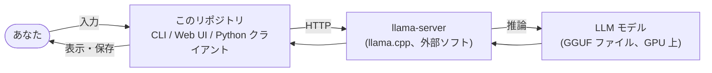

# ドキュメントの読み方

このプロジェクトを初めて見る人向けの案内。コードを開く前に、ここに並ぶ順で読むと全体がつかめる。

## 何のプロジェクトか(1 分で)

自宅 PC の GPU でローカル LLM(大規模言語モデル)を動かし、それと会話するための
「CLI チャット」と「ブラウザのチャット画面」を自作している。モデルの推論そのものは
llama.cpp というオープンソースのサーバ(`llama-server`)に任せ、このリポジトリの Python コードは
そのサーバに HTTP で問い合わせて結果を表示・保存する役目を持つ。

## 読む順番

| 順 | ドキュメント | 内容 | こんな人向け |
| --- | --- | --- | --- |
| 1 | [external-spec.md](external-spec.md) | 前提知識と用語、利用者から見た振る舞い、画面、コマンド、HTTP API | 使う人、API を叩く人、まず全体を知りたい人 |
| 2 | [internal-spec.md](internal-spec.md) | 全体像、モジュールの責務、データフロー、処理フロー、拡張の仕方 | コードを読む人、機能を足す人 |
| 3 | [spec-phase1-2.md](spec-phase1-2.md) | 実装前に決めた方針と、各 Phase の完了条件 | なぜこの設計になったか知りたい人 |
| - | [../README.md](../README.md) | セットアップ、起動コマンド、ハードウェア、ベンチ、ロードマップ | 動かしたい人 |

## 最短ルート

- **動かしたいだけ**: ルートの README「セットアップ」と「使い方」。
- **API を叩きたい**: external-spec の 6 章(HTTP API)と 7 章(Python API)。
- **コードを読みたい**: internal-spec の 0 章(全体像)→ 7 章(データフロー)→ 気になるモジュールの章。
- **RAG など機能を足したい**: internal-spec の 10 章(拡張ポイント)から逆引き。

## 用語の最低限

詳しくは external-spec の 0 章。ここでは 5 つだけ。

| 用語 | 意味 |
| --- | --- |
| llama-server | llama.cpp に含まれる推論サーバ。モデルを GPU に載せ、OpenAI 互換の HTTP API を提供する |
| OpenAI 互換 API | `POST /v1/chat/completions` などの、OpenAI 社の API と同じ形式。多くのクライアントがそのまま使える |
| SSE | Server-Sent Events。HTTP レスポンスを閉じずに `data: ...` 行を少しずつ送る仕組み。文字を逐次表示するために使う |
| thinking | Qwen3 系モデルが本文の前に出す「考え中」のテキスト。本文とは別に扱う |
| モデル id | `unsloth/Qwen3.6-35B-A3B-GGUF:Q4_K_M` のような、llama-server が公開するモデルの名前 |
