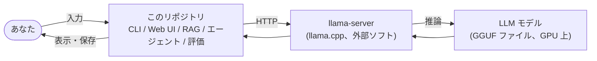

# ドキュメントの読み方

このプロジェクトを初めて見る人向けの案内。コードを開く前に、ここに並ぶ順で読むと全体がつかめる。

## 何のプロジェクトか(1 分で)

自宅 PC の GPU でローカル LLM(大規模言語モデル)を動かし、それと会話するための
「CLI チャット」と「ブラウザのチャット画面」を自作し、その上に文書検索(RAG)、
ツールを使うエージェント、追加学習(LoRA)、それらを比べる評価を積み上げた。
モデルの推論そのものは llama.cpp のサーバ(`llama-server`)に任せ、このリポジトリの
Python コードはそのサーバに HTTP で問い合わせて結果を表示・保存・検証する役目を持つ。

## 読む順番

### 1. まず guide/(初学者向け、図と流れで説明)

各章は同じ構成で書いてある: 「この章で分かること」→「前提となる用語(1 行ずつ)」→「全体のどこに当たるか(図で強調)」→「何をしているか(flowchart / sequenceDiagram)」→「使っているアルゴリズム・技術と、なぜそれを選んだか」→「実際のコードの場所」→「動かして確かめる方法」。
数字はすべて `eval/results/`、`bench/`、`training/runs/` の実測値。

| 順 | 章 | 内容 | 対応する Phase |
| --- | --- | --- | --- |
| 0 | [guide/00-overview.md](guide/00-overview.md) | 全体構成図、6 つの部品の役割、どのモデルをなぜ使うか | 0 |
| 1 | [guide/01-llm-basics.md](guide/01-llm-basics.md) | トークン、コンテキスト長、temperature、thinking、速度と VRAM | 0〜1 |
| 2 | [guide/02-chat-client.md](guide/02-chat-client.md) | OpenAI 互換 API、SSE ストリーミング、`LlamaClient`、CLI と Web UI の役割分担 | 1〜2 |
| 3 | [guide/03-rag.md](guide/03-rag.md) | チャンク分割、埋め込み、コサイン類似度検索、出典付き回答 | 3 |
| 4 | [guide/04-agent.md](guide/04-agent.md) | ツール呼び出し、Pi、「LLM が提案しコードが決める」ハーネス、予算と停止条件 | 4 |
| 5 | [guide/05-lora.md](guide/05-lora.md) | データ合成、QLoRA 学習、GGUF 変換、なぜ unsloth + WSL か | 5 |
| 6 | [guide/06-evaluation.md](guide/06-evaluation.md) | 2 段階採点、採点モデルの分離、5 構成の結果の読み方と限界 | 6 |
| 7 | [guide/07-dev-harness.md](guide/07-dev-harness.md) | 契約・検証・証拠・Completion Report で開発を進める型 | 3〜6 |

### 2. 次に仕様書(正確に引くためのリファレンス)

| ドキュメント | 内容 | こんなとき |
| --- | --- | --- |
| [external-spec.md](external-spec.md) | 利用者から見た振る舞い、画面、コマンド、HTTP API の表 | API の引数やエンドポイントを正確に知りたい |
| [internal-spec.md](internal-spec.md) | モジュールの責務、データフロー、処理フロー、拡張ポイント | コードを読む、機能を足す |
| [spec-phase1-2.md](spec-phase1-2.md) | Phase 1〜2 の方針と完了条件 | なぜこの設計になったか |
| [spec-phase3-6.md](spec-phase3-6.md) | Phase 3〜6 の方針と完了条件 | 同上(RAG 以降) |

### 3. 経緯と判定

| ドキュメント | 内容 |
| --- | --- |
| [journal/](journal/README.md) | Phase ごとの「何を・なぜ・どう確かめたか」と、うまくいかなかったこと |
| [harness/](harness/README.md) | 契約、Completion Report、判定 JSON、証拠(guide 07 章の実体) |
| [../README.md](../README.md) | セットアップ、起動コマンド、ベンチ表、評価表 |

## guide の章と仕様書の章の対応

| guide | external-spec | internal-spec |
| --- | --- | --- |
| 00 概要 | 0 前提知識と用語、1 システム概要 | 0 全体像、1 技術スタック、2 ディレクトリ構成 |
| 01 LLM の基礎 | 0 前提知識と用語、2 前提と動作環境 | 4 共通層(`client.py` のパラメータ) |
| 02 チャットクライアント | 3〜7(起動、CLI、Web UI、HTTP API、Python API) | 4 共通層、5 CLI 層、6 Web 層、7 データフロー |
| 03 RAG | 10 RAG | 11 RAG |
| 04 エージェント | 11 エージェント | 12 エージェント |
| 05 LoRA | — | — (`training/README.md` と journal/phase-5) |
| 06 評価 | 12 評価 | 13 評価 |
| 07 開発ハーネス | — | — (`harness/README.md`) |

## 最短ルート

- **動かしたいだけ**: ルートの README「セットアップ」と「使い方」。
- **仕組みを知りたい**: guide 00 → 01 → 02 の順。RAG と LoRA の違いは guide 05 冒頭の表。
- **API を叩きたい**: external-spec の 6 章(HTTP API)と 7 章(Python API)。
- **コードを読みたい**: guide の各章末尾「実際のコードの場所」→ internal-spec の該当章。
- **結果の数字の意味を知りたい**: guide 06「結果の読み方」と「この評価が言えないこと」。

## 以前のドキュメントが読みにくかった理由(guide を作った動機)

- 仕様書は API の表とモジュールの責務を正確に書いたもので、「全体を一枚で見渡す地図」と「処理の目的」が無かった。
- 用語の説明が external-spec の 0 章と各 journal に分かれていた。
- 「なぜコサイン類似度か」「なぜ採点モデルを分けるか」のような設計理由が journal の中に散らばっていた。
- Phase 番号と概念(RAG、エージェント、LoRA)の対応が暗黙だった。
- README の数字(正答率、tok/s)に解釈が付いていなかった。

guide はこれらを 1 章 1 テーマで、図と「なぜ」を付けてまとめ直したもの。仕様書と journal はそのまま残してある。
