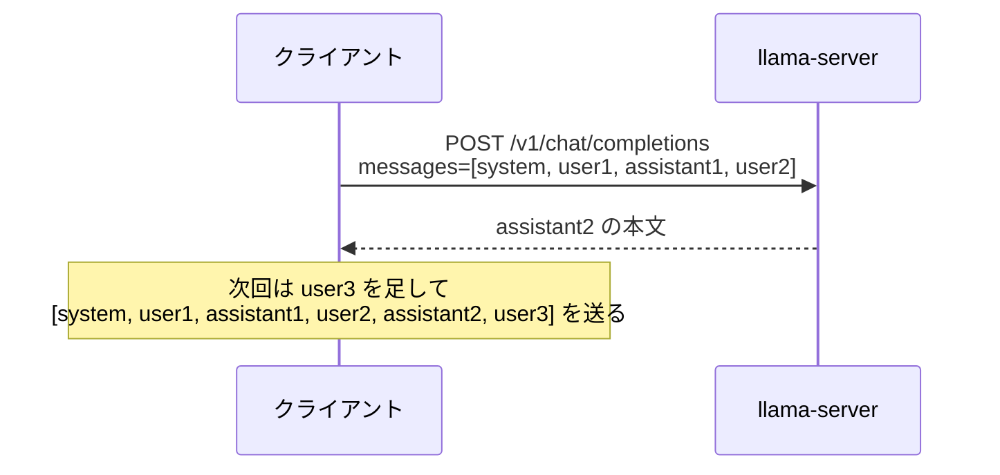
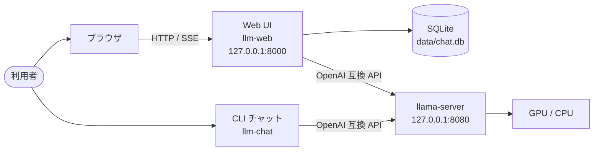
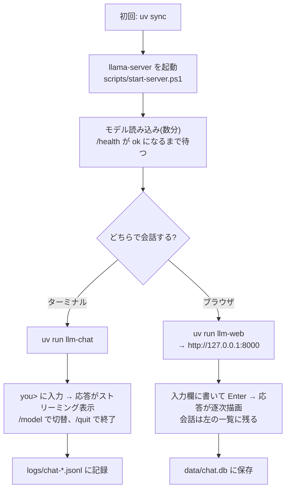
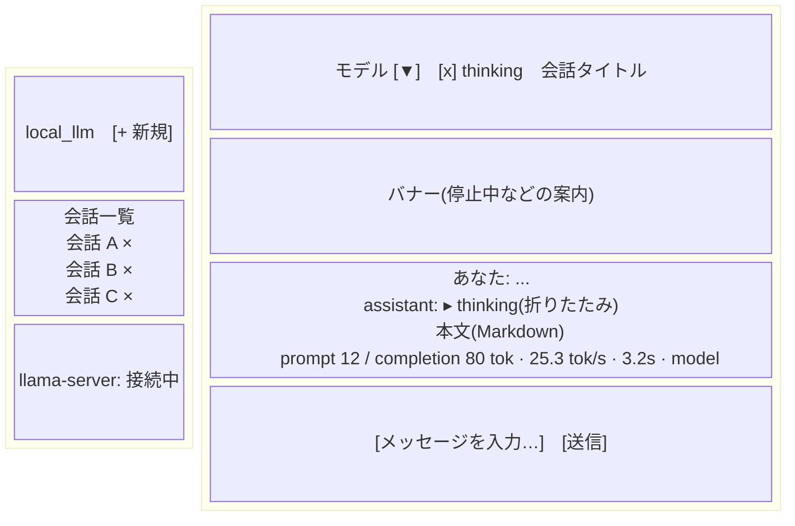

# 外部仕様書(Phase 1〜4)

利用者から見た振る舞いを定義する。内部構造は [internal-spec.md](internal-spec.md)、
開発時の決定経緯は [spec-phase1-2.md](spec-phase1-2.md) を参照。

対象バージョン: local-llm 0.1.0(Phase 2 完了時点)

## 0. 前提知識と用語

この章は、ローカル LLM や llama.cpp を触ったことがない人向けの説明。知っている人は 1 章へ。

### 0.1 登場するソフトウェア

| 名前 | 何か | このプロジェクトでの扱い |
| --- | --- | --- |
| LLM(大規模言語モデル) | テキストを入力すると続きを生成するニューラルネット。ChatGPT の中身と同種 | Qwen3 系のモデルを使う |
| GGUF | llama.cpp 用のモデルファイル形式。量子化(重みを 4bit などに圧縮)してあり、家庭用 GPU でも動く | Hugging Face から自動ダウンロードされる |
| llama.cpp | C++ 製の LLM 推論エンジン。CPU と GPU の両方を使える | `llama-local/` にビルド済みバイナリを置く |
| llama-server | llama.cpp に含まれる HTTP サーバ。モデルを読み込み、API で推論を受け付ける | 本プロジェクトの「相手」。`scripts/start-server.ps1` で起動する |
| ルーターモード | llama-server の機能。設定ファイル(`models.ini`)に複数モデルを登録し、リクエストの `model` で切り替える | モデル切替 UI はこれに頼っている |
| OpenAI 互換 API | OpenAI 社の API(`/v1/chat/completions` など)と同じ形式の HTTP API。llama-server が提供する | 自作クライアントが叩く |
| uv | Python のパッケージ管理ツール。仮想環境と依存の解決をまとめて行う | `uv sync` と `uv run` で使う |
| FastAPI | Python の Web フレームワーク | Web UI のバックエンド |
| SQLite | ファイル 1 つで動く組み込みデータベース | 会話の保存先 |

### 0.2 会話 API の基本形

LLM との「会話」は、過去のやり取りを全部まとめて毎回送り直すことで成り立つ。
サーバは状態を持たない。



`messages` の各要素は `{"role": "system" | "user" | "assistant", "content": "..."}`。

| role | 意味 |
| --- | --- |
| system | モデルへの指示(口調や制約)。先頭に 1 つ置く。省略可 |
| user | 利用者の発言 |
| assistant | モデルの過去の応答 |

### 0.3 ストリーミングと SSE

応答を全部生成してから返すと、長文では何十秒も待つことになる。そこで `stream: true` を付けると、
サーバは HTTP レスポンスを閉じずに、生成した数文字ずつを **SSE(Server-Sent Events)** の形式で送る。

```
data: {"choices":[{"delta":{"content":"こん"}}]}

data: {"choices":[{"delta":{"content":"にちは"}}]}

data: [DONE]
```

- 1 イベントは `data: ` で始まる行と、それに続く空行。
- `[DONE]` が終端。
- 本プロジェクトは、llama-server からの SSE をクライアントで読み、Web UI ではさらにブラウザ向けの SSE に詰め直して流す(二段構え)。

### 0.4 thinking(推論過程)

Qwen3 系のモデルは、本文の前に「考え中」のテキストを出す機能を持つ。これを thinking と呼ぶ。

- API では本文と別のフィールド `reasoning_content` で届く(llama-server の既定設定)。
- 古い設定では本文中に `<think>...</think>` として混ざることがある。両方に対応している。
- 利用者は thinking を見るかどうかを切り替えられる。無効にするときはリクエストに `chat_template_kwargs: {"enable_thinking": false}` を付ける。
- 次の発言を送るとき、過去の thinking は `messages` に含めない(モデルの推奨)。

### 0.5 モデル id

llama-server が `/v1/models` で返す名前。例: `unsloth/Qwen3.6-35B-A3B-GGUF:Q4_K_M`。
読み方は「Hugging Face の `組織/リポジトリ` : 量子化の種類」。

注意: `models.ini` では `UD-Q4_K_M` と書いてあるが、llama-server は公開時に `UD-` を落とす。
API に渡すのは `UD-` なしの id。

## 1. システム概要

llama.cpp の `llama-server`(OpenAI 互換 API)で動くローカル LLM に対して、
ターミナルとブラウザの 2 通りで会話できる。



| 構成要素 | 役割 |
| --- | --- |
| llama-server | モデルの読み込みと推論。`scripts/start-server.ps1` で起動する(本仕様の範囲外) |
| `llm-chat` | ターミナルで会話する CLI |
| `llm-web` | ブラウザ用チャット UI と REST/SSE API を提供する Web サーバ |
| `local_llm` パッケージ | 自分の Python コードから llama-server を呼ぶためのクライアント |

## 2. 前提と動作環境

| 項目 | 内容 |
| --- | --- |
| OS | Windows 11(PowerShell 5.1)。Python 部分は OS 非依存 |
| Python | 3.12 以上、パッケージ管理は uv |
| llama-server | ルーターモードで起動し、`/v1/models` `/v1/chat/completions` `/health` を提供すること |
| ネットワーク | すべて 127.0.0.1 で完結する。認証はない |
| ブラウザ | `fetch` の `ReadableStream`、`<details>`、`<template>` に対応したモダンブラウザ |

利用者は `uv sync` で依存を入れ、llama-server を起動してから各コマンドを使う。

### 2.1 典型的な利用の流れ



### 2.2 プロセスとポートの関係

同時に動くプロセスは最大 3 つ。すべて同じ PC 上で、ループバック(127.0.0.1)だけで通信する。

| プロセス | 起動コマンド | ポート | 待ち受け相手 |
| --- | --- | --- | --- |
| llama-server | `scripts/start-server.ps1` | 8080 | `llm-chat`、`llm-web`、llama.cpp 内蔵 Web UI(ブラウザ) |
| `llm-web`(uvicorn) | `uv run llm-web` | 8000 | ブラウザ |
| `llm-chat` | `uv run llm-chat` | なし | なし(クライアントのみ) |

llama-server は 1 つで、CLI と Web UI の両方から同時に使える。

## 3. 設定

環境変数、またはカレントディレクトリの `.env` で設定する。
優先順位は「設定済みの環境変数 > `.env` > 既定値」。

| 変数 | 既定値 | 意味 |
| --- | --- | --- |
| `LLAMA_BASE_URL` | `http://127.0.0.1:8080` | llama-server の URL。末尾の `/` は無視する |
| `LLM_DEFAULT_MODEL` | `unsloth/Qwen3.6-35B-A3B-GGUF:Q4_K_M` | 既定モデル id。`/v1/models` が返す id を指定する |
| `CHAT_DB_PATH` | `data/chat.db` | Web UI の会話を保存する SQLite ファイル |
| `LLAMA_TIMEOUT` | `600` | llama-server への HTTP タイムアウト(秒) |

モデル id について: `models.ini` のプリセット名に含まれる `UD-` は llama-server が公開時に
落とすため、API に渡す id は `UD-` なしの形になる。

## 4. CLI チャット `llm-chat`

### 4.1 起動

```
uv run llm-chat [--model ID] [--system TEXT] [--no-think] [--base-url URL] [--timeout SEC] [--log-dir DIR]
```

| オプション | 既定値 | 意味 |
| --- | --- | --- |
| `--model`, `-m` | `LLM_DEFAULT_MODEL` | 使うモデル id |
| `--system`, `-s` | なし | system prompt |
| `--no-think` | off | Qwen3 の thinking(推論過程)を無効にする |
| `--base-url` | `LLAMA_BASE_URL` | llama-server の URL |
| `--timeout` | `LLAMA_TIMEOUT` | HTTP タイムアウト(秒) |
| `--log-dir` | `logs` | 会話ログの保存先ディレクトリ |

### 4.2 起動時の振る舞い

1. 1 行目に現在のモデル名と thinking の状態を表示する。
2. llama-server の疎通を確認し、届かなければ赤字で警告して起動手順を案内する(終了はしない)。
3. 指定モデルがサーバのモデル一覧に無ければ黄字で警告し、利用できる id を列挙する。

### 4.3 対話

- プロンプト `you>` に入力する。空行は無視する。
- `/` で始まる行はコマンド、それ以外はユーザー発言として送信する。
- 応答はストリーミングで逐次表示する。
  - thinking があれば先に `[thinking]` という見出しのあと薄い色で表示する。
  - 本文は `assistant>` のあとに通常色で表示する。
- 応答の末尾に統計を 1 行で表示する。
  形式: `(prompt N tok / completion M tok, X.X tok/s, Y.Ys)`。
  生成速度は初トークンまでの待ち時間を除いた時間で割る。usage が取れなければ `(Y.Ys, usage なし)`。
- Ctrl+C で応答を中断できる。途中までの本文は履歴に残る。
- llama-server がエラーを返した場合は赤字で表示し、その発言は履歴から外す(再送しても二重にならない)。

### 4.4 コマンド

| コマンド | 動作 |
| --- | --- |
| `/model` | サーバのモデル一覧を表示する。現在のモデルに `*` を付ける |
| `/model <id>` | モデルを切り替える(存在確認はしない) |
| `/clear` | 会話履歴を消す。system prompt とモデルは保持する |
| `/system <text>` | system prompt を差し替える。引数なしで外す |
| `/think on\|off` | thinking の有無を切り替える |
| `/help` | コマンド一覧を表示する |
| `/quit`, `/exit` | 終了する。Ctrl+D / Ctrl+Z、Ctrl+C でも終了する |

不明なコマンドは赤字で知らせ、`/help` を案内する。

### 4.5 会話ログ

- `logs/chat-<YYYYMMDD-HHMMSS>.jsonl` に 1 メッセージ 1 行で追記する。
- ファイルは最初のメッセージを書くときに作る(何も話さず終了すれば作らない)。
- 1 行の形式: `{"time": ISO8601, "role": "user"|"assistant", "content": str, "model": str, "reasoning": str|null}`。
  `reasoning` は assistant 行のみ。
- 終了時にログファイルのパスを表示する。

## 5. Web チャット UI `llm-web`

### 5.1 起動

```
uv run llm-web [--host HOST] [--port PORT] [--reload]
```

| オプション | 既定値 | 意味 |
| --- | --- | --- |
| `--host` | `127.0.0.1` | 待ち受けアドレス |
| `--port` | `8000` | 待ち受けポート |
| `--reload` | off | コード変更で自動再起動(開発用) |

起動時に `CHAT_DB_PATH` のテーブルを作る(存在すれば何もしない)。親ディレクトリも作る。

### 5.2 画面構成



| 領域 | 内容 |
| --- | --- |
| サイドバー上部 | ブランド名と「+ 新規」ボタン |
| 会話一覧 | 更新日時の新しい順。クリックで開く。`×` で削除(確認ダイアログあり)。現在の会話を強調表示。ホバーでモデルと更新日時を表示 |
| サイドバー下部 | llama-server の疎通状態(「確認中…」「接続中」「停止中」「API に接続できません」) |
| ツールバー | モデル選択ドロップダウン、thinking チェックボックス、会話タイトル |
| バナー | エラーや停止中の案内。問題が解消されると消える |
| メッセージ欄 | 会話がないときは案内文を表示する |
| 入力欄 | 自動で高さが伸びる(最大 200px)。送信ボタン |

### 5.3 操作

| 操作 | 振る舞い |
| --- | --- |
| 送信(Enter またはボタン) | 空文字は送らない。Shift+Enter は改行。日本語入力の変換確定 Enter では送信しない |
| 会話がない状態で送信 | ドロップダウンのモデルで会話を自動作成してから送る |
| 送信中 | 入力欄・送信・新規ボタンを無効化する。会話の切替と削除もできない |
| 応答の表示 | thinking は折りたたみで表示し、本文が始まるまでは開いておき、始まったら閉じる。本文は逐次 Markdown 描画する |
| 応答完了 | メッセージ下に `prompt N / completion M tok · X tok/s · Y s · モデル id` を表示する。会話一覧とタイトルを更新する |
| エラー | メッセージ下に赤字で `エラー: ...` を出す。送信自体が失敗した場合はバナーに出す |
| モデル変更 | ドロップダウンの値は次の送信時に会話のモデルとして保存される |
| thinking 切替 | チェックの状態が次の送信に適用される |
| 会話を開く | メッセージを復元し、会話に保存されたモデルをドロップダウンに反映する |
| 「+ 新規」 | 画面を空にする。会話は最初の送信時に作られる |
| 削除 | 確認後に削除。開いていた会話なら画面を空にする |

### 5.4 自動処理

- 15 秒ごとに llama-server の疎通を確認し、サイドバー下部とバナーを更新する。
- 停止中から復帰したときはモデル一覧を取り直す。
- 会話タイトルは最初のユーザー発言の先頭 40 文字(改行は空白に潰す)を自動設定する。
- 会話は SQLite に保存され、リロードやサーバ再起動後も残る。

### 5.5 Markdown 表示

- assistant の本文は marked(CDN、GFM、改行を `<br>` に変換)で描画する。
- CDN が読めない場合はプレーンテキストで表示する。
- ユーザー発言は Markdown 解釈せずそのまま表示する。

## 6. HTTP API(Web UI のバックエンド)

ベース URL は `http://127.0.0.1:8000`。すべて `/api` 配下、JSON、認証なし。
自動ドキュメントは `/docs`(Swagger UI)。

### 6.1 一覧

| メソッド | パス | 成功 | 説明 |
| --- | --- | --- | --- |
| GET | `/api/health` | 200 | llama-server の疎通 |
| GET | `/api/models` | 200 | モデル一覧(llama-server を中継) |
| GET | `/api/conversations` | 200 | 会話一覧(新しい順) |
| POST | `/api/conversations` | 201 | 会話を作る |
| GET | `/api/conversations/{id}` | 200 | 会話をメッセージ込みで取得 |
| DELETE | `/api/conversations/{id}` | 204 | 会話を削除 |
| POST | `/api/conversations/{id}/messages` | 200 (SSE) | 発言を送り応答をストリーミング |
| GET | `/` | 200 | UI の HTML |
| GET | `/static/*` | 200 | UI の静的ファイル |

### 6.2 各エンドポイント

**GET /api/health**

```json
{"ok": true, "llama_base_url": "http://127.0.0.1:8080"}
```

llama-server に届かなくても 200 を返し、`ok` が false になる。

**GET /api/models**

```json
{"models": ["unsloth/Qwen3.6-35B-A3B-GGUF:Q4_K_M", "..."], "default": "unsloth/Qwen3.6-35B-A3B-GGUF:Q4_K_M"}
```

llama-server に届かない、またはエラーのときは 502 と `{"detail": "..."}`。

**GET /api/conversations**

```json
{"conversations": [{"id": 3, "title": "こんにちは", "model": "...", "created_at": "...", "updated_at": "..."}]}
```

**POST /api/conversations**

リクエスト `{"model": "..."}`。`model` は省略可(null)で、省略時は `LLM_DEFAULT_MODEL`。
レスポンスは作成した会話(201)。`title` は null で始まる。

**GET /api/conversations/{id}**

```json
{"id": 3, "title": "...", "model": "...", "created_at": "...", "updated_at": "...",
 "messages": [{"id": 1, "role": "user", "content": "...", "reasoning": null, "created_at": "..."}]}
```

存在しなければ 404。

**DELETE /api/conversations/{id}**

204。存在しなければ 404。メッセージも一緒に消える。

**POST /api/conversations/{id}/messages**

リクエスト:

```json
{"content": "質問文", "enable_thinking": true, "model": "任意: 会話のモデルを変更"}
```

- `content` は 1 文字以上必須(空は 422)。
- `model` を指定し、会話のモデルと異なれば会話のモデルを更新してから送る。
- 会話が存在しなければ 404。

レスポンスは `text/event-stream`。各イベントは `data: <JSON>\n\n`:

| type | フィールド | 意味 |
| --- | --- | --- |
| `reasoning` | `text` | thinking の断片 |
| `content` | `text` | 本文の断片 |
| `done` | `model`, `usage`, `tokens_per_second`, `elapsed_seconds` | 完了。`usage` は `{prompt_tokens, completion_tokens, total_tokens}` または null |
| `error` | `text` | 失敗。これが最後のイベントになり `done` は来ない |

保存の規則:

- ユーザー発言は受信直後に保存する(llama-server が落ちていても残る)。
- assistant の発言は完了時に保存する。エラーや切断のときは、そこまでの本文と thinking を保存する。何も生成されていなければ保存しない。
- 過去の thinking は次の送信時に llama-server へ送らない。

## 7. Python API(`local_llm` パッケージ)

```python
from local_llm import LlamaClient, LlamaClientError, Message, ChatChunk, Usage
```

| 名前 | 内容 |
| --- | --- |
| `LlamaClient(base_url, timeout)` | 非同期クライアント。`async with` で使う |
| `await client.health() -> bool` | 疎通。失敗時は例外でなく False |
| `await client.list_models() -> list[str]` | モデル id 一覧 |
| `client.chat(messages, model, *, stream=True, temperature=None, enable_thinking=True)` | `ChatChunk` の非同期イテレータ。`stream=False` でも 1 個のチャンクを返す |
| `Message(role, content)` | 送信メッセージ |
| `ChatChunk(content, reasoning, finish_reason, usage)` | 応答断片。`usage` は最終チャンクのみ |
| `LlamaClientError` | 接続失敗、タイムアウト、HTTP 4xx/5xx、ストリーム内エラーをまとめた例外。`status_code` 属性を持つ |

## 8. エラー時の振る舞いまとめ

| 状況 | CLI | Web UI |
| --- | --- | --- |
| llama-server 停止 | 起動時に警告。送信時はエラー表示し発言を履歴から外す | 下部が「停止中」、バナー表示。送信するとユーザー発言は保存され `error` イベントが届く |
| モデル id が存在しない | 起動時に警告して一覧表示 | llama-server のエラーが `error` イベントで届く |
| 応答中の中断 | Ctrl+C。途中までを履歴に残す | ブラウザを閉じる等。途中までを DB に保存 |
| 空入力 | 無視 | 送信しない(API 直叩きは 422) |

## 9. 範囲外(Phase 5 以降)

- 書き込み・コマンド実行を許可するエージェント、マルチエージェント(Phase 4 は読み取り専用のみ。11 章)
- 認証、LAN 公開、複数ユーザー
- 会話のエクスポート、検索、タイトルの手動変更
- temperature などのサンプリング設定 UI

## 10. RAG: 資料を根拠に答える(Phase 3)

### 10.1 何ができるか

`data/corpus/` 配下の Markdown を索引しておくと、質問に近い部分(チャンク)を上位 k 件選び、
「以下の資料だけを根拠に答え、使った資料を [n] で示す」という指示とともにモデルへ渡す。
回答には `[1]` のような引用番号が付き、どの資料のどの見出しを使ったかが CLI / Web UI に表示される。

### 10.2 コーパスの取得と索引

```powershell
.\scripts\fetch-corpus.ps1          # ai_harness の Markdown 19 本を data/corpus/ai_harness/ に取得
uv run llm-index                     # 索引を作成・更新(llama-server が起動していること)
uv run llm-index --force             # 変更の有無に関わらず作り直す(埋め込みモデルを替えたとき)
```

- `llm-index` は `RAG_CORPUS_DIR`(既定 `data/corpus`)配下の `**/*.md` を読む。文書ごとに sha256 を記録し、変わっていない文書は読み飛ばす。コーパスから消えた文書は索引からも消える。
- 出力例: `更新 19 文書 / 変更なし 0 文書 / 削除 0 文書 / 新規チャンク 433 件`
- 索引はチャット DB(`CHAT_DB_PATH`、既定 `data/chat.db`)の `documents` / `chunks` 表に入る。

### 10.3 設定

| 環境変数 | 既定 | 内容 |
| --- | --- | --- |
| `LLM_EMBED_MODEL` | `Qwen/Qwen3-Embedding-0.6B-GGUF:Q8_0` | 埋め込みモデル id。`models.ini` の同名セクションから配信される |
| `LLAMA_EMBED_BASE_URL` | (`LLAMA_BASE_URL` と同じ) | 埋め込みだけ別の llama-server で動かすときの URL |
| `RAG_CORPUS_DIR` | `data/corpus` | 索引する Markdown の置き場 |

### 10.4 CLI(`llm-chat`)

| 操作 | 内容 |
| --- | --- |
| `--rag` | 起動時から RAG を有効にする |
| `--top-k N` | 差し込む資料の件数(既定 5、最大 20) |
| `/rag` | 現在の状態と索引の文書数・チャンク数を表示 |
| `/rag on` / `/rag off` | RAG の有無を切り替える |

RAG が有効なとき、発言を送るとまず出典が薄い色で `[1] path › 見出し  (0.721)` の形で並び、続けて本文が流れる。
索引が空なら「インデックスが空です」と案内する。資料の検索に失敗した(埋め込みサーバに届かない)場合はエラーを表示して送信を中止し、発言は履歴に積まない。

### 10.5 Web UI

- ツールバーの「RAG」チェックで有効化。右隣に「資料 19 件 / 433 チャンク」のように索引の状態が出る。
- 応答の下に出典リスト(番号、パス、見出し、類似度)が本文より先に表示される。
- 該当資料が無い(索引が空)ときは、その旨をリストに表示する。

### 10.6 HTTP API の追加・変更

| メソッド | パス | 成功 | 説明 |
| --- | --- | --- | --- |
| GET | `/api/rag/status` | 200 | 索引の文書数・チャンク数・埋め込みモデル・コーパスの場所 |
| GET | `/api/rag/search?q=...&top_k=5` | 200 | 質問に近いチャンクを本文つきで返す(Phase 4 のツールが使う) |
| POST | `/api/conversations/{id}/messages` | 200 (SSE) | 本文に `use_rag`(既定 false)と `top_k`(既定 5、1〜20)を追加 |

**GET /api/rag/status**

```json
{"documents": 19, "chunks": 433, "embedding_models": ["Qwen/Qwen3-Embedding-0.6B-GGUF:Q8_0"],
 "last_indexed_at": "2026-10-25T02:36:25+00:00",
 "embedding_model": "Qwen/Qwen3-Embedding-0.6B-GGUF:Q8_0", "corpus_dir": "data/corpus"}
```

**GET /api/rag/search**

```json
{"query": "Fencing Token とは",
 "results": [{"n": 1, "chunk_id": 311, "path": "ai_harness/docs/profiles/distributed-execution.md",
              "title": "Profile: 分散・長時間・複数Worker実行", "heading": "... > Fencing Token",
              "text": "Lease取得ごとに単調増加Tokenを発行します。...", "score": 0.7212}]}
```

`q` が空なら 422、`top_k` が範囲外なら 422。埋め込みサーバに届かなければ 502。
索引と検索で埋め込みモデルの次元が合わないときは 409(`llm-index --force` で作り直す)。

**POST /api/conversations/{id}/messages(use_rag=true)**

SSE のイベント列は `sources` → (`reasoning`)* → `content`* → `done`。

```
data: {"type": "sources", "items": [{"n": 1, "path": "...", "title": "...", "heading": "...", "score": 0.72}, ...]}
data: {"type": "content", "text": "Lease取得ごとに..."}
data: {"type": "done", "model": "...", "usage": {...}, "tokens_per_second": 42.7, "elapsed_seconds": 9.11,
       "rag": {"used": true, "sources": 3}}
```

- `sources` は検索が終わった直後、モデルを呼ぶ前に 1 回だけ届く。`use_rag=false` のときは届かず、`done.rag` は null。
- 検索に失敗した場合は `error` イベントのみ届き、モデルは呼ばれない(ユーザー発言は保存済み)。
- 資料は system メッセージとして毎回差し込むだけで、DB の会話には保存しない。

### 10.7 エラー時の振る舞い(RAG 固有)

| 状況 | CLI | Web UI / API |
| --- | --- | --- |
| 索引が空 | 「資料が見つかりませんでした」を表示し、資料なしで送信 | `sources.items` が空。UI は「該当する資料がありません」 |
| 埋め込みサーバ停止 | エラー表示、送信中止、履歴に積まない | `error` イベント(messages)、502(search) |
| 埋め込みモデルの次元不一致 | エラー表示、送信中止 | `error` イベント(messages)、409(search) |

## 11. エージェント `llm-agent`: ツール呼び出しをコードで許可する(Phase 4)

### 11.1 何ができるか

Task Contract(JSON)と指示文を渡すと、ローカルの Pi(pi-coding-agent)が llama-server のモデルにツールを使わせて作業し、
結果を `evidence/<run_id>/` に残す。使えるツール、読める場所、手数の上限は Contract に書いてあるものだけで、
モデルがそれ以外を要求しても extension が block して記録する。完了したかどうかはモデルの申告ではなく runner の検証で決まる。

### 11.2 前提

| 項目 | 内容 |
| --- | --- |
| Node.js と Pi | `npm install -g @earendil-works/pi-coding-agent`(1.0.0 で確認)。`~/.pi` の設定は使わず、`agent/pi/` を `PI_CODING_AGENT_DIR` で渡す |
| extension の依存 | `cd agent/harness && npm install`(vitest、typebox の devDependencies。実行時は Pi 同梱のライブラリを使う) |
| llama-server | ルーターモードで起動済み(`--jinja` が有効で function calling が通ること) |
| llm-web | `rag_search` が `GET /api/rag/search` を叩く。索引済みであること(10 章) |

### 11.3 起動

```powershell
uv run llm-agent --contract agent/contracts/summarize-docs.json --task "RAG の設計方針を 3 点にまとめて"
```

| オプション / 環境変数 | 既定 | 内容 |
| --- | --- | --- |
| `--contract PATH` | (必須) | Task Contract。`docs/harness/schemas/task-contract.schema.json` で検証し、`contract_hash` が内容と一致しなければ起動しない |
| `--task TEXT` | (必須) | エージェントへの指示 |
| `--run-id ID` | 日時 + 乱数 | `evidence/<run_id>/` の名前 |
| `--evidence-dir DIR` | `evidence` | 証拠の置き場 |
| `--rag-url URL` / `HARNESS_RAG_URL` | `http://127.0.0.1:8000` | `llm-web` の URL |
| `--model` / `LLM_AGENT_MODEL` | `llama-local/unsloth/Qwen3.6-35B-A3B-GGUF:Q4_K_M` | Pi の `provider/model-id`(`agent/pi/models.json` に定義があること) |
| `--thinking` | `off` | `off` のとき llama-server へのリクエストに `enable_thinking=false` を付ける |
| `--timeout SEC` | 900 | `agent_settled` を待つ秒数。超えたら pi を終了し `RUN_SETTLED` を fail にする |
| `--max-steps N` / `--max-tool-calls N` | Contract の値 | 予算の上書き(動作確認用) |
| `--expose-builtin-tools` | なし | Pi 組み込みの bash / read などをモデルに見せる(block されることの確認用。既定では見せない) |
| `--pi CMD` | `pi` | pi コマンド(テストでは偽の pi に差し替える) |

標準出力の例:

```
run_id: e2e-summarize  (66.3s, turns=8, settled=True, exit=0)
decision: accepted
  PASS FINISH_CALLED          finish が 1 回呼ばれ result.json がある
  ...
  ---- SUMMARY_QUALITY        この criterion_id に対応する決定論的な検査が runner に無い
decision: ...\evidence\e2e-summarize\decision.json
```

終了コードは判定が `accepted` のときだけ 0。

### 11.4 エージェントに見えるツール(読み取り専用プロファイル)

| ツール | 引数 | 内容 | 制限 |
| --- | --- | --- | --- |
| `rag_search` | `query`, `top_k`(1〜3、既定 3) | `llm-web` の `/api/rag/search` を呼び `[n] path › 見出し (score)` と本文を返す | 本文は 1 件 350 字まで |
| `read_file` | `path`(workspace 相対) | `scope.read` 内で `scope.forbidden` に当たらないファイルを読む | 3000 字まで。scope 外は block され、run は `scope_violation` で止まる |
| `list_files` | `glob` | workspace を走査し、`scope.read` 内のパスだけ返す | 200 件まで。`node_modules` / `.git` / `.venv` は走査しない |
| `finish` | `summary`, `sources[]` | 結果を提出する。`result.json` に保存され、以後のツール呼び出しは block | 1 回だけ |

ツール出力は run 全体で 6000 字まで(`HARNESS_MAX_OUTPUT_CHARS`)。超えると読み取り系ツールはエラー文「出力予算切れ。今ある材料で finish せよ」を返す。
これは ctx 8192 のモデルでコンテキスト溢れを起こさないための制限で、Contract ではなくハーネスの設定。

### 11.5 Contract の読まれ方

| Contract の項目 | extension / runner の動き |
| --- | --- |
| `capability_profile.allowed_tools` | これ以外の `tool_call` は `tool_not_allowed` で block(実行されない)。`denied_tools` は明示の記録用 |
| `scope.read` / `scope.forbidden` | `read_file` のパスを検査。forbidden が勝つ。違反は `scope_boundary_exceeded` で block し、run を `scope_violation` で止める |
| `execution_budget.max_steps` | turn 数。超えた turn の開始で `stop budget_exceeded` を記録し run を中断 |
| `execution_budget.max_tool_calls` / `same_error_limit` | 呼び出し数の上限 / 同じツール・同じ引数・同じエラー文の連続回数。超えたら block して止める |
| `completion_criteria[].criterion_id` | runner が同名の検査を持つものだけ pass / fail を付ける(11.6)。無いものは `not_run` |

### 11.6 判定(`decision.json`)

runner が持つ検査と、サンプル Contract での意味:

| criterion_id | pass の条件 |
| --- | --- |
| `FINISH_CALLED` | `finish` が 1 回呼ばれ `result.json` がある |
| `SUMMARY_NONEMPTY` | `result.summary` が空でない |
| `SOURCES_IN_SCOPE` | `result.sources` が空でなく、すべて `scope.read` 内に実在する |
| `ONLY_ALLOWED_TOOLS` | 実行されたツールがすべて `allowed_tools` 内(許可外の呼び出しは block されていれば可) |
| `NO_SCOPE_VIOLATION` | `scope_boundary_exceeded` の block が 0 件 |
| `WITHIN_BUDGET` | `stop_reason` が `budget_exceeded` / `same_error_repeated` / `scope_violation` でない |
| `RUN_SETTLED` | `agent_settled` を受信し、runner 側のエラー(タイムアウト、pi の異常終了、モデルエラー)が無い |

| 判定 | 条件 |
| --- | --- |
| `blocked` | 予算超過・同一エラー反復・scope 違反で run が止まった |
| `rejected` | 必須 criterion に `fail` がある |
| `needs_human` | 必須 criterion に `not_run`(runner が検査を持たない、human-review など)がある |
| `accepted` | 必須 criterion がすべて `pass` |

`report.md` にはエージェントの `finish` 本文も載るが「未検証の自己申告」と明記され、判定の根拠にはならない。

### 11.7 出力ファイル(`evidence/<run_id>/`)

| ファイル | 内容 |
| --- | --- |
| `events.jsonl` | 1 行 1 イベント。`run_start` / `turn_start` / `tool_call`(引数と正規化 hash)/ `tool_result`(先頭 500 字)/ `block` / `stop` / `finish` / `run_end`。全行に `run_id` と `contract_hash` |
| `result.json` | `finish` の `summary` と `sources` |
| `pi_events.jsonl` / `pi_stderr.txt` | Pi の RPC イベント全部と標準エラー |
| `decision.json` | Completion Decision(`completion-decision.schema.json` 適合) |
| `verification.json` | criterion ごとの Verification Result の配列 |
| `report.md` | 人向けの要約(criterion 表、ツール呼び出し表、finish 本文) |

### 11.8 エラー時の振る舞い(エージェント固有)

| 状況 | 振る舞い |
| --- | --- |
| Contract が Schema に合わない / hash が合わない | 起動前に終了(終了コード 1)。evidence は作らない |
| `pi` コマンドが無い | `RUN_SETTLED` fail、decision は `rejected` |
| llama-server 停止 | モデルエラーとして `RUN_SETTLED` fail |
| `llm-web` 停止 | `rag_search` がエラー文を返す(run は続く)。同じエラーが `same_error_limit` 回続けば停止 |
| 許可外ツール要求 | block して記録、run は続く。`ONLY_ALLOWED_TOOLS` は pass のまま |
| scope 外の `read_file` | block し `scope_violation` で停止、`blocked` |
| 手数超過 | `budget_exceeded` で停止、`blocked` |

## 12. 評価 `llm-eval`: 5 構成を同じ問題で比べる(Phase 6)

### 12.1 何ができるか

版番号付きの Q&A データセット(`eval/datasets/qa-v1.jsonl`、147 問)を回答モデルに投げ、
決定論的な採点(キーワード再現率)と LLM 採点(1〜5)の 2 段で点を付け、`eval/results/` に JSON と Markdown を出す。
比較する構成は 5 つで、モデルは llama-server のルーターモードで 1 つずつ載せ替える。

| 構成 | 回答モデル(`/v1/models` の id) | RAG | 意図 |
| --- | --- | --- | --- |
| A | `LLM_DEFAULT_MODEL`(既定 `unsloth/Qwen3.6-35B-A3B-GGUF:Q4_K_M`) | なし | 大型モデルの素の知識 |
| B | 同上 | あり | RAG の効果 |
| C | `unsloth/Qwen3-4B-GGUF:Q4_K_M` | なし | 小型の基準 |
| D | `local/qwen3-4b-localllm-lora` | なし | LoRA の効果 |
| E | `local/qwen3-4b-localllm-lora` | あり | 併用 |

採点モデルは回答モデルと**別**(既定 `unsloth/Qwen3-8B-GGUF:Q4_K_M`、`LLM_GRADER_MODEL` / `--grader-model`)。
同じモデルを指定すると何も実行せず終了コード 2 で止まる。

### 12.2 起動

```powershell
.\scripts\start-server.ps1 -Preset .\eval\models-eval.ini   # 8B 採点モデルに hf-repo を足したプリセット(12.6)
uv run llm-index                                             # RAG あり構成(B / E)の索引。コーパスは 10.2 と scripts/sync-local-corpus.ps1
uv run llm-eval --suite qa --config A                        # 1 構成
.\scripts\run-eval-all.ps1                                   # A〜E を順に実行し、最後に比較表を出す
uv run llm-eval --summarize                                  # 構成ごと最新の結果から比較表(Markdown)だけを出す
```

| オプション | 既定 | 内容 |
| --- | --- | --- |
| `--suite` | `qa` | データセットの種類(現在は qa のみ) |
| `--config` | (必須) | A〜E |
| `--n` / `--seed` | 全件 / 42 | 部分集合で走らせるときの件数と seed。使った件数・seed・行番号は結果 JSON に残る |
| `--top-k` | 5 | RAG あり構成で差し込む資料数 |
| `--grader-model` | `LLM_GRADER_MODEL` | 採点モデル id |
| `--large-model` | `LLM_DEFAULT_MODEL` | 構成 A / B の大型モデル id |
| `--base-url` / `--db` / `--out-dir` | 設定値 / 設定値 / `eval/results` | llama-server、RAG 索引、出力先 |
| `--threshold` | 0.5 | 正答とみなすキーワード再現率 |
| `--max-tokens` | 400 | 回答の最大トークン数 |
| `--no-llm-grade` | | LLM 採点を行わない(決定論的採点のみ) |
| `--no-manage-models` | | ルーターの `/models/load` `/models/unload` を使わない(単体モデルのサーバ向け) |

実行中は 1 問ごとに `[A 回答] 12/147 recall=0.67 OK (3.1s)`、採点中は `[A 採点] 12/147 score=4` と出る。
途中経過は `eval/results/<日時>-qa-A.partial.json` に書かれ、完了時に消える。

### 12.3 採点の規則

| 段 | 指標 | 規則 |
| --- | --- | --- |
| 1(決定論) | キーワード再現率 | 正解文の語(英数字 3 字以上、カタカナ・漢字 2 字以上、一般語を除外)のうち応答に含まれる割合。0.5 以上で「正答」。Phase 5 の `training/eval_quick.py` と同じ規則 |
| 1(決定論) | 引用率 | 応答に `[n]` があるか(RAG あり構成で資料を根拠にしたかの目安) |
| 1(決定論) | 検索ヒット率 | 問いの出典ファイル(`source` のパス部分)が検索結果の上位 3 件 / k 件に含まれるか(RAG あり構成のみ) |
| 2(LLM) | 1〜5 の整数 | 採点モデルに質問・模範解答・応答を渡し、温度 0・thinking off・JSON Schema 強制で `{"score", "reason"}` を返させる。JSON が壊れていれば `score: null` として失敗数に数える |

### 12.4 出力

- `eval/results/<日時>-<suite>-<構成>.json`: `eval/schemas/qa-result.schema.json` に適合。`answer.model` と `grader.model`、`dataset.{version, n, seed, indices, sha256}`、`metrics`、全問の応答と採点が入る
- 同名の `.md`: 指標の表と各問の一覧
- `--summarize`: 構成 A〜E の最新結果を 1 つの表にする(README の比較表はこれを転記する)

### 12.5 エラー時の振る舞い(評価固有)

| 状況 | 振る舞い |
| --- | --- |
| 採点モデル == 回答モデル | 実行前に止まる(終了コード 2)。サーバには何も送らない |
| RAG あり構成で索引が空 | 「先に `uv run llm-index`」と案内して終了コード 1 |
| データセット名が `<name>-v<N>.jsonl` でない / 行に question・answer・source が無い | 終了コード 1 |
| ルーターに無いモデル id | `/models` に出ないので「models.ini を確認」と出て終了コード 1 |
| 途中で Ctrl+C | `*.partial.json` を残して終了コード 130 |

### 12.6 プリセットについて

`models.ini` の `[unsloth/Qwen3-8B-GGUF:Q4_K_M]` に `hf-repo` が無いと、ルーターは 8B の子プロセスにモデルを渡さず、
子がそれ自身ルーターとして起動して永遠に `loading` のままになる(Phase 5 で 4B に起きた現象と同じ)。
Phase 6 の契約では `models.ini` を書き換えられないため、1 行だけ足した `eval/models-eval.ini` を用意した。
`models.ini` 本体に同じ 1 行を入れれば(Completion Report の Amendment 案)このファイルは不要になる。
