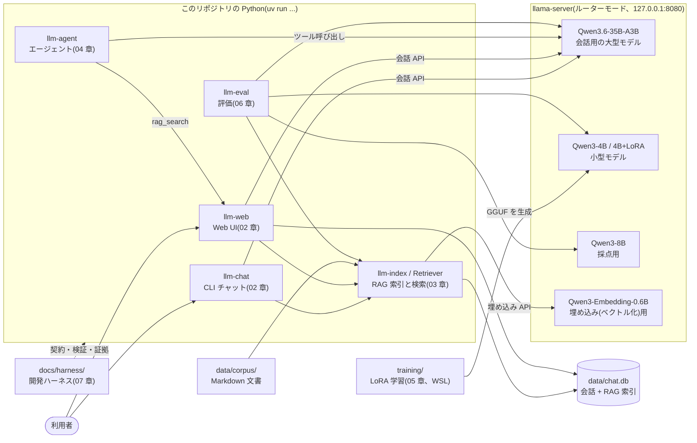
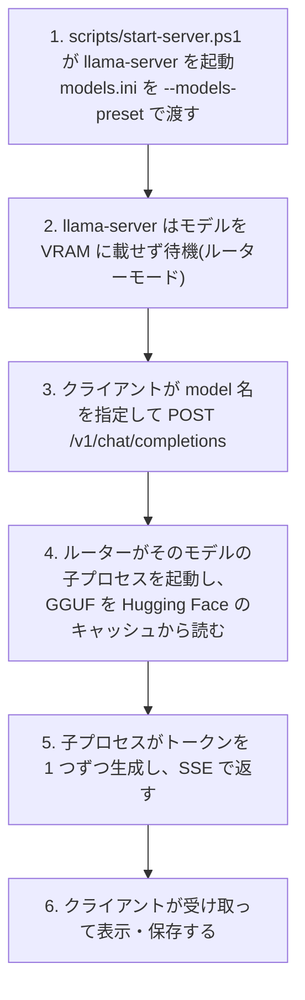
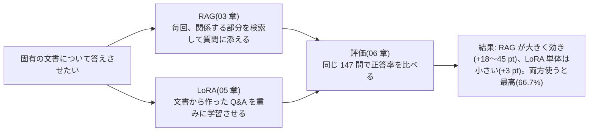

# 00. 全体像: このリポジトリは何をどう組み合わせているか

## この章で分かること

- 「ローカル LLM を動かす」とは、具体的にどのソフトが何をしているのか
- llama.cpp / llama-server / GGUF / 量子化 / ルーターモードという言葉の意味
- このリポジトリの 6 つの構成要素(CLI、Web UI、RAG、エージェント、LoRA、評価)が 1 枚の図でどうつながるか
- 以降の章(01〜07)をどの順で読めばよいか

## 前提となる用語

| 用語 | 1 行説明 |
| --- | --- |
| LLM(大規模言語モデル) | 文章を入力すると「続き」を 1 語ずつ予測して生成するニューラルネット。ChatGPT の中身と同種 |
| ローカル LLM | クラウドの API ではなく、自分の PC の GPU / CPU で動かす LLM。データが外に出ない代わりに、ハードの制約を受ける |
| 推論(inference) | 学習済みモデルに入力を与えて出力を得ること。学習(training)とは別の作業 |
| llama.cpp | C++ で書かれたオープンソースの LLM 推論エンジン。家庭用 GPU と CPU を組み合わせて動かせる |
| llama-server | llama.cpp に同梱の HTTP サーバ。モデルを読み込み、OpenAI 互換の API で推論を受け付ける |
| GGUF | llama.cpp 専用のモデルファイル形式。1 ファイルに重み・語彙・設定がまとまっている |
| 量子化(quantization) | モデルの重み(数値)を 16bit から 4bit などに丸めてファイルと VRAM を小さくすること。`Q4_K_M` は 4bit 量子化の一方式 |
| VRAM | GPU に載っているメモリ。このプロジェクトでは 12 GB。モデルがここに収まるかどうかが速度を決める |
| ルーターモード | llama-server の機能。設定ファイル `models.ini` に複数モデルを登録し、リクエストの `model` 名で載せ替える |
| OpenAI 互換 API | `POST /v1/chat/completions` などの、OpenAI 社の API と同じ形の HTTP API。llama-server が提供する |
| Hugging Face | モデルファイルの配布サイト。`unsloth/Qwen3-4B-GGUF` のような「組織/リポジトリ」名で指定する |

## 全体のどこに当たるか

この章は図の全体を説明する。以降の章では、同じ図の該当部分を黄色で強調する。



## 何をしているか

### 役割分担: 推論は llama-server、それ以外はこのリポジトリ

モデルの計算(推論)はすべて llama-server という外部ソフトが行う。このリポジトリの Python コードは一切モデルを計算しない。
代わりに「HTTP でサーバに問い合わせる」「結果を表示・保存する」「検索した資料を質問に添える」「ツールの実行を許可・拒否する」「正答率を採点する」といった周辺の仕事を受け持つ。



### 6 つの構成要素と Phase の対応

| 構成要素 | コマンド | 何をするか | 章 |
| --- | --- | --- | --- |
| API クライアントと CLI | `uv run llm-chat` | llama-server の API を httpx で叩き、ターミナルで会話する | 02 |
| Web UI | `uv run llm-web` | ブラウザで会話し、SQLite に保存する | 02 |
| RAG | `uv run llm-index`、`llm-chat --rag` | Markdown 文書を検索し、根拠付きで答えさせる | 03 |
| エージェント | `uv run llm-agent` | モデルにツール(検索、ファイル読み)を使わせ、許可・予算・証拠をコードで強制する | 04 |
| LoRA | `training/` | 小型モデルに文書の Q&A を追加学習させ、GGUF にして登録する | 05 |
| 評価 | `uv run llm-eval` | 5 構成を同じ 147 問で比べ、2 段階で採点する | 06 |
| 開発ハーネス | `scripts/agent/verify.ps1` | 上記すべての開発を「契約 → 検証 → 証拠」で進める | 07 |

Phase 0 は土台(llama.cpp の配置、`models.ini`、起動スクリプト、ベンチ)で、Phase 1〜6 が上の表の順に対応する。

### 「知識を補う」2 つのやり方と、それを測る仕組み

このリポジトリの後半(03〜06 章)は 1 つの問いでつながっている。
「このプロジェクト固有の文書について、モデルに正しく答えさせるにはどうするか」。



## 使っているアルゴリズム・技術と、なぜそれを選んだか

| 技術 | 何のために | なぜこれか |
| --- | --- | --- |
| llama.cpp(llama-server) | 12 GB の GPU で 35B クラスのモデルを動かす | 量子化 GGUF を読め、GPU に載りきらない層を CPU に逃がせる。Windows のビルド済みバイナリがある |
| GGUF + Q4_K_M 量子化 | モデルを VRAM に収める | 4B モデルで 2.3 GiB、8B で 4.7 GiB(`bench/` の実測)。16bit のままなら 4 倍のサイズになる |
| ルーターモード | 会話用・採点用・埋め込み用のモデルを 1 つのサーバで切り替える | サーバを複数立てずに済む。評価(06 章)では `/models/load` `/models/unload` で順に載せ替える |
| MoE(Mixture of Experts)+ `cpu-moe` | 35B モデルを 12 GB で動かす | Qwen3.6-35B-A3B は「35B のうち毎回 3B しか使わない」構造。使わない部分(エキスパート)を CPU 側に置くと GPU 側は約 4 GB で済む |
| OpenAI 互換 API | クライアントを自作する | 形式が広く知られていて、将来クラウド API に切り替えても同じコードが使える |
| Python + uv | クライアント、Web、RAG、評価 | 標準ライブラリの sqlite3、httpx、FastAPI、numpy だけで足りる。uv で環境再現が 1 コマンド |
| Qwen3 系モデル | 会話・採点・埋め込み・学習ベースをすべて同系で揃える | 日本語が使え、thinking(01 章)を API から切り替えられ、量子化版と埋め込みモデルが同じ配布元にある |

### 使っているモデル

| モデル(`models.ini` のセクション名) | 種類 | GGUF サイズ | 生成速度(tg128) | 用途 |
| --- | --- | --- | --- | --- |
| `unsloth/Qwen3.6-35B-A3B-GGUF:UD-Q4_K_M` | MoE 35B(アクティブ 3B) | 20.6 GiB | 43.5 tok/s | 既定の会話モデル。エージェント、Q&A 合成にも使う |
| `unsloth/Qwen3-4B-GGUF:Q4_K_M` | dense 4B | 2.32 GiB | 180.1 tok/s | LoRA との比較用の素のモデル |
| `local/qwen3-4b-localllm-lora` | dense 4B + LoRA マージ | 2.32 GiB | 179.7 tok/s | 05 章で学習したモデル |
| `unsloth/Qwen3-8B-GGUF:Q4_K_M` | dense 8B | 4.68 GiB | 113.7 tok/s | 06 章の採点モデル |
| `Qwen/Qwen3-Embedding-0.6B-GGUF:Q8_0` | 埋め込み 0.6B | 約 0.6 GB | (生成しない) | 03 章のベクトル化 |
| `unsloth/Qwen3.8-27B-GGUF:UD-Q4_K_M` | dense 27B | 15.32 GiB | 5.9 tok/s | VRAM に収まらない例。普段は使わない |

数値は `bench/bench-20261025-175710.md`(RTX 5070、llama.cpp b11146)。dense は「毎回すべての重みを使う」普通の構造で、MoE と対になる言葉。

## 実際のコードの場所

| 場所 | 内容 |
| --- | --- |
| `models.ini` | ルーターモードに登録するモデル一覧。`[*]` セクションが共通設定(`ctx-size = 8192`、`jinja = true` など) |
| `scripts/start-server.ps1` | `llama-server.exe --models-preset models.ini --host 127.0.0.1 --port 8080` を組み立てて起動する |
| `llama-local/` | llama.cpp のビルド済みバイナリ(git 管理外。`llama-server.exe`、`llama-bench.exe`、`llama-quantize.exe`) |
| `src/local_llm/config.py` | `Settings` と `load_settings()`。環境変数と `.env` から URL やモデル id を読む |
| `src/local_llm/client.py` | `LlamaClient`。llama-server への HTTP はすべてここを通る(02 章) |
| `src/local_llm/rag/` | RAG(03 章) |
| `src/local_llm/agent/` と `agent/harness/` | エージェント(04 章) |
| `training/` | LoRA 学習(05 章) |
| `src/local_llm/eval/` | 評価(06 章) |
| `docs/harness/` と `scripts/agent/verify.ps1` | 開発ハーネス(07 章) |

## 動かして確かめる方法

```powershell
uv sync                                  # 初回のみ。Python 3.12 と依存を入れる
.\scripts\start-server.ps1               # llama-server を起動(別ターミナルで動かし続ける)
curl http://127.0.0.1:8080/v1/models     # 登録済みモデルの id 一覧が JSON で返る
uv run llm-chat                          # CLI で会話。初回はモデルのダウンロードと読み込みに数分かかる
```

`/v1/models` の id は `models.ini` のセクション名から `UD-` を落とした形で返る(例: `unsloth/Qwen3.6-35B-A3B-GGUF:Q4_K_M`)。
API に渡す名前はこちらを使う。

## 次に読む章

1. [01-llm-basics.md](01-llm-basics.md): トークン、コンテキスト長、temperature、thinking、速度と VRAM の関係
2. [02-chat-client.md](02-chat-client.md): API クライアント、ストリーミング、CLI と Web UI
3. [03-rag.md](03-rag.md): 文書検索で知識を補う
4. [04-agent.md](04-agent.md): ツールを使うモデルをコードで制御する
5. [05-lora.md](05-lora.md): 追加学習で知識を補う
6. [06-evaluation.md](06-evaluation.md): 2 つのやり方を同じ物差しで測る
7. [07-dev-harness.md](07-dev-harness.md): 開発そのものをどう検証したか
