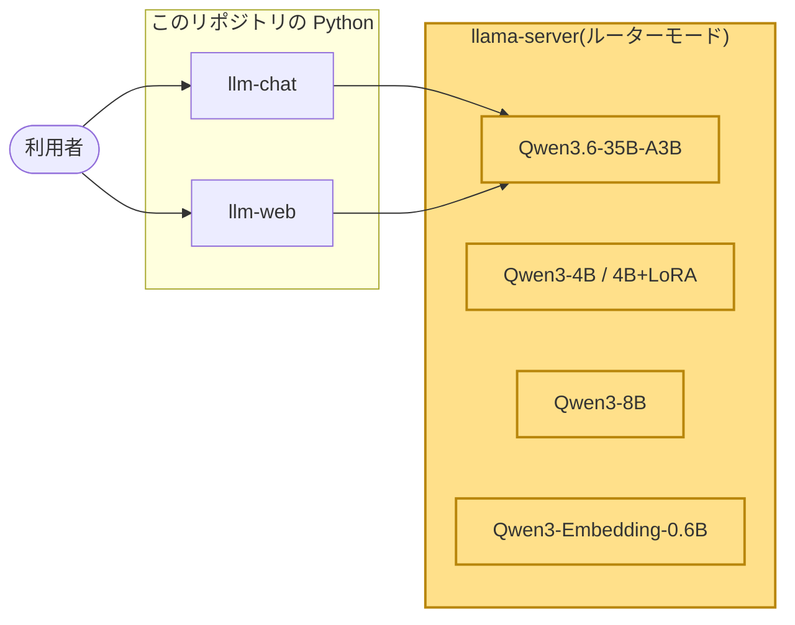
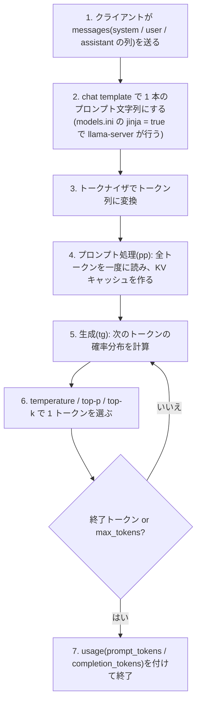
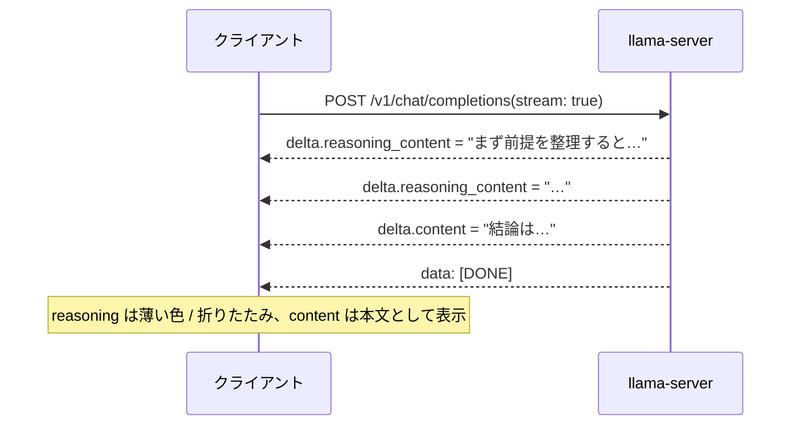

# 01. LLM の基礎: トークン、コンテキスト長、temperature、thinking、速度と VRAM

## この章で分かること

- モデルが文章をどういう単位(トークン)で読み書きし、一度にどれだけ読めるか(コンテキスト長)
- 応答のばらつきを決める temperature と、このプロジェクトでの設定値
- Qwen3 系モデルの thinking(推論過程)とは何か、API でどう切り替えるか
- 生成速度(tok/s)が VRAM にどう左右されるか。Phase 0 で 3 つのモデルを比べて何が分かったか

## 前提となる用語

| 用語 | 1 行説明 |
| --- | --- |
| トークン | モデルが扱う文章の最小単位。単語や文字の断片。日本語はおおよそ 1〜2 文字で 1 トークン |
| トークナイザ | 文章をトークン列に変換する(逆も行う)部品。モデルごとに語彙が違う |
| コンテキスト長(ctx-size) | モデルが一度に読める最大トークン数。質問と応答と過去の会話がすべてここに入る必要がある |
| KV キャッシュ | 読んだトークンごとに GPU に残す中間計算の記憶。コンテキスト長に比例して VRAM を使う |
| temperature | 次のトークンを選ぶときの「ばらつき」の度合い。0 なら毎回同じ、1 なら確率どおりに揺れる |
| top-p / top-k / min-p | 候補トークンを絞る追加の規則。確率上位の一定範囲からだけ選ぶ |
| thinking(推論過程) | Qwen3 系が本文の前に出す「考え中」のテキスト。API では `reasoning_content` として本文と別に届く |
| chat template | 「system / user / assistant」の会話を 1 本のプロンプト文字列に組み立てる型。モデルごとに決まっている |
| tok/s | 1 秒あたりのトークン数。pp(プロンプト処理)と tg(生成)で分けて測る |
| MoE / dense | MoE は「層ごとに一部の専門家だけ使う」構造、dense は毎回すべての重みを使う構造 |

## 全体のどこに当たるか

この章はコードではなく、llama-server とモデルそのものの性質を扱う。図では右側のサーバ全体が対象。



## 何をしているか

### 1 回の応答で何が起きるか



ポイントは 2 つ。プロンプト処理(pp)は一度にまとめて計算できるので速く、生成(tg)は 1 トークンずつ順に計算するので遅い。
`bench/` の表で pp512 が数千 tok/s、tg128 が数十〜百数十 tok/s と桁が違うのはこのため。

### コンテキスト長と VRAM

`models.ini` の共通設定は `ctx-size = 8192`。これを超える会話は llama-server がエラー(HTTP 400)を返す。
04 章のエージェントでツール出力を合計 6,000 字に制限しているのは、この 8,192 トークンの中に system prompt とツール定義と履歴を収めるため。

コンテキストを大きくすると KV キャッシュの分だけ VRAM が増える。35B モデル(エキスパートは CPU)での実測:

| ctx-size | VRAM 使用(MiB) | 起動前比 |
| --- | --- | --- |
| 8192 | 5644 | +3906 |
| 16384 | 5820 | +4082 |
| 32768 | 6296 | +4558 |

(`bench/ctx-vram-20261025-175920.md`、起動前の VRAM 使用 1738 MiB)。8k から 32k にしても +650 MiB で、12 GB なら 32k まで余裕がある。

### temperature とサンプリング

`models.ini` の `[*]` には `temp = 1.0`、`top-p = 0.95`、`top-k = 20`、`min-p = 0.0` と書いてある。これは Qwen3 の推奨値で、クライアントが何も指定しなければこの値で生成される。
`LlamaClient.chat()` は `temperature` を指定したときだけリクエストに入れる(`_build_payload()`)。

| 場面 | temperature | 理由 |
| --- | --- | --- |
| CLI / Web UI の会話 | 指定しない(サーバ既定 1.0) | 会話は多少の揺れがあってよい |
| 評価(06 章)の回答と採点 | 0 | 同じ入力で同じ結果にしたい(再現性) |
| Q&A 合成(05 章) | 0.7 | 3 組の Q&A に変化が欲しいが、崩れすぎない値 |

temperature 0 でも llama.cpp の実装上わずかに非決定的な部分があり、再実行で数問ぶれることがある(06 章「結果の限界」)。

### thinking(推論過程)

Qwen3 系モデルは、本文の前に `<think> ... </think>` で囲んだ推論過程を出す。llama-server は既定でこれを本文から分離し、SSE の `delta.reasoning_content` として別フィールドで返す。



thinking を止めるには、リクエストに `chat_template_kwargs: {"enable_thinking": false}` を付ける。これは chat template への引数で、`LlamaClient.chat(enable_thinking=False)` がこれを送る。
思考分のトークンを生成しないので速く短くなる(Phase 1 の実測では 35B で thinking あり 34 tok/s、なし 46 tok/s)。評価とエージェントは thinking off で動かしている。

過去の会話を送り直すとき、以前の thinking は `messages` に含めない(Qwen3 の推奨)。Web UI は DB に thinking を残すが、`build_prompt()` で送信から外す。

### 速度(tok/s)と VRAM の関係

GPU に載っている層は速く、CPU に残った層は遅い。モデルが VRAM に収まるかどうかが生成速度を決める。

| モデル | GGUF サイズ | GPU に載る層 | 生成 tg128 |
| --- | --- | --- | --- |
| Qwen3-4B Q4_K_M | 2.32 GiB | 全層(99) | 180.1 tok/s |
| Qwen3-8B Q4_K_M | 4.68 GiB | 全層(99) | 113.7 tok/s |
| Qwen3.6-35B-A3B(MoE) | 20.60 GiB | 注意層は GPU、エキスパートは CPU | 43.5 tok/s |
| Qwen3.8-27B(dense) | 15.32 GiB | 39 / 65 層 | 5.9 tok/s |

(`bench/bench-20261025-175710.md`、RTX 5070 12 GB、pp512 / tg128 / 3 回平均)

- 4B と 8B は丸ごと VRAM に入るので、サイズに反比例して速い。
- 27B は 15 GiB あり 12 GB に入らない。llama-server は空き VRAM に合わせて 39 層だけ GPU に載せ、残り 26 層を CPU で計算する。CPU 側が足を引っ張り 5.9 tok/s にとどまる。
- 35B-A3B は MoE で、毎回使うのは 3B 分だけ。`cpu-moe = true` でエキスパート(大部分の重み)を CPU に置き、注意層と KV キャッシュだけ GPU に置く。重みの大半が CPU にあっても計算量が 3B 相当なので 43.5 tok/s 出る。

### Phase 0 のモデル選定で比べたこと

Phase 0 では「12 GB で動く会話用モデル」を決めるために、dense 27B、MoE 35B-A3B、dense 8B の 3 つを `models.ini` に登録して試した。
ベンチの数値は Phase 6 で計測を済ませたもので、結論は次のとおり(README「普段使いのモデル」)。

| 候補 | 判断 |
| --- | --- |
| 27B dense | 品質は高いが 5.9 tok/s で会話に遅すぎる。登録は残すが普段は使わない |
| 35B-A3B(MoE) | 43.5 tok/s で読む速さを超え、06 章の評価でも素の正答率が 4B 系より高い(36.0% 対 18.4%)。既定モデルに採用 |
| 8B dense | 113.7 tok/s と速く丸ごと GPU に載る。06 章で採点モデルとして使う |

## 使っているアルゴリズム・技術と、なぜそれを選んだか

| 技術 | 役割 | なぜこれか |
| --- | --- | --- |
| Q4_K_M 量子化 | 重みを 4bit にしてサイズを約 1/4 にする | 品質低下が小さいとされる標準的な方式。配布元(unsloth)が用意している |
| `cpu-moe` | MoE のエキスパートを CPU に置く | 20 GiB のモデルを 12 GB の GPU で 43 tok/s で動かす唯一の現実的な手段 |
| `n-gpu-layers = auto` | 空き VRAM に合わせて GPU に載せる層数を自動で決める | 27B のように収まらないモデルでも落ちずに動く |
| `chat_template_kwargs.enable_thinking` | thinking の有無を API から切り替える | 用途(会話 / 評価 / エージェント)ごとに速度と出力の形を揃えられる |
| temperature 0 + JSON Schema(06 章) | 採点を再現可能にする | 同じ入力で同じ点にしたい。形式を Schema で固定するとパース失敗が無くなる |

## 実際のコードの場所

| 場所 | 内容 |
| --- | --- |
| `models.ini` `[*]` | `ctx-size`、`temp`、`top-p`、`top-k`、`min-p`、`n-gpu-layers = auto`、`jinja = true` |
| `models.ini` `[unsloth/Qwen3.6-35B-A3B-GGUF:UD-Q4_K_M]` | `cpu-moe = true` |
| `src/local_llm/client.py` `LlamaClient._build_payload()` | `temperature`、`max_tokens`、`chat_template_kwargs` をリクエストに付ける条件 |
| `src/local_llm/client.py` `LlamaClient._parse_stream_event()` | `delta.reasoning_content` を `ChatChunk.reasoning` に、`usage` を `Usage` に変換 |
| `src/local_llm/client.py` `ThinkTagSplitter` | 本文に `<think>` が混ざった場合の予備の分離 |
| `src/local_llm/cli.py` `ChatSession._print_stats()` | `completion_tokens / (経過秒 - 初トークンまでの秒)` で tok/s を出す |
| `scripts/bench.ps1` / `scripts/ctx-vram.ps1` | llama-bench と VRAM 計測。結果は `bench/` |

## 動かして確かめる方法

thinking の有無と速度の違いを CLI で見る:

```powershell
uv run llm-chat                       # thinking あり。[thinking] が薄い色で先に出る
uv run llm-chat --no-think            # thinking なし。応答末尾の tok/s が上がる
```

CLI の中で `/think on` `/think off` でも切り替えられる。応答の末尾に `(prompt N tok / completion M tok, X tok/s, Y s)` が出る。

トークン数を API で直接見る:

```powershell
curl http://127.0.0.1:8080/v1/chat/completions -H "Content-Type: application/json" -d '{"model":"unsloth/Qwen3-4B-GGUF:Q4_K_M","messages":[{"role":"user","content":"こんにちは"}],"chat_template_kwargs":{"enable_thinking":false}}'
```

応答 JSON の `usage.prompt_tokens` と `usage.completion_tokens` がトークン数。`prompt_tokens` には chat template が足す制御トークンも含まれる。

速度と VRAM を測り直す(llama-server を止めてから):

```powershell
.\scripts\bench.ps1 -Models "unsloth/Qwen3-4B-GGUF:Q4_K_M"   # bench/bench-<日時>.md に pp512 / tg128
.\scripts\ctx-vram.ps1                                        # bench/ctx-vram-<日時>.md に ctx ごとの VRAM
```
