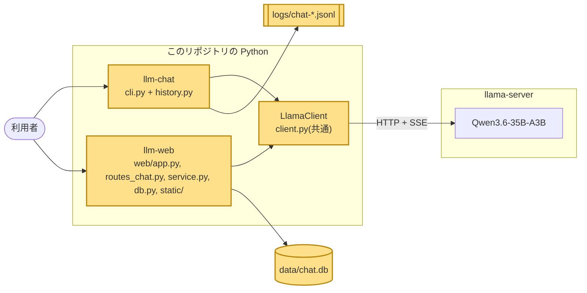
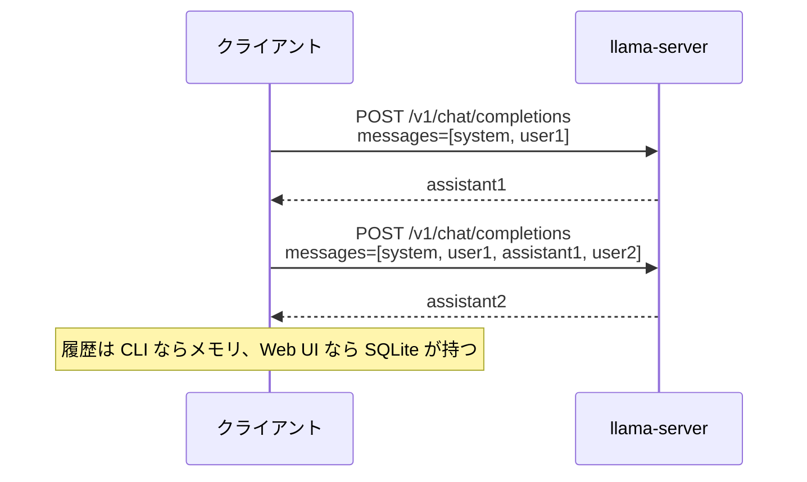
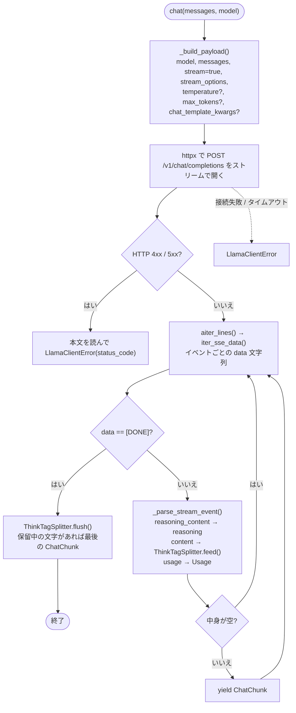
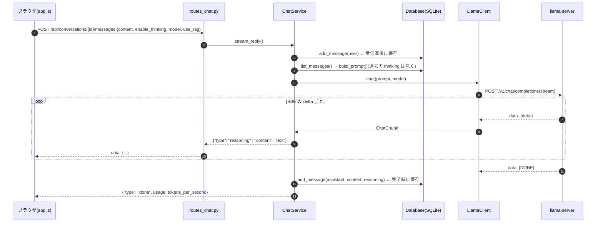

# 02. チャットクライアント: OpenAI 互換 API、ストリーミング、CLI と Web UI

## この章で分かること

- OpenAI 互換 API の「会話」が、過去のやり取りを毎回送り直す仕組みであること
- HTTP のストリーミング(SSE)で応答が少しずつ届く仕組みと、それを自前でパースする理由
- `LlamaClient` の中身(ペイロード組み立て、SSE パース、thinking の分離、エラーの包み方)
- CLI(`llm-chat`)と Web UI(`llm-web` = FastAPI + ブラウザ + SQLite)の役割分担

## 前提となる用語

| 用語 | 1 行説明 |
| --- | --- |
| HTTP | ブラウザや curl がサーバと話す規約。リクエストを送り、レスポンスを受け取る |
| REST / エンドポイント | `GET /api/models` のような「メソッド + パス」で機能を呼ぶ API の形 |
| OpenAI 互換 API | `POST /v1/chat/completions` に `messages` を送ると応答が返る、OpenAI 社と同じ形式の API |
| messages / role | 会話の配列。各要素は `{"role": "system" \| "user" \| "assistant", "content": "..."}` |
| ステートレス | サーバが前回のやり取りを覚えていないこと。だから毎回全履歴を送る |
| ストリーミング | 応答を全部作ってから返すのではなく、できた端から少しずつ返すこと |
| SSE(Server-Sent Events) | HTTP レスポンスを閉じずに `data: ...` 行を空行区切りで送り続ける形式 |
| httpx | Python の HTTP クライアントライブラリ。非同期(async)でストリーミングを読める |
| 非同期(async / await) | 待ち時間(ネットワーク)の間に他の処理を進める書き方。ストリーミング表示に向く |
| FastAPI / uvicorn | Python の Web フレームワークと、それを動かすサーバ |
| SQLite | ファイル 1 つで動く組み込みデータベース。Python 標準ライブラリで使える |
| JSONL | 1 行 1 JSON のテキストファイル。CLI の会話ログに使う |

## 全体のどこに当たるか



## 何をしているか

### 会話は「全履歴を毎回送る」

llama-server は前回の会話を覚えていない。クライアントが `messages` に過去の user / assistant をすべて積み直して送る。



履歴が長くなると 01 章のコンテキスト長(8192 トークン)を超えてエラーになる。CLI の `/clear` はこの履歴を空にするコマンド。

### ストリーミング(SSE)の中身

`stream: true` を付けると、llama-server はレスポンスを閉じずに次の形で送り続ける。

```
data: {"choices":[{"delta":{"reasoning_content":"まず"}}]}

data: {"choices":[{"delta":{"content":"こん"}}]}

data: {"choices":[{"delta":{"content":"にちは"}}]}

data: {"choices":[],"usage":{"prompt_tokens":12,"completion_tokens":80,"total_tokens":92}}

data: [DONE]
```

規則は「`data:` 行が空行で区切られる」「`[DONE]` が終端」だけで、`LlamaClient` は httpx の `aiter_lines()` で行を読み `iter_sse_data()` でイベントに切る。
最後の `usage` は `stream_options.include_usage` を付けたときだけ届き、tok/s の計算に使う。

### `LlamaClient.chat()` の処理の流れ



`ChatChunk` は `content`、`reasoning`、`finish_reason`、`usage` を持つ小さなデータ型で、CLI も Web UI もこれだけを見ればよい。

`ThinkTagSplitter` は、本文に `<think>...</think>` が混ざって届いた場合の予備の分離器。タグがチャンク境界で `<thi` と `nk>` に分かれても扱えるよう、タグの先頭と一致する末尾を次のチャンクまで保留する状態機械になっている。

### CLI と Web UI の役割分担

同じ `LlamaClient` を使い、違うのは「履歴の置き場」と「表示の仕方」だけ。

| 観点 | CLI(`llm-chat`) | Web UI(`llm-web`) |
| --- | --- | --- |
| 履歴 | メモリ上の `list[Message]` | SQLite の `conversations` / `messages` 表 |
| 記録 | `logs/chat-<日時>.jsonl` に 1 メッセージ 1 行 | DB がそのまま記録。リロードしても残る |
| 表示 | `rich` でターミナルに逐次出力 | ブラウザの JavaScript が SSE を読んで逐次描画 |
| 失敗時 | user 発言を履歴から外し赤字表示 | 途中までの本文を DB に保存し `error` イベント |

Web UI は SSE が二段構えになる。llama-server → `LlamaClient`(OpenAI の形)、`routes_chat.py` → ブラウザ(自前の `{"type": ..., "text": ...}` の形)。ブラウザに llama-server の生の形式を知らせないための変換で、04 章のエージェントや 06 章の評価はこの Web API を再利用する。



保存が 2 回に分かれている理由は、途中で llama-server が落ちたりブラウザが閉じられたりしても user 発言とそこまでの本文を失わないため。`stream_reply()` の `save_partial()` が `finally` で呼ばれる。

## 使っているアルゴリズム・技術と、なぜそれを選んだか

| 技術 | 役割 | なぜこれか |
| --- | --- | --- |
| httpx で直接叩く(openai SDK を使わない) | API クライアント | SSE のパースまで自分で書くことが学習目的に合う。依存が軽く、llama-server 固有の `reasoning_content` や `chat_template_kwargs` も素直に扱える |
| SSE の自前パース(`iter_sse_data`) | ストリーミング受信 | 形式が単純で、`data:` 行と空行だけ見ればよい。CRLF と複数 `data:` 行にも対応 |
| `ThinkTagSplitter`(状態機械) | thinking の予備分離 | llama-server は通常 `reasoning_content` で分けて返すが、設定によっては本文に `<think>` が混ざる。両方に備える |
| 例外を `LlamaClientError` に統一 | エラー処理 | 接続失敗・タイムアウト・HTTP エラー・ストリーム内エラーを呼び出し側で 1 種類だけ捕まえればよい |
| FastAPI + 素の HTML/JS | Web UI | ビルド工程なしで動く。Markdown 描画だけ CDN の marked を使う |
| SQLite(標準ライブラリ) | 会話の永続化 | ファイル 1 つで済み、03 章の RAG 索引も同じファイルに入れられる |
| 呼び出しごとに `sqlite3.connect()` | DB 接続 | FastAPI が同期ルートをスレッドプールで動かしても安全 |
| ブラウザ向け SSE を `{type, text}` に詰め直す | フロントとの契約 | llama-server の形式に依存しない。`sources`(03 章)のような独自イベントを足せる |

## 実際のコードの場所

| 場所 | 関数 / クラス | 内容 |
| --- | --- | --- |
| `src/local_llm/types.py` | `Message`、`ChatChunk`、`Usage` | 送信メッセージと応答断片の型 |
| `src/local_llm/client.py` | `LlamaClient.chat()`、`_build_payload()`、`_parse_stream_event()` | API 呼び出しと SSE → `ChatChunk` の変換 |
| `src/local_llm/client.py` | `iter_sse_data()` | SSE の行 → イベント |
| `src/local_llm/client.py` | `ThinkTagSplitter.feed()` / `flush()` | `<think>` の分離 |
| `src/local_llm/client.py` | `LlamaClient.health()`、`list_models()` | `GET /health`、`GET /v1/models` |
| `src/local_llm/config.py` | `Settings`、`load_settings()` | `LLAMA_BASE_URL`、`LLM_DEFAULT_MODEL` などを `.env` から読む |
| `src/local_llm/cli.py` | `ChatSession.run()`、`ask()`、`handle_command()` | 入力ループ、1 往復、スラッシュコマンド |
| `src/local_llm/history.py` | `ChatLogger.append()` | JSONL への追記 |
| `src/local_llm/web/app.py` | `create_app()`、`main()` | FastAPI アプリの組み立てと uvicorn 起動 |
| `src/local_llm/web/routes_chat.py` | `send_message()`、`_sse()` | `/api/*` のエンドポイントと SSE 文字列化 |
| `src/local_llm/web/service.py` | `ChatService.stream_reply()`、`build_prompt()` | DB ↔ `LlamaClient` の橋渡し、部分保存 |
| `src/local_llm/web/db.py` | `Database.add_message()`、`list_messages()`、`init_schema()` | SQLite のスキーマと CRUD |
| `src/local_llm/web/static/app.js` | `sendMessage()`、`readSse()`、`checkHealth()` | fetch + `ReadableStream` で SSE を読み、逐次描画。15 秒ごとに疎通確認 |

コードを読む順番は `types.py` → `client.py` の `chat()` → `web/service.py` の `stream_reply()` → `routes_chat.py` → `app.js` の `readSse()` が追いやすい。

## 動かして確かめる方法

```powershell
.\scripts\start-server.ps1               # 別ターミナル
uv run llm-chat                          # you> に入力。/model で一覧、/model <id> で切替、/quit で終了
uv run llm-web                           # http://127.0.0.1:8000 をブラウザで開く
```

SSE を生で見る(curl の `-N` でバッファリングを切る):

```powershell
curl -N http://127.0.0.1:8080/v1/chat/completions -H "Content-Type: application/json" -d '{"model":"unsloth/Qwen3-4B-GGUF:Q4_K_M","messages":[{"role":"user","content":"1 から 5 まで数えて"}],"stream":true,"stream_options":{"include_usage":true}}'
```

`data: {...}` が少しずつ流れ、最後に `usage` 付きの行と `data: [DONE]` が出る。

Web API を直接叩く(`llm-web` 起動中。FastAPI の自動ドキュメントは http://127.0.0.1:8000/docs):

```powershell
curl -X POST http://127.0.0.1:8000/api/conversations -H "Content-Type: application/json" -d '{}'
curl -N -X POST http://127.0.0.1:8000/api/conversations/1/messages -H "Content-Type: application/json" -d '{"content":"こんにちは","enable_thinking":false}'
```

自分の Python から使う:

```python
import asyncio
from local_llm import LlamaClient, Message

async def main():
    async with LlamaClient("http://127.0.0.1:8080") as client:
        async for chunk in client.chat([Message("user", "こんにちは")], "unsloth/Qwen3-4B-GGUF:Q4_K_M"):
            print(chunk.content, end="", flush=True)

asyncio.run(main())
```

GPU なしのテスト(llama-server は respx でモック):

```powershell
uv run pytest tests/test_client.py tests/test_web.py -q
```
