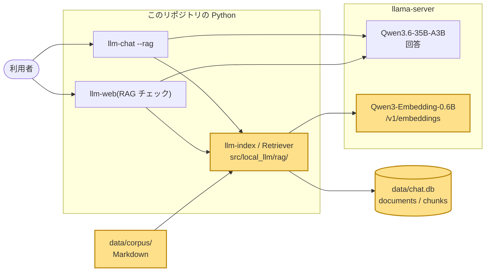
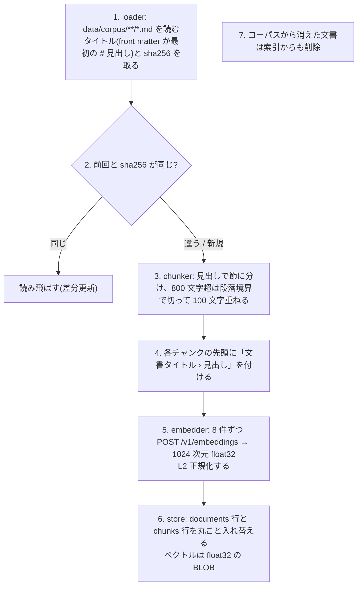
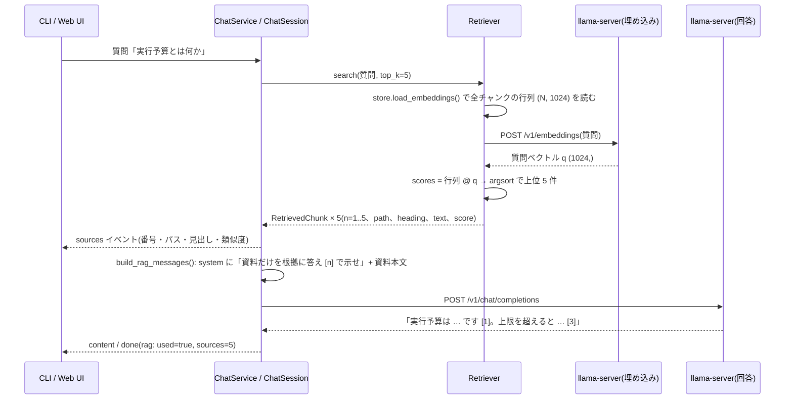

# 03. RAG: 文書を検索して根拠付きで答えさせる

## この章で分かること

- RAG(検索拡張生成)とは何か、なぜ「モデルに覚えさせる」より先に試すのか
- 文書をチャンクに分け、埋め込み(ベクトル)にし、コサイン類似度で検索し、プロンプトに差し込むまでの流れ
- 回答の `[n]` 引用がどう付くか、出典がどう画面に届くか
- なぜベクトル DB を入れず、SQLite と numpy の総当たりで足りるのか

## 前提となる用語

| 用語 | 1 行説明 |
| --- | --- |
| RAG(Retrieval-Augmented Generation) | 質問に関係する文書片を検索してプロンプトに足し、それを根拠に答えさせる手法 |
| コーパス | 検索対象の文書集合。ここでは `data/corpus/` 配下の Markdown |
| チャンク | 文書を検索しやすい長さに切った断片。ここでは見出し単位、約 800 文字 |
| 埋め込み(embedding) | 文章を固定長の数値ベクトル(ここでは 1024 次元)にしたもの。意味が近い文章はベクトルも近い |
| 埋め込みモデル | 文章からベクトルを作る専用のモデル。会話用モデルとは別物で、文章を生成しない |
| コサイン類似度 | 2 本のベクトルの向きの近さ。1 が同じ向き、0 が無関係。長さを 1 に揃えてあれば内積と同じ |
| L2 正規化 | ベクトルの長さを 1 に揃えること。これをしておくと内積がそのままコサイン類似度になる |
| top-k | 類似度の上位 k 件。既定 5 |
| pooling | トークンごとのベクトルを 1 本にまとめる方法。Qwen3-Embedding は `last`(最終トークン)を使う |
| system メッセージ | モデルへの指示を書く先頭のメッセージ。資料はここに差し込む |

## 全体のどこに当たるか



## 何をしているか

RAG は「索引を作る」と「質問に答える」の 2 つの処理に分かれる。索引は文書が変わったときだけ作り直し、検索は質問のたびに行う。

### 索引を作る(`uv run llm-index`)



実測(Phase 6 時点): 36 文書(このリポジトリの README + docs と ai_harness の Markdown 21 本)から 1,168 チャンク。
Phase 3 時点では ai_harness だけで 19 文書 433 チャンク、索引作成は約 20 秒だった。

### 質問に答える(`use_rag=true`)



### 検索の中身: 行列積 1 回

`Retriever.search()` の核心は次の 3 行に相当する。

```python
ids, matrix = self.store.load_embeddings(self.embedder.model)   # (N, 1024)、各行は長さ 1
q = await self.embedder.embed_query(query)                       # (1024,)、長さ 1
scores = matrix @ q                                              # N 個のコサイン類似度
order = np.argsort(-scores)[:top_k]
```

埋め込みを保存時に L2 正規化してあるので、内積がそのままコサイン類似度になる。1,168 × 1,024 の float32 行列は約 4.8 MB で、行列積はミリ秒で終わる。

類似度の例(Phase 3 の実測): 「実行予算とは何か」と資料「Execution Budget の例」が 0.78、「Fencing Token とは」と該当資料が 0.48。

### プロンプトへの差し込みと `[n]` 引用

`build_rag_messages()` は履歴の先頭に次の system メッセージを置く(既に system があれば連結する)。

```
あなたは資料に基づいて回答するアシスタントです。以下の資料だけを根拠に答え、使った資料を本文中で [n] の形で示してください。
資料に書かれていないことは「資料にはありません」と答え、推測で補わないでください。

## 資料

[1] ai_harness/docs/core/glossary.md › 用語集 > Execution Budget
(チャンク本文)

[2] ...
```

`[n]` を付けるのはモデルの仕事で、コードは番号付きの資料を渡すだけ。番号は `RetrievedChunk.n`(1 始まり)で、`sources` イベントの番号と一致するので、UI は本文の `[1]` と出典リストの 1 番を対応付けられる。
引用が付いたかどうかは 06 章の評価で「引用率」として測っている(35B で 91.2%、4B LoRA で 55.1%)。

資料は毎回検索し直すので、DB の会話には system メッセージを保存しない。検索に使うのは最新のユーザー発言だけで、過去の会話は検索語に含めない。

## 使っているアルゴリズム・技術と、なぜそれを選んだか

| 技術 | 役割 | なぜこれか |
| --- | --- | --- |
| 見出し単位のチャンク分割(800 字、重なり 100 字) | 検索の単位を「1 つの話題」にする | Markdown は見出しが話題の境界。800 字は日本語で 1 トークン ≒ 1 文字として埋め込みモデルの ctx(4096)に余裕で収まる。重なりは節の切れ目で文脈が途切れるのを和らげる |
| 「タイトル › 見出し」を本文に前置して埋め込む | どの文書・節の話かをベクトルに含める | 同じ語が複数文書に出るとき、文書名が手がかりになる |
| Qwen3-Embedding-0.6B(`pooling = last`) | 文章 → 1024 次元ベクトル | 会話用モデルと同じ llama-server のルーターモードで配信できる(`embeddings = true`)。別プロセスを増やさない |
| コサイン類似度(正規化済み内積) | 質問とチャンクの近さ | 埋め込みモデルの標準的な使い方。長さに依存せず向きだけを比べる |
| numpy の総当たり + SQLite の BLOB | ベクトルの保存と検索 | 数千チャンクなら行列積 1 回で済む。ベクトル DB(FAISS、sqlite-vec など)は「失敗を見てから足す」方針で入れていない。数万チャンクを超えたら `store.py` と `retriever.py` だけ差し替えれば済む構造 |
| sha256 による差分更新 | 索引の再作成を速くする | 文書が変わっていなければ埋め込み API を呼ばない。`--force` で全部作り直せる |
| `sources` を本文より先に流す | UI が出典を先に表示できる | 検索と生成は独立しているので、検索が終わった時点で出せる。検索失敗なら生成を呼ばず `error` だけ返す |

### なぜ RAG を先に試すのか

モデルは学習時点の知識しか持たず、このリポジトリ固有の内容(ファイル名、設定値)は知らない。
知識を足す方法は「毎回資料を渡す(RAG)」と「重みに学習させる(05 章の LoRA)」の 2 つで、RAG は学習が不要で文書の更新にすぐ追従し、出典を示せる。
06 章の評価では、RAG が正答率を 36.0% → 53.7%(35B)、21.8% → 66.7%(4B LoRA)に上げ、LoRA 単体の +3.4 pt より効果が大きかった。

## 実際のコードの場所

| 場所 | 関数 / クラス | 内容 |
| --- | --- | --- |
| `src/local_llm/rag/loader.py` | `load_documents()`、`extract_title()` | Markdown を読み、`Document(path, title, text, sha256)` にする |
| `src/local_llm/rag/chunker.py` | `chunk_text()`、`split_sections()`、`_split_long()` | 見出し分割と 800 / 100 文字の分割。コードフェンス内の `#` は見出し扱いしない |
| `src/local_llm/rag/embedder.py` | `Embedder.embed_texts()`、`normalize()` | 8 件ずつ `LlamaClient.embed()` を呼び、L2 正規化 |
| `src/local_llm/client.py` | `LlamaClient.embed()` | `POST /v1/embeddings`。`data[].index` で順序を揃える |
| `src/local_llm/rag/store.py` | `RagStore.replace_document()`、`load_embeddings()`、`get_chunks()` | `documents` / `chunks` 表。ベクトルは `float32.tobytes()` |
| `src/local_llm/rag/retriever.py` | `Retriever.search()`、`RetrievedChunk` | 行列積 → argsort → 上位 k 件に `n` を振る |
| `src/local_llm/rag/prompt.py` | `RAG_SYSTEM_PROMPT`、`build_rag_messages()`、`format_context()` | system メッセージの組み立て |
| `src/local_llm/rag/indexer.py` | `index_corpus()`、`main()` | `llm-index` の入口。差分更新と削除 |
| `src/local_llm/web/service.py` | `ChatService.stream_reply()`、`build_prompt()` | Web UI 側の検索 → `sources` → 生成 |
| `src/local_llm/cli.py` | `ChatSession._retrieve()`、`_command_rag()` | CLI 側の検索と `/rag on|off` |
| `src/local_llm/web/routes_chat.py` | `rag_status()`、`rag_search()` | `GET /api/rag/status`、`GET /api/rag/search`(04 章のツールが使う) |
| `models.ini` `[Qwen/Qwen3-Embedding-0.6B-GGUF:Q8_0]` | | `embeddings = true`、`pooling = last`、`hf-repo` 必須 |
| `scripts/agent/eval_retrieval.py` | | 検索精度の評価(10 問、top-3 で 10/10) |

## 動かして確かめる方法

```powershell
.\scripts\start-server.ps1               # 別ターミナル
.\scripts\fetch-corpus.ps1               # ai_harness の Markdown を data/corpus/ai_harness/ に取得(初回のみ)
.\scripts\sync-local-corpus.ps1          # README と docs/ を data/corpus/local_llm/ にコピー
uv run llm-index                         # 期待: 「更新 36 文書 / 変更なし 0 文書 / 削除 0 文書 / 新規チャンク 1168 件」(数は文書の版で変わる)
uv run llm-index                         # もう一度。期待: 「更新 0 文書 / 変更なし 36 文書 …」(差分更新が効いている)
uv run llm-chat --rag                    # 質問すると先に [1] path › 見出し (0.72) の出典が並び、本文に [1] が付く
```

検索だけを API で確かめる(`llm-web` 起動中):

```powershell
curl "http://127.0.0.1:8000/api/rag/search?q=Fencing+Token+とは&top_k=3"
curl http://127.0.0.1:8000/api/rag/status
```

検索精度の評価(実サーバが必要):

```powershell
uv run python scripts/agent/eval_retrieval.py    # 期待: PASS: 10/10 hit@3 (threshold 8)
```

GPU なしのテストでは `tests/rag/conftest.py` が `/v1/embeddings` を疑似ベクトル(単語ごとに 1 次元を立てる 32 次元)でモックしている。

```powershell
uv run pytest tests/rag -q
```
