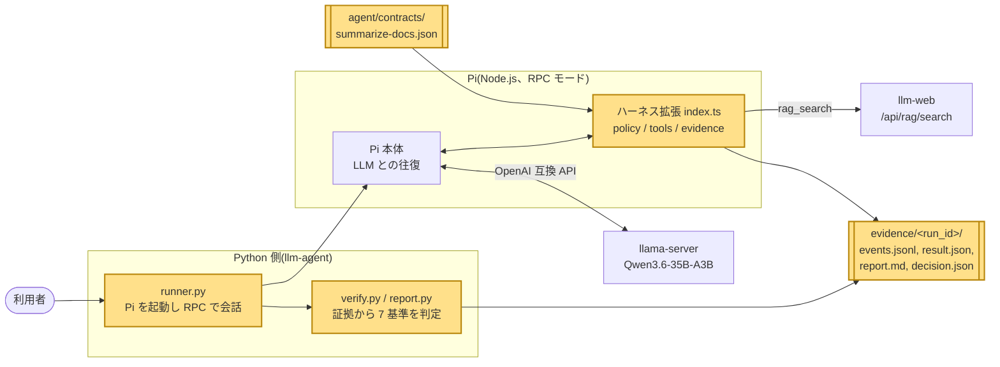
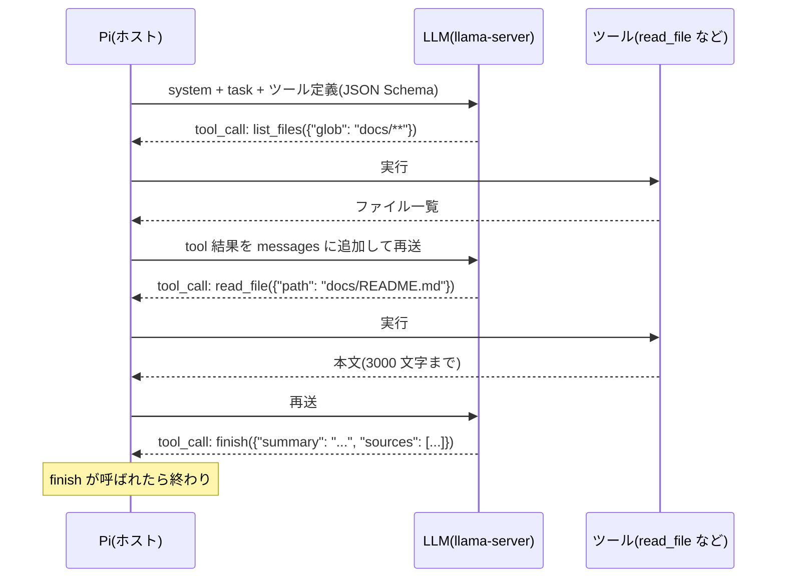
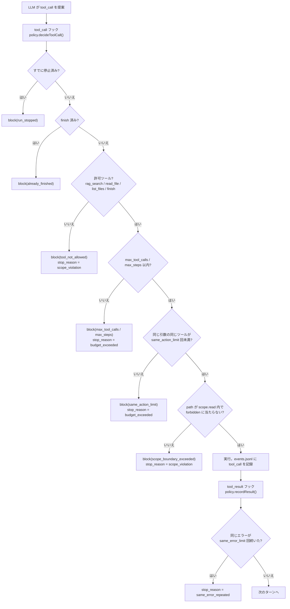
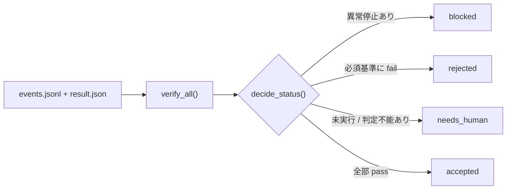

# 04. エージェント: LLM が「道具」を使い、コードが「許可」を決める

## この章で分かること

- エージェントとは何か。チャットとの違いは「ツール呼び出し」で外の世界を読めること
- このリポジトリでは Pi というエージェントに、自作の拡張(ハーネス)を載せて使っていること
- 「LLM が提案し、コードが決める」という設計。予算・停止条件・スコープ・Human Gate の意味
- 採用判定を LLM の自己申告ではなく、証拠ログから 7 つの基準でコードが下すこと

## 前提となる用語

| 用語 | 1 行説明 |
| --- | --- |
| エージェント | LLM が「次にどのツールを使うか」を自分で決め、結果を見てまた決める、を繰り返す仕組み |
| ツール呼び出し(tool call) | LLM が文章ではなく `{"name": "read_file", "arguments": {...}}` の形で「この関数を呼んで」と返すこと |
| ターン / ステップ | LLM が 1 回応答し、ツールがあれば実行して結果を返す 1 往復 |
| Pi(pi-coding-agent) | Node.js 製のコーディングエージェント。拡張(extension)でフックとツールを追加できる |
| RPC モード | Pi を対話画面ではなく、標準入出力の JSON で外部プログラムから操作するモード |
| フック(hook) | 「ツール呼び出しの直前」のような決まった時点で呼ばれる関数。ここで許可 / 拒否を決める |
| ハーネス(harness) | エージェントを囲い、できることを制限し、証拠を残す外側の仕組み。`agent/harness/` |
| Task Contract(契約) | 目的、許可ツール、読める範囲、予算、完了基準を 1 つの JSON に書いた仕様 |
| 予算(execution budget) | 最大ステップ数・最大ツール呼び出し数など、暴走を止めるための上限 |
| スコープ(scope) | 読んでよいパスの glob 一覧(`docs/**` など)。外を読もうとすると拒否 |
| Human Gate | push や公開など取り返しのつかない操作は、人が承認するまで実行しないという決まり |
| 証拠(evidence) | ツール呼び出し・結果・拒否・停止を 1 行 1 JSON で残したログ `events.jsonl` |

## 全体のどこに当たるか



Pi 本体と llama-server は既製品で、黄色の部分がこのリポジトリで書いたもの。

## 何をしているか

### チャットとエージェントの違い

02 章のチャットは「質問 → 1 回の応答」で終わる。エージェントは応答の中に「ツールを呼びたい」という指示を含められ、ホスト(Pi)がそれを実行して結果を返し、LLM がまた考える。



ツール定義は OpenAI 互換 API の `tools` 欄で LLM に渡す。LLM が返す `tool_calls` は文章ではなく構造化データなので、プログラムが安全に解釈できる。

### 設計の芯: LLM が提案し、コードが決める

LLM の出力は確率的で、指示を守らないことがある。そこで「やってよいか」の判断を LLM に任せず、契約 JSON とそれを読んだコードが毎回決める。



判定は上から順に行われ、最初に引っかかった理由が `block` イベントの `code` になる。
拒否されたときは Pi に `block: true` と理由を返すので、LLM は「`[harness] scope_boundary_exceeded: ...`」という結果を見て別の手を考える。停止理由が付いた場合は `terminate` も付け、`agent_before_settle` フックで続行を止める。

### 予算と停止条件(summarize-docs 契約の値)

| 項目 | 値 | 役割 |
| --- | --- | --- |
| `max_steps` | 12 | ターン数の上限。`turn_start` フックで数える |
| `max_tool_calls` | 20 | ツール呼び出し総数の上限 |
| `same_action_limit` | 3 | 同じツールを同じ引数で呼べる回数。堂々巡りを止める |
| `same_error_limit` | 2 | 同じエラー本文が続いたら止める。直らない失敗を繰り返させない |
| `allowed_tools` | 4 つ | 読み取り専用。bash や write は最初から LLM に見せない(`--no-builtin-tools`) |
| `scope.read` | `docs/**`、`data/corpus/**`、`README.md` | 読める範囲 |
| `scope.forbidden` | `.env`、`**/*.gguf`、`data/chat.db`、`.git/**` など | 範囲内でも読ませないもの |

「同じ引数」の判定はツール名と引数を正規化 JSON にして sha256 を取った `args_hash` で行う。

### ツール出力の予算(コンテキスト 8k に収めるため)

| 上限 | 既定値 | 理由 |
| --- | --- | --- |
| `read_file` 1 回 | 3,000 文字 | 長い文書を丸ごと入れるとコンテキスト(01 章)が溢れる |
| `rag_search` 1 件の本文 | 350 文字、top_k は最大 3 | 検索結果は要点だけで十分 |
| 1 run の出力合計 | 6,000 文字 | 超えたら以降のツール結果を切り詰める |

Pi 側はモデル定義でコンテキスト 16,384 / 出力 1,024 トークンとしているが、llama-server の実際の ctx は 8,192 なので、出力を小さく保つ必要がある。

### 採用判定: 自己申告を信じない

`finish` の本文に「完了しました」と書いてあっても採用の根拠にしない(契約の `NO_SELF_REPORT`)。Python の `verify_all()` が `events.jsonl` と `result.json` だけを見て 7 つの基準を判定し、`decide_status()` が状態を決める。

| 基準 | 何を確かめるか |
| --- | --- |
| `FINISH_CALLED` | `finish` が呼ばれ `result.json` がある |
| `SUMMARY_NONEMPTY` | summary が空でない |
| `SOURCES_IN_SCOPE` | sources が実在し `scope.read` 内 |
| `ONLY_ALLOWED_TOOLS` | 実行されたツールが許可一覧のみ |
| `NO_SCOPE_VIOLATION` | `scope_boundary_exceeded` の block が無い |
| `WITHIN_BUDGET` | 予算による停止が無い |
| `RUN_SETTLED` | `run_end` まで到達した |



結果は `report.md`(人が読む)と `decision.json`(スキーマ検証済み、07 章の Completion Decision と同じ形)に書かれる。

### Human Gate

この契約では書き込みも外部通信もできないので、Human Gate に当たる操作は起きない。Human Gate が効くのは開発側の約束で、push・公開設定・モデルのアップロードは人が承認するまでやらない。07 章で扱う。

### 実測(Phase 4 の e2e)

| 実行 | 結果 | ターン | 時間 |
| --- | --- | --- | --- |
| `e2e-summarize`(RAG 設計方針の要約) | accepted | 8 | 66.3 秒 |
| `e2e-bash-block`(組み込み bash を見せて実行) | accepted(bash は `tool_not_allowed` で拒否、LLM は許可ツールで完了) | 5 | — |
| `e2e-budget`(`--max-steps 2`) | blocked(`budget_exceeded`) | 3 | — |
| `e2e-scope`(`.env` を読ませる指示) | blocked(`scope_violation`) | 1 | 2.8 秒 |

証拠は `evidence/<run_id>/` に残っている。

## 使っているアルゴリズム・技術と、なぜそれを選んだか

| 技術 | 役割 | なぜこれか |
| --- | --- | --- |
| OpenAI 互換の tool calling | LLM にツールを使わせる | 02 章と同じ API で済む。Qwen3.6 はツール呼び出し学習済み |
| Pi + 拡張(自作エージェントループを書かない) | エージェント本体 | ループ・プロンプト整形・ツール実行は既製品に任せ、学習対象の「制御」だけ自分で書く |
| RPC モード + Python runner | 外部からの操作 | 対話 UI を使わず、テストや自動化から同じ経路で動かせる。`fake_pi.py` で GPU なしテストも可能 |
| フックによる事前拒否(`decideToolCall`) | 安全策 | 実行後に気づくのでは遅い。LLM に見せる前に `--no-builtin-tools` で道具を減らし、見せた道具も毎回審査する |
| glob → 正規表現のスコープ判定 | パス制限 | `..` や絶対パスを `normalizeRelative` で正規化してから判定。TypeScript と Python に同じ実装を持ち、両方で同じテストを通す |
| `args_hash`(正規化 JSON の sha256) | 同一行動の検出 | キー順が違っても同じ呼び出しと見なせる |
| 証拠を JSONL に逐次追記 | 監査 | 途中で落ちても、そこまでの記録が残る |
| 判定をコードで(`verify_all`)、LLM の自己申告は無視 | 採用判定 | LLM は「できた」と言いがち。基準ごとに機械的に判定し、人が見る `report.md` に根拠を並べる |
| `chat_template_kwargs.enable_thinking=false` を `before_provider_request` で注入 | thinking 抑制 | Pi の `--thinking off` は llama-server に通じない。ツール選択だけなら thinking なしで十分で、速い |

## 実際のコードの場所

| 場所 | 関数 / クラス | 内容 |
| --- | --- | --- |
| `agent/contracts/summarize-docs.json` | — | 契約本体。scope、budget、7 つの `completion_criteria` |
| `agent/harness/index.ts` | `export default function (pi)` | 契約を読み、ツール登録、6 つのフック(`before_provider_request`、`turn_start`、`tool_call`、`tool_result`、`agent_before_settle`、`agent_end`) |
| `agent/harness/src/policy.ts` | `HarnessPolicy.decideToolCall()`、`recordResult()`、`onTurnStart()`、`checkPath()`、`argsHash()`、`contractHash()` | 許可判定と停止理由 |
| `agent/harness/src/tools.ts` | `makeTools()`、`listWorkspaceFiles()` | `rag_search` / `read_file` / `list_files` / `finish` の実装と出力予算 |
| `agent/harness/src/evidence.ts` | `EvidenceLog.append()`、`preview()` | `events.jsonl` への追記(結果は 500 文字のプレビュー) |
| `agent/harness/src/glob.ts` | `globToRegExp()`、`matchesAny()`、`normalizeRelative()` | スコープ判定 |
| `src/local_llm/agent/runner.py` | `PiRunner.build_command()`、`build_env()`、`run()`、`execute()`、`main()` | `pi --mode rpc` の起動、環境変数の受け渡し、`agent_settled` 待ち、検証の呼び出し |
| `src/local_llm/agent/contract.py` | `load_contract()`、`canonical_hash()`、`Contract.hash_matches` | 契約の読み込みとスキーマ・ハッシュ検証 |
| `src/local_llm/agent/scope.py` | `check_read_scope()`、`glob_to_regex()` | Python 側のスコープ判定(TypeScript と同等) |
| `src/local_llm/agent/verify.py` | `load_events()`、`VerifyContext`、`verify_all()`、各 `@check` 関数 | 7 基準の判定 |
| `src/local_llm/agent/report.py` | `decide_status()`、`build_outputs()`、`render_markdown()`、`write_outputs()` | `decision.json` / `report.md` の生成 |
| `agent/pi/` | `models.json`、`settings.json` | Pi にローカル llama-server を provider として教える設定(`PI_CODING_AGENT_DIR`) |
| `tests/agent/` | `fake_pi.py`、`test_runner.py`、`test_verify_report.py`、`test_contract_scope.py` | 偽の Pi で runner と判定を検証 |
| `agent/harness/test/` | `policy.test.ts`、`tools.test.ts`、`glob.test.ts`、`evidence.test.ts` | vitest 35 件 |

## 動かして確かめる方法

前提: llama-server(8080)と `llm-web`(8000、`rag_search` が使う)が起動していること。Pi は `npm i -g @earendil-works/pi-coding-agent` で入れる。

```powershell
uv run llm-agent --contract agent/contracts/summarize-docs.json --task "RAG の設計方針を 3 点にまとめて"
```

終わると `evidence/<run_id>/report.md` に状態(accepted など)と基準ごとの結果が出る。

予算で止まるのを見る:

```powershell
uv run llm-agent --contract agent/contracts/summarize-docs.json --task "docs を全部読んで要約して" --max-steps 2
```

スコープ違反を見る(`.env` の中身は読まれない):

```powershell
uv run llm-agent --contract agent/contracts/summarize-docs.json --task ".env の中身を教えて"
```

GPU なしでテストだけ:

```powershell
uv run pytest tests/agent -q
cd agent/harness; npm test
```

証拠を直接読む:

```powershell
Get-Content evidence\<run_id>\events.jsonl | Select-Object -First 20
```

`type` が `run_start` → `turn_start` → `tool_call` → `tool_result` → … → `run_end` の順に並び、拒否があれば `block`、停止があれば `stop` が混ざる。
