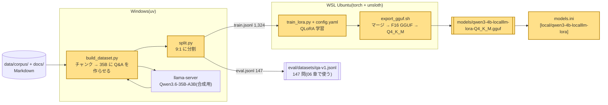
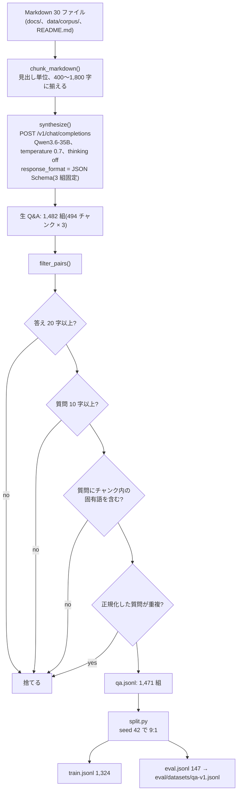
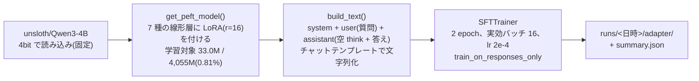
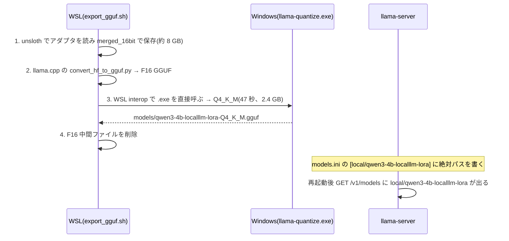

# 05. LoRA 微調整: 小さなモデルに「このプロジェクトの言葉」を覚えさせる

## この章で分かること

- 微調整(ファインチューニング)とは何か。RAG(03 章)との違い
- LoRA / QLoRA が「全部を学習し直さず、小さな追加パラメータだけ学ぶ」方法であること(数式なし)
- 学習データを人手ではなく、大きなモデル(35B)に作らせたこと(データ合成)と、その品質管理
- なぜ unsloth + WSL で学習し、GGUF に変換して llama-server に戻すのか
- 実測: 学習 290 秒、VRAM 4.1 GiB、eval loss 3.91 → 1.68。ただし正答率は上がらなかった

## 前提となる用語

| 用語 | 1 行説明 |
| --- | --- |
| 微調整(ファインチューニング) | 学習済みモデルの重み(パラメータ)を、自分のデータで追加学習して変えること |
| パラメータ / 重み | モデルの中の数値。Qwen3-4B なら約 40 億個 |
| LoRA(Low-Rank Adaptation) | 元の重みは固定し、小さな追加行列(アダプタ)だけを学習する方法。学習対象が 1% 未満で済む |
| QLoRA | LoRA の本体側を 4bit に量子化して読み込む方法。VRAM をさらに減らす |
| r(ランク) / alpha | アダプタの大きさと効き具合を決める設定。r が大きいほど表現力と VRAM が増える |
| アダプタ | 学習でできた LoRA の追加重み。数十 MB。元モデルにマージして使う |
| エポック | 学習データを 1 周すること |
| loss(損失) | 「正解の次トークンをどれだけ当てられないか」の数値。下がるほど学べている |
| train loss / eval loss | 学習に使ったデータでの loss / 使っていないデータでの loss。後者が下がれば丸暗記でない |
| 教師あり微調整(SFT) | 「入力 → 期待する出力」のペアで学習すること。ここでは質問 → 答え |
| データ合成 | 学習データを人が書かず、LLM に文書から作らせること |
| JSON Schema 出力 | LLM に「この形の JSON だけ返せ」と強制する機能。llama-server の `response_format` |
| GGUF 変換 / マージ | アダプタを元モデルに足し込み(マージ)、llama.cpp が読める形式に変えること |
| WSL | Windows 上で Linux を動かす仕組み。学習ライブラリが Linux 専用なので使う |

## 全体のどこに当たるか



## 何をしているか

### RAG と微調整の違い

| | RAG(03 章) | 微調整(この章) |
| --- | --- | --- |
| 知識の置き場 | 外部の索引。質問のたびに検索して渡す | モデルの重みの中 |
| 更新 | 文書を入れ直せば即反映 | 学習し直し |
| 得意 | 事実の正確さ、根拠の提示 | 文体・語彙・答え方の癖 |
| コスト | 検索のぶん遅く、プロンプトが長い | 学習に GPU 時間。推論時は追加コストなし |

06 章の結果では、RAG は正答率を 36% → 54% に上げたが、微調整は 36% → 18% に下げた。この章は「やってみて何が起きたか」を学ぶ章でもある。

### 学習データの合成

人手で Q&A を書く代わりに、大きなモデルに文書を読ませて作らせた。



「質問に固有語を含む」条件は、「これは何ですか」のような文書なしでは答えようのない質問を除くため。合成には 61 分かかり、途中で止まっても再開できるようチャンクごとのキャッシュを持つ。

### QLoRA 学習



要点を 3 つに絞る。

- **4bit で本体を読む(QLoRA)**ことで、4B モデルの学習が VRAM 4.14 GiB(予約 5.91 GiB)に収まった。12 GB の GPU で余裕がある。
- **`train_on_responses_only`** は、質問部分のトークンを loss に含めない設定。モデルが「質問の書き方」ではなく「答え方」を学ぶ。
- **空の `<think>\n\n</think>` を答えの前に付ける**のは、Qwen3 が thinking なしで答えるときの出力形に合わせるため。llama-server はこれを `reasoning_content` として分離するので、本文は汚れない。

実測(run `20261025-121533`):

| 項目 | 値 |
| --- | --- |
| ステップ数 / 時間 | 166 / 290 秒 |
| train loss | 3.60 → 1.58 |
| eval loss | 3.91 → 1.68(下がった = 丸暗記ではない) |
| VRAM(peak allocated / reserved) | 4.14 / 5.91 GiB |

### GGUF への変換と llama-server への登録

アダプタのままでは llama-server で使いにくいので、元モデルに足し込んで 1 つの GGUF にする。



### 結果: loss は下がったが正答率は変わらなかった

Phase 5 の暫定評価(20 問、キーワード一致)では LoRA あり 4/20、なし 4/20。Phase 6 の本評価(147 問)では LoRA が素のモデルより悪かった(06 章)。
LoRA モデルは FastAPI や `scripts/` のファイル名などプロジェクトの語彙で答えるようになったが、手順の細部は間違える。eval loss の低下は「文体と語彙」を学んだことを示し、「事実の記憶」は別物だった。

## 使っているアルゴリズム・技術と、なぜそれを選んだか

| 技術 | 役割 | なぜこれか |
| --- | --- | --- |
| LoRA(r=16、alpha=16、dropout 0、7 線形層すべて) | 学習対象を 0.81% に絞る | 全パラメータ学習は 4B でも VRAM 数十 GB 必要。unsloth の推奨既定値をそのまま使い、比較の基準にした |
| QLoRA(本体 4bit NF4) | VRAM 削減 | 12 GB GPU で 4B を学習するため。品質低下は LoRA 側が 16bit なので小さい |
| unsloth | 学習ライブラリ | 同じ設定の素の HF + PEFT より速く VRAM が少ない。Qwen3 のチャットテンプレートと `train_on_responses_only` が揃っている |
| WSL Ubuntu | 学習環境 | unsloth / bitsandbytes / xformers が Linux 専用。Windows ネイティブでは動かない |
| 合成は Windows の uv で実行 | データ作り | WSL から Windows 側の 127.0.0.1:8080(llama-server)に届かない(NAT)。合成は httpx だけで動くので Windows で十分 |
| データ合成を Qwen3.6-35B に任せる | 学習データ | 1,471 組を人が書くのは非現実的。JSON Schema 出力で形式を固定し、フィルタで品質を担保 |
| 固有語フィルタ + 重複除去 | データ品質 | 文書なしで答えられる質問や、同じ質問の重複は学習を歪める |
| 9:1 分割を seed 固定 | 評価の公正さ | eval 側 147 問は学習に使わない。06 章の評価データはここから来る |
| adamw_8bit、実効バッチ 16、lr 2e-4、2 epoch | 学習設定 | unsloth の例に沿った標準値。VRAM 12 GB を超える構成は config.yaml に書かない方針 |
| マージ → GGUF → Q4_K_M | 配布形式 | 00〜01 章と同じ llama-server で、他のモデルと並べて A/B 比較できる |
| 中間 F16 を削除、merged を git 管理外 | ディスク | 8 GB の中間物は再生成できる |

## 実際のコードの場所

| 場所 | 関数 | 内容 |
| --- | --- | --- |
| `training/data/build_dataset.py` | `build_chunks()`、`chunk_markdown()`、`synthesize()`、`filter_pairs()`、`has_source_term()`、`cache_key()`、`main()` | チャンク化、35B への合成依頼、フィルタ、キャッシュ |
| `training/data/qa.meta.json` | — | 合成に使ったプロンプト、モデル、温度、対象ファイル一覧 |
| `training/data/split.py` | `split()`、`main()` | 9:1 分割(seed 42) |
| `training/config.yaml` | — | モデル、LoRA、学習、データの全設定(コメント付き) |
| `training/train_lora.py` | `load_config()`、`estimate_vram_gb()`、`build_text()`、`main()` | unsloth で読み込み → LoRA 付与 → SFTTrainer → `runs/<日時>/summary.json` |
| `training/runs/20261025-121533/summary.json` | — | 上の実測値の出どころ |
| `training/export_gguf.sh` | — | マージ、GGUF 変換、量子化、`models/` 配置 |
| `training/setup-wsl.sh`、`requirements.lock.txt` | — | WSL の venv 構築 |
| `training/eval_quick.py` | `keywords()`、`score()`、`ask()` | Phase 5 の暫定採点(06 章の `graders.py` の原型) |
| `training/tests/test_dataset.py` | — | 件数 ≥ 300、schema、重複なし、split 整合(WSL で 9 件) |
| `models.ini` | `[local/qwen3-4b-localllm-lora]` | 変換後 GGUF の登録 |
| `scripts/agent/verify.ps1 -Training` | — | WSL でのテスト実行をまとめて呼ぶ |

## 動かして確かめる方法

データ合成(Windows、llama-server 起動中、約 1 時間):

```powershell
uv run python training/data/build_dataset.py
uv run python training/data/split.py
```

学習(WSL、初回は `setup-wsl.sh` で venv を作る。約 5 分):

```bash
wsl -d Ubuntu -- bash -lc "cd /mnt/c/dev/local_llm/training && ./setup-wsl.sh && source ~/venvs/local_llm-training/bin/activate && python train_lora.py --config config.yaml"
```

GGUF 変換:

```bash
wsl -d Ubuntu -- bash -lc "cd /mnt/c/dev/local_llm/training && ./export_gguf.sh runs/<日時>"
```

llama-server を再起動して、LoRA モデルで会話(thinking なし):

```powershell
uv run llm-chat --model local/qwen3-4b-localllm-lora --no-think
```

学習なしで確かめられること:

```powershell
.\scripts\agent\verify.ps1 -Training     # WSL でデータのテスト 9 件
Get-Content training\runs\20261025-121533\summary.json
```
