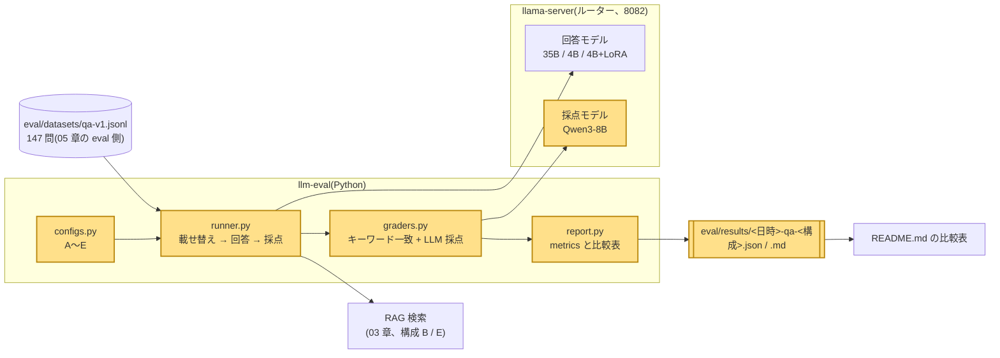
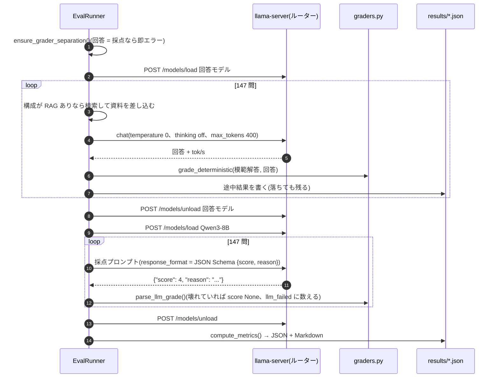
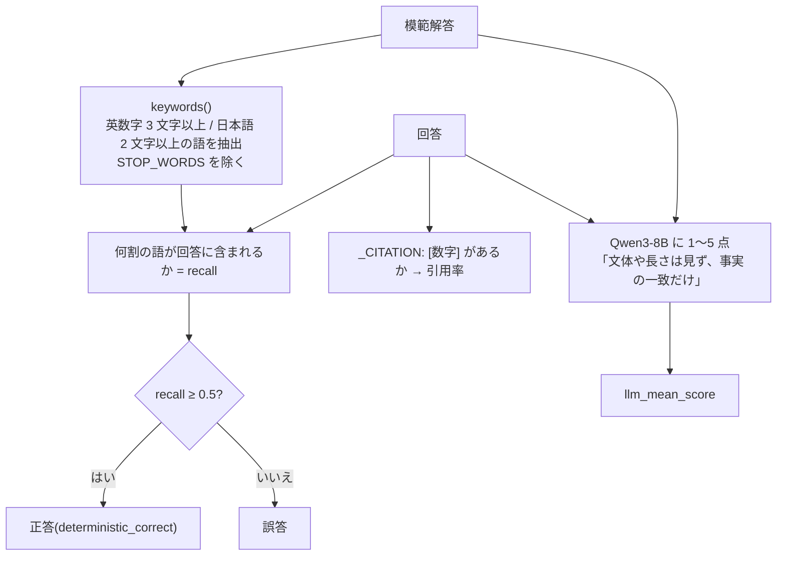

# 06. 評価: 「良くなった」を数字で言うための仕組み

## この章で分かること

- なぜ評価が要るのか。「触った感じ良い」が当てにならない理由
- 2 段階採点(機械的なキーワード一致 + LLM による 1〜5 点)の仕組みと、両方使う理由
- 採点するモデルと答えるモデルを必ず分ける(grader ≠ answer model)理由と、それをコードで強制していること
- 5 構成 A〜E の結果(147 問)の読み方。RAG は効き、LoRA は効かなかった
- この評価が言えないこと(限界)

## 前提となる用語

| 用語 | 1 行説明 |
| --- | --- |
| 評価データセット | 「質問・模範解答・出典」を並べたファイル。`eval/datasets/qa-v1.jsonl`、147 問 |
| 構成(config) | 「どのモデルで、RAG あり / なしで答えるか」の組み合わせ。A〜E の 5 つ |
| 決定論的採点 | 同じ入力なら必ず同じ結果になる、ルールだけの採点。ここではキーワード一致 |
| キーワード再現率(recall) | 模範解答の語のうち、回答に含まれていた割合 |
| LLM 採点(LLM-as-a-judge) | 別の LLM に「模範解答と比べて何点か」を判定させること |
| 採点モデル(grader) | LLM 採点を担当するモデル。Qwen3-8B |
| 回答モデル(answer model) | 問題に答える側のモデル。構成ごとに違う |
| 引用率(citation rate) | 回答に `[1]` のような出典番号が含まれていた割合 |
| hit@3 / top-k 命中率 | 検索結果の上位 3 件 / 上位 k 件に正解の出典が入っていた割合(03 章) |
| temperature 0 | 最も確率の高いトークンだけ選ぶ設定。評価では再現性のためこれを使う |
| ルーター | llama-server の複数モデル切替機能。評価中に回答モデルと採点モデルを順に載せ替える(00 章) |
| JSON Schema | 評価結果ファイルの形を定義したもの。`eval/schemas/qa-result.schema.json` |

## 全体のどこに当たるか



## 何をしているか

### なぜ評価するのか

03 章の RAG と 05 章の LoRA は、どちらも「知識を足す」手段で、両方作った。どちらがどれだけ効いたかは、同じ問題を同じ採点で解かせないと比べられない。
評価がないと「LoRA の eval loss は下がった」のような中間指標で満足してしまう。実際、loss は下がったのに正答率は上がらなかった(05 章)。

### 5 つの構成

| 構成 | 回答モデル | RAG | 知りたいこと |
| --- | --- | --- | --- |
| A | Qwen3.6-35B-A3B | なし | 大型モデルの素の知識 |
| B | Qwen3.6-35B-A3B | あり(top-5) | RAG の効果 |
| C | Qwen3-4B | なし | 小型の基準 |
| D | Qwen3-4B + LoRA | なし | LoRA の効果 |
| E | Qwen3-4B + LoRA | あり(top-5) | 併用 |

A と B の差が RAG、C と D の差が LoRA、D と E の差が「LoRA の上に RAG」の効果になるよう組んである。

### 1 回の評価の流れ



回答と採点を分けて 2 周するのは、VRAM 12 GB に 2 つのモデルを同時に載せられないため。ルーターの load / unload で順番に使う。

### 2 段階採点



| 段 | 長所 | 短所 |
| --- | --- | --- |
| キーワード一致 | 再現性がある。速い。採点モデルの癖に左右されない | 言い換えに弱い。語が含まれていれば誤りでも正答扱いになりうる |
| LLM 採点 | 言い換えや部分正解を評価できる | 主観的。採点モデル自身の知識不足で誤採点しうる |

2 つの指標が同じ方向を向けば結論に自信が持てる。実際、下の結果では正答率と LLM 平均点の順位がほぼ一致した。

### 採点モデルを分ける理由

自分の答えを自分で採点させると甘くなる(自己評価バイアス)。そこで採点は Qwen3-8B に固定し、`ensure_grader_separation()` が回答モデルと同じ id なら `GraderSeparationError` を投げる。
結果ファイルの `grader.differs_from_answer_model` は JSON Schema で `const: true` になっており、同一モデルで採点した結果はスキーマ検証を通らない。

### 結果の読み方(2026-10-25、147 問、seed 42)

| 構成 | 正答率(キーワード ≥ 0.5) | 再現率平均 | LLM 平均(1〜5) | 引用率 | hit@3 | tok/s |
| --- | --- | --- | --- | --- | --- | --- |
| A: 35B | 36.0%(53/147) | 0.410 | 2.72 | 0% | — | 36.9 |
| B: 35B + RAG | **53.7%**(79/147) | 0.536 | **3.82** | 91.2% | 77.5% | 16.7 |
| C: 4B | 18.4%(27/147) | 0.326 | 2.55 | 0% | — | 153.6 |
| D: 4B + LoRA | 21.8%(32/147) | 0.346 | 2.58 | 0% | — | 152.5 |
| E: 4B + LoRA + RAG | **66.7%**(98/147) | 0.599 | 3.77 | 55.1% | 77.5% | 117.4 |

読み取れること。

- **RAG は大きく効く**。A → B で +17.7 pt、D → E で +44.9 pt。LLM 平均点も 2.7 → 3.8 に上がった。
- **LoRA 単体はほぼ効かない**。C → D は +3.4 pt で、147 問の誤差(およそ ±8 pt)の中。
- **E が A を上回る**。4B でも RAG を付ければ、35B の素の知識より正答率が高く、速度は 3 倍。「小さいモデル + 検索」が実用的な組み合わせだと分かる。
- **引用率は B の方が高い**。35B は指示どおり `[n]` を付けるが、4B+LoRA は半分しか付けない。正答率と指示追従は別の能力。
- **A は 400 トークンで切れた回答が 33 問ある**。35B は thinking なしでも長く書く傾向があり、正答率を少し損ねている可能性がある。

A と B の tok/s が低いのは 35B が MoE + `cpu-moe` で CPU を使うため(01 章)。評価全体は 5 構成で約 39 分(A 20 分、B 11 分、C〜E 各 2〜3 分)。

### この評価が言えないこと

- **n = 147 は小さい**。1 問が約 0.7 pt なので、数 pt の差は意味がない。
- **データセットは学習データと同じ合成元**(05 章)。LoRA に有利なはずの条件でも効かなかった、とは言えるが、一般の質問での性能は分からない。
- **模範解答も合成**。35B が作った答えを基準にしているので、35B の誤りは「正解」として扱われる。
- **8B が 35B を採点する**。採点モデルの方が弱いので、LLM 点の絶対値は信用しすぎない。相対比較に使う。
- **1 回しか走らせていない**。temperature 0 なので同じ結果になるはずだが、確かめてはいない。
- **キーワード一致は粗い**。言い換えを誤答に、語だけ合った誤りを正答にする。
- **測定時に別プロセスが VRAM を使っていた**ので、tok/s は条件が揃っていない。

## 使っているアルゴリズム・技術と、なぜそれを選んだか

| 技術 | 役割 | なぜこれか |
| --- | --- | --- |
| 5 構成の差分設計(A/B、C/D、D/E) | 実験計画 | 1 つずつ条件を変えると、差の原因を 1 つに絞れる |
| 学習に使わない 147 問を seed 固定で選ぶ | 公正さ | LoRA が「見た問題」で高得点を取るのを防ぐ |
| temperature 0、thinking off、max_tokens 400 | 再現性と時間 | 同じ入力で同じ答え。thinking ありだと 35B で 1 問数十秒かかる |
| キーワード再現率 + 閾値 0.5 | 決定論的採点 | 実装が単純で検査できる。Phase 5 の `eval_quick.py` を整理したもの |
| LLM-as-a-judge + JSON Schema 強制出力 | 意味を見る採点 | 1〜5 の整数と 1 文の理由だけ返させ、パース失敗を `llm_failed` に数える(今回 0 件) |
| 採点モデル分離をコードとスキーマの両方で強制 | バイアス対策 | 「気を付ける」ではなく、分けないと動かない・検証を通らない形にする |
| ルーターの load / unload | VRAM 管理 | 2 モデル同時は 12 GB に載らない。回答全問 → 採点全問の 2 周にして載せ替えを 2 回で済ます |
| 途中結果の逐次保存 | 耐障害 | 1 構成で最長 20 分かかる。落ちても途中までの JSON が残る |
| 結果を JSON Schema で検証 | 信頼性 | `scripts/agent/check_eval_results.py` が形と `differs_from_answer_model` を機械的に確かめる |
| `eval/models-eval.ini` | 採点モデルの起動 | 8B に `hf-repo` を明示しないとルーターが子プロセスにモデルを渡さず loading のまま止まる |
| 結果の Markdown と比較表の自動生成 | 報告 | README の表は `--summarize` の出力を貼ったもので、手で数字を写していない |

## 実際のコードの場所

| 場所 | 関数 / 定数 | 内容 |
| --- | --- | --- |
| `src/local_llm/eval/configs.py` | `build_configs()`、`resolve_config()`、`SMALL_BASE_MODEL`、`LORA_MODEL`、`DEFAULT_GRADER_MODEL` | A〜E の定義 |
| `src/local_llm/eval/dataset.py` | `load_dataset()`、`select_items()`、`parse_dataset_name()` | `<name>-v<N>.jsonl` の読み込みと seed 付き抽出 |
| `src/local_llm/eval/graders.py` | `keywords()`、`grade_deterministic()`、`retrieval_hit()`、`GRADER_SYSTEM_PROMPT`、`GRADER_RESPONSE_FORMAT`、`parse_llm_grade()` | 2 段階採点 |
| `src/local_llm/eval/runner.py` | `ensure_grader_separation()`、`EvalRunner.run()`、`answer_one()`、`grade_one()`、`_load()` / `_unload()`、`_write_partial()`、`ANSWER_SYSTEM_PROMPT` | 評価の本体 |
| `src/local_llm/eval/report.py` | `compute_metrics()`、`render_markdown()`、`render_comparison()`、`latest_per_config()`、`write_result()` | 指標計算と出力 |
| `src/local_llm/eval/cli.py` | `parse_args()`、`run()`、`summarize()`、`main()` | `llm-eval` コマンド |
| `eval/datasets/qa-v1.jsonl`、`eval/datasets/README.md` | — | 147 問と来歴 |
| `eval/results/20261025-*-qa-{A..E}.json` / `.md` | — | 上の表の出どころ。`items[]` に 1 問ごとの質問・回答・検索結果・両採点 |
| `eval/schemas/qa-result.schema.json` | — | 結果の形。`differs_from_answer_model: const true` |
| `eval/models-eval.ini` | — | 採点モデル用プリセット |
| `scripts/agent/check_eval_results.py` | — | 結果のスキーマ検証 |
| `scripts/agent/eval_retrieval.py` | — | 検索だけの評価(hit@3、03 章) |
| `tests/eval/` | — | 採点・データ・レポートのテスト(llama-server は respx でモック) |

## 動かして確かめる方法

まず結果を読む(GPU 不要):

```powershell
uv run llm-eval --summarize
Get-Content eval\results\20261025-173634-qa-B.md
```

1 問ごとの回答と採点理由を見る:

```powershell
uv run python -c "import json; d=json.load(open('eval/results/20261025-173634-qa-B.json',encoding='utf-8')); it=d['items'][0]; print(it['question']); print(it['response']); print(it['deterministic']); print(it['llm'])"
```

評価を走らせる(別ポートで評価用プリセットを起動。1 構成 2〜20 分):

```powershell
.\scripts\start-server.ps1 -Port 8082 -Preset .\eval\models-eval.ini
uv run llm-eval --config B --base-url http://127.0.0.1:8082
uv run llm-eval --config B --base-url http://127.0.0.1:8082 --n 20      # まず 20 問で様子を見る
```

採点モデル分離が効くことを見る(すぐエラーで止まる):

```powershell
uv run llm-eval --config A --grader-model unsloth/Qwen3.6-35B-A3B-GGUF:Q4_K_M
```

結果のスキーマ検証とテスト:

```powershell
uv run python scripts/agent/check_eval_results.py
uv run pytest tests/eval -q
```
