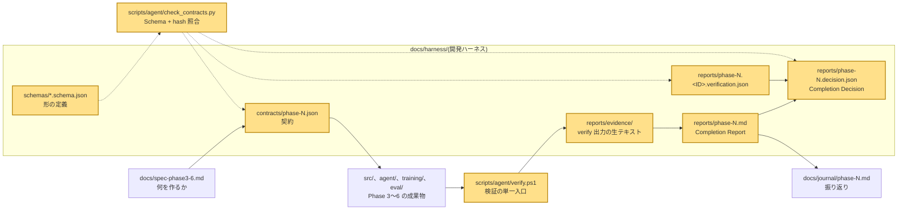
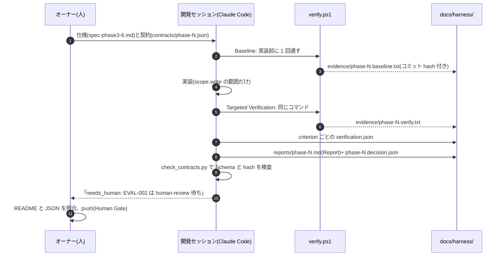
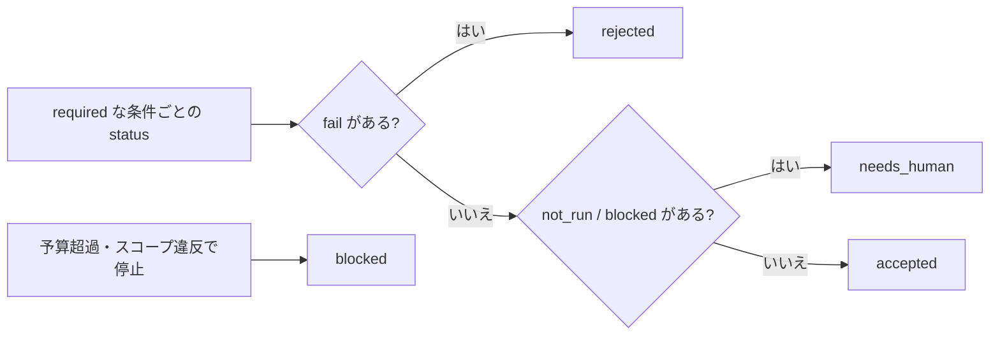

# 07. 開発ハーネス: AI に書かせたコードを「自己申告」で採用しないための仕組み

## この章で分かること

- このリポジトリが Phase 3 以降、Claude Code に「契約 → 実装 → 検証 → 証拠 → 報告」の型で作らせたこと
- 契約(Task Contract)、検証(Verification)、証拠(Evidence)、完了報告(Completion Report)がそれぞれ何で、どのファイルか
- 04 章のエージェント用ハーネスと同じ考え方(LLM が提案し、人とコードが決める)を、開発作業そのものに当てていること
- 人が読むべきファイルの順番と、何を見れば「本当に動いたか」を確かめられるか

## 前提となる用語

| 用語 | 1 行説明 |
| --- | --- |
| ai_harness | AI エージェントの作業を契約・検証・証拠で囲う考え方をまとめた外部リポジトリ。`data/corpus/ai_harness/` に本文がある |
| Task Contract(契約) | 作業前に書く JSON。目的、完了条件、触ってよい範囲、予算、人の承認が要る操作を決める |
| completion_criteria(完了条件) | `RAG-001` のような ID 付きの条件。`required` が true なら全部通らないと採用されない |
| verification_methods | 条件をどう確かめるか(unit-test、integration-test、e2e、human-review など)の宣言 |
| Verification Result(検証結果) | 条件 1 つにつき 1 つの JSON。何を実行して pass / fail / not_run になったか |
| Evidence(証拠) | 検証コマンドの生出力とコミットハッシュ。`docs/harness/reports/evidence/` |
| Completion Report(完了報告) | 人が読む Markdown。条件ごとの結果、未実施、残存リスク、戻し方 |
| Completion Decision(完了判定) | 機械が読む JSON。`accepted` / `rejected` / `blocked` / `needs_human` |
| Baseline | 実装前に検証スクリプトを 1 回通しておくこと。壊したのが自分かどうかを切り分ける |
| Targeted Verification | 実装後に同じ検証スクリプトを走らせ、結果を証拠として残すこと |
| Human Gate | push、公開設定、外部アップロードなど、人の承認なしにやらない操作 |
| Amendment(改訂) | 契約を途中で変えたときの記録。版を上げ、ハッシュを再計算する |
| JSON Schema | 契約・判定・検証結果の形を機械的に検査する定義。`docs/harness/schemas/` |
| worktree | git の機能で、ブランチごとに別フォルダを作る。Phase ごとに別セッションが並行作業した |

## 全体のどこに当たるか



04 章のエージェント用ハーネス(`agent/harness/`)は「LLM のツール呼び出し」を囲う。この章の開発ハーネス(`docs/harness/`)は「Claude Code の開発作業」を囲う。契約・証拠・判定の JSON は同じ ai_harness のスキーマを使う。

## 何をしているか

### 1 つの Phase の流れ



### 契約に何が書いてあるか(Phase 6 の例)

| 項目 | Phase 6 の値 | 意味 |
| --- | --- | --- |
| `objective` / `expected_outcomes` | 評価ハーネスを作り 5 構成を測る | 終わったときに成立している状態 |
| `scope.write` | `src/local_llm/**`、`tests/**`、`eval/**`、`docs/**`、`README.md` など 12 項目 | ここ以外は書かない(`models.ini` は含まれず、だから `eval/models-eval.ini` が別にある) |
| `scope.forbidden` | `.env`、`llama-local/**`、`*.gguf`、`data/chat.db`、`.git/**` | 読みもしない |
| `completion_criteria` | `EVAL-001`〜`EVAL-006` | 条件ごとに `verification_methods` を宣言 |
| `required_evidence` | 「pytest 出力」「結果 JSON」など | 条件ごとに、どんな証拠を、どの独立性(`deterministic-process` など)で出すか |
| `capability_profile` | ネットワークは 127.0.0.1 のみ、`git push` と `huggingface-cli upload` は拒否 | 与える能力の一覧 |
| `human_gates` | `GATE_EXTERNAL_PUBLISH`(push、公開、アップロード)、`GATE_NEW_DEPENDENCY`(仕様にない依存の追加) | 人の承認が要る操作 |
| `execution_budget` | `same_error_limit` 2、`no_progress_limit` 3、`max_files_changed` 80、超えたら stop | 04 章の予算と同じ考え |
| `stop_conditions` | `scope_violation`、`same_error_repeated_twice`、`budget_exceeded`、`baseline_failure_unexplained`、`human_gate_required` | 止まる条件 |
| `contract_hash` | 内容の sha256 | 契約を黙って書き換えられないようにする |

### 判定(Completion Decision)の決まり方

04 章の `decide_status()` と同じ規則を人が適用する。



Phase 6 の判定は `needs_human`。評価ハーネスのテストと e2e は pass したが、`EVAL-002`(README の比較表と JSON の照合)などは `human-review` が検証方法なので、オーナーが見るまで `not_run` のまま。ルール 4 のとおり `not_run` を `pass` に書き換えない。

### 検証スクリプト `verify.ps1` が通すもの

| ステップ | 内容 | 既定で動くか |
| --- | --- | --- |
| contracts schema | `check_contracts.py`。契約・判定・検証結果が Schema に適合し、hash が内容と一致 | 常に |
| eval results schema | `check_eval_results.py`。`eval/results/*.json` が Schema に適合、採点モデル ≠ 回答モデル | 常に |
| `git diff --check` | 空白の誤りがない | 常に |
| pytest | Python のテスト。107 件(llama-server は respx でモック、GPU 不要) | `-SkipPytest` で省略 |
| vitest | `agent/harness` の 35 件 | `-Agent` で実行 |
| training tests | WSL でデータセットのテスト 9 件 | `-Training` で実行 |

最後に `commit: <hash>` と `ALL OK` または `FAILED: <ステップ名>` を出す。Report にはこの出力をそのまま貼る。

### 証拠の読み方(Phase 6)

`docs/harness/reports/evidence/phase-6.baseline.txt` は commit `16f9a6f` で pytest 87 件、`phase-6.verify.txt` は実装後に 107 件(87 + eval 20)。差分 20 件が Phase 6 で足したテストで、既存のテストは壊れていないと分かる。
Phase 3 では `phase-3.eval_retrieval.json`(hit@3 10/10)と `phase-3.e2e_rag.json`(実機の RAG 応答)が証拠になっている。

### Human Gate の実際

Phase 3〜6 のどのセッションも `git push` を行わず、ブランチ名と「push は人が行う」を Report に書いて終わっている。`capability_profile.denied_tools` に `git push` が明記され、04 章と違ってコードで強制はされていないが、記録と判定でそれを見える形にしている。

## 使っているアルゴリズム・技術と、なぜそれを選んだか

| 技術 | 役割 | なぜこれか |
| --- | --- | --- |
| Task Contract を JSON で書き、Schema で検査 | 作業の仕様化 | 「何ができたら完了か」を曖昧な文章ではなく ID 付きの条件にする。形の誤りは機械が見つける |
| `contract_hash`(正規化 JSON の sha256) | 改ざん防止 | 条件を後から緩めたら hash が合わなくなる。変えるなら版を上げ Amendment を書く |
| Baseline → Targeted Verification の同一コマンド | 回帰の切り分け | 実装前後で同じ `verify.ps1` を打てば、壊したのが自分かどうかが分かる |
| 生出力をそのまま証拠として保存 | 検証可能性 | 「通りました」ではなく、通ったときの出力とコミット hash を残す |
| 条件ごとに Verification Result を 1 ファイル | 追跡性 | どの条件を何で確かめたかが 1 対 1 で分かる |
| `needs_human` という状態 | 判定の誠実さ | 人の目が要る条件を AI が勝手に pass にしない |
| Human Gate を契約に明記 | 不可逆操作の防止 | push や公開は取り消しにくい。AI の判断に任せない |
| 「同じエラー 2 回で止まる」 | 無駄な試行の抑制 | 直らない失敗を繰り返して時間と文脈を浪費しない。04 章の `same_error_limit` と同じ |
| Phase ごとに worktree + 別セッション | 並行開発 | Phase 3〜5 を同時に進められる。ポート衝突などの問題は journal に残っている |
| 自作のエージェントハーネス(04 章)と同じスキーマ | 一貫性 | 「作るもの」と「作り方」で同じ語彙を使う。ai_harness の文書が RAG コーパスにも入っている |

## 実際のコードの場所

| 場所 | 内容 |
| --- | --- |
| `docs/harness/README.md` | ハーネスの説明、契約の読み方、運用ルール 5 つ |
| `docs/harness/schemas/task-contract.schema.json` ほか 4 つ | ai_harness Core 1.0 の Schema(契約、完了判定、検証結果、方針判定、承認記録) |
| `docs/harness/contracts/phase-3.json`〜`phase-6.json` | 各 Phase の契約 |
| `docs/harness/reports/phase-N.md` | Completion Report(Baseline、Targeted Verification、条件表、未実施、残存リスク、Rollback) |
| `docs/harness/reports/phase-N.decision.json` | Completion Decision |
| `docs/harness/reports/phase-N.<ID>.verification.json` | 条件ごとの検証結果(Phase 3: RAG-001〜005、4: AGT-001〜006、6: EVAL-001〜006) |
| `docs/harness/reports/evidence/` | `phase-N.baseline.txt`、`phase-N.verify.txt`、Phase 3 の e2e / 検索評価 JSON |
| `scripts/agent/verify.ps1` | 検証の単一入口(`-Agent`、`-Training`、`-SkipPytest`、`-Scope`) |
| `scripts/agent/check_contracts.py` | `canonical_hash()`、`check_file()`。`--rehash` で hash を書き戻す |
| `scripts/agent/check_eval_results.py` | 評価結果の Schema 検証(06 章) |
| `docs/spec-phase3-6.md` | 契約の元になった仕様 |
| `docs/journal/phase-N.md` | 各 Phase の振り返り(うまくいかなかったことも含む) |
| `agent/contracts/summarize-docs.json` | 04 章のエージェント用契約。同じ Schema |

## 動かして確かめる方法

検証をまとめて通す(GPU 不要、約 10 秒):

```powershell
.\scripts\agent\verify.ps1 -Agent
```

契約の形とハッシュだけ確かめる:

```powershell
uv run python scripts/agent/check_contracts.py
```

契約を書き換えると hash 不一致で止まることを見る(試したら `git checkout docs/harness/contracts/phase-6.json` で戻す):

```powershell
uv run python scripts/agent/check_contracts.py --rehash
```

Phase 6 の判定を読む:

```powershell
Get-Content docs\harness\reports\phase-6.decision.json
Get-Content docs\harness\reports\phase-6.md
```

`criterion_results[]` の `status` が `pass` / `not_run` で、`not_run` のものは `notes` に「なぜ人の確認待ちか」が書いてある。
