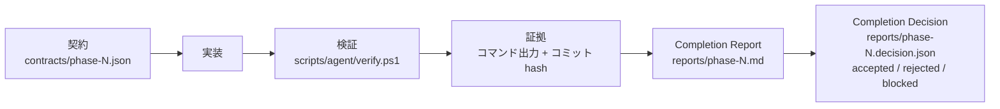

# 開発ハーネス

このフォルダは、Phase 3 以降の開発を [Moro-1025/ai_harness](https://github.com/Moro-1025/ai_harness) の
考え方で進めるための「契約・検証・証拠」の置き場。何を作るかは [../spec-phase3-6.md](../spec-phase3-6.md)、
作ったものの説明は [../journal/](../journal/) にある。

## ハーネスとは何か(初めての人向け)

AI にコードを書かせるとき、「書きました」「動くはずです」という自己申告だけでは採用できない。
そこで、作業の前に **契約(Task Contract)** で「何ができたら完了か」「どこを触ってよいか」「いつ止まるか」を決め、
作業の後に **検証スクリプト** を同じ条件で走らせ、その出力を **証拠** として残し、
契約の条件ごとに合否を付けた **Completion Report** を書く。ai_harness はこの一連の仕組みを「ハーネス」と呼ぶ。

## ファイル

| パス | 内容 |
| --- | --- |
| `schemas/*.schema.json` | ai_harness の JSON Schema(2026-10-25 に取得、Core 1.0)。契約・判定・検証結果の形を機械的に検査する |
| `contracts/phase-N.json` | Phase ごとの Task Contract。`task-contract.schema.json` に適合し、`contract_hash` は内容から計算する |
| `reports/phase-N.md` | Completion Report(人向け)。criterion ごとの結果、証拠、未実施、残存リスク、Rollback 方法 |
| `reports/phase-N.decision.json` | Completion Decision(機械向け)。`completion-decision.schema.json` に適合 |
| `reports/phase-N.verification.json` | Verification Result の配列ではなく 1 ファイル 1 criterion にしたいときは `phase-N.<CRITERION>.verification.json` |
| `../../scripts/agent/verify.ps1` | 検証の単一入口 |
| `../../scripts/agent/check_contracts.py` | 契約と判定 JSON の Schema 検証と hash 照合 |

## 契約の読み方

| 項目 | 意味 |
| --- | --- |
| `objective` / `expected_outcomes` | 目的と、終わったときに成立している状態 |
| `scope.read` / `scope.write` / `scope.forbidden` | 読んでよい場所、書いてよい場所、触ってはいけない場所(グロブ) |
| `non_goals` | やらないこと。範囲が広がるのを防ぐ |
| `completion_criteria[]` | ID 付きの完了条件。`verification_methods` で確かめ方を宣言する |
| `required_evidence[]` | 条件ごとに必要な証拠の種類と、誰が出した証拠なら認めるか(`minimum_independence`) |
| `capability_profile` | 与える能力。ファイル、ネットワーク、外部送信、ツール |
| `human_gates[]` | 人間の承認が要る操作 |
| `execution_budget` | 予算。超えたら `on_exceed` に従って止まる |
| `stop_conditions` | 止まる条件の名前 |

## 運用ルール

1. 契約を変えたら `uv run python scripts/agent/check_contracts.py --rehash` で hash を更新し、`contract_version` を上げ、`amendment` を書く(版 2 以降は必須)。
2. 実装前に `verify.ps1` を 1 回打ち、通ることを確認する(Baseline)。
3. 実装後に同じコマンドを打ち、出力の要点とコミット hash を Report に書く。
4. 「できました」ではなく、Report の criterion 表で判定する。`not_run` を `pass` にしない。
5. push、公開設定、外部アップロードは Human Gate。セッションは行わず、人間に依頼する。
