# 内部仕様書(Phase 1 / Phase 2)

実装の構造、モジュールの責務、データの流れを定義する。利用者から見た振る舞いは
[external-spec.md](external-spec.md) を参照。用語(llama-server、SSE、thinking など)は
external-spec の 0 章にある。

## 0. 全体像(最初に読む)

### 0.1 何が動いているか

このリポジトリのコードは 3 つの形で動く。どれも同じ `local_llm` パッケージの中にあり、
llama-server との通信はすべて `LlamaClient` という 1 つのクラスを通る。

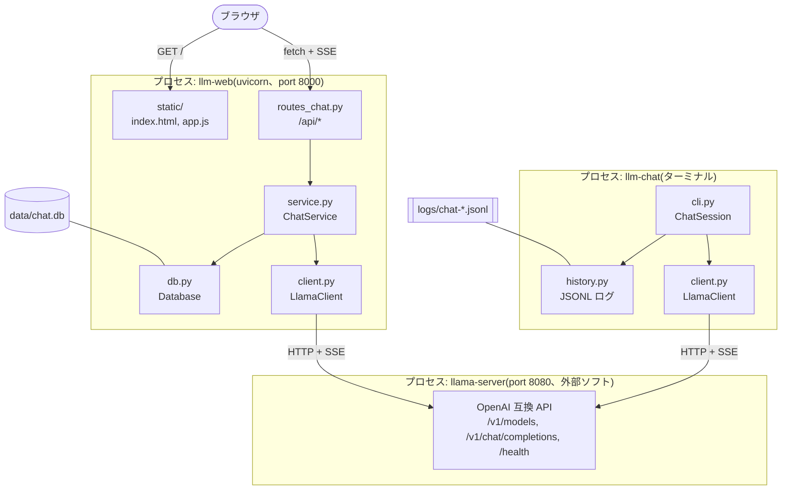

### 0.2 層の分け方

| 層 | ファイル | 責務 | 知っていること / 知らないこと |
| --- | --- | --- | --- |
| 共通層 | `config.py` `types.py` `client.py` | 設定、データ型、llama-server との HTTP 通信 | HTTP と SSE の形式を知っている。CLI も Web も知らない |
| CLI 層 | `cli.py` `history.py` | ターミナルの入出力、履歴の保持、JSONL 記録 | 共通層を使う。Web を知らない |
| Web 層 | `web/app.py` `routes_chat.py` `service.py` `db.py` | HTTP API、会話の永続化、SSE 配信 | 共通層を使う。CLI を知らない |
| フロント | `web/static/*` | 画面描画、ユーザー操作、SSE の受信 | `/api/*` の形だけ知っている。Python を知らない |

依存は上から下への一方向。共通層は単独で `pip install` して使えるライブラリとして成り立つ。

### 0.3 1 リクエストの一生(Web UI の場合)

利用者が「こんにちは」と送ってから、画面に応答が出るまで。番号は下の図と対応する。

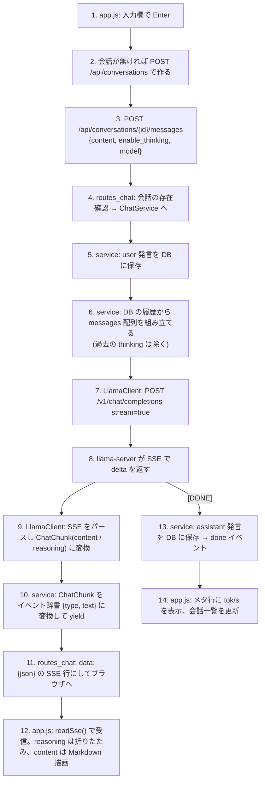

ポイント:

- **保存は 2 回**。user は受信直後(5)、assistant は完了時(13)。途中で失敗しても、そこまでの本文を保存する。
- **SSE は二段構え**。llama-server → `LlamaClient`(OpenAI 形式)、`routes_chat` → ブラウザ(自前の `{type, text}` 形式)。形式を変えているのは、ブラウザに llama-server の生の形を知らせないため。
- **モデルは会話に紐づく**。ドロップダウンで変えると、次の送信時に会話の `model` が更新される。

### 0.4 CLI の場合との違い

| 観点 | Web UI | CLI |
| --- | --- | --- |
| 履歴の置き場 | SQLite(`db.py`) | メモリ上の `list[Message]`(`ChatSession.history`) |
| 記録 | DB がそのまま記録 | `history.py` が JSONL に追記(読み戻しは再開用で、起動時には読まない) |
| 表示 | ブラウザが SSE を受けて描画 | `rich` でターミナルに逐次出力 |
| 失敗時 | 途中までを DB に保存し `error` イベント | user 発言を履歴から外し、赤字表示 |
| 共通部分 | `LlamaClient`、`Message`、`ChatChunk`、設定の読み込み | 同じ |

### 0.5 コードを読む順番

1. `types.py`(50 行): `Message` と `ChatChunk` の形を押さえる。
2. `client.py`: `chat()` と `_parse_stream_event()`。SSE が `ChatChunk` になるまで。
3. `web/service.py`: `stream_reply()`。DB と `LlamaClient` をどうつなぐか。
4. `web/routes_chat.py` → `web/static/app.js` の `sendMessage()` と `readSse()`。
5. `cli.py` の `ask()`。service.py と同じ構造を CLI でやっている。

## 1. 技術スタックと依存

| 層 | 技術 | 用途 |
| --- | --- | --- |
| 言語 | Python 3.12+ | すべてのサーバ側コード |
| パッケージ管理 | uv + hatchling | `pyproject.toml`、`src/` レイアウト |
| HTTP クライアント | httpx(AsyncClient) | llama-server との通信。openai SDK は使わない |
| 設定 | python-dotenv | `.env` の読み込み |
| CLI 表示 | rich | 色付き出力と入力プロンプト |
| Web | FastAPI + uvicorn | REST、SSE、静的配信 |
| DB | sqlite3(標準ライブラリ) | 会話の永続化 |
| フロント | 素の HTML/CSS/JS + marked(CDN) | ビルドなし |
| テスト | pytest, pytest-asyncio, respx | llama-server をモック |

## 2. ディレクトリ構成

```
src/local_llm/
├─ __init__.py        公開 API の re-export
├─ config.py          Settings と load_settings()
├─ types.py           Message / Usage / ChatChunk
├─ client.py          LlamaClient, LlamaClientError, ThinkTagSplitter, iter_sse_data
├─ history.py         ChatLogger(JSONL), read_log()
├─ cli.py             ChatSession, parse_args(), main()
└─ web/
   ├─ app.py          create_app(), app, main()
   ├─ db.py           Database(SQLite)
   ├─ service.py      ChatService, build_prompt()
   ├─ routes_chat.py  APIRouter(/api/*)
   └─ static/         index.html, app.js, style.css
tests/
├─ conftest.py        共通フィクスチャ(respx のモック、一時 DB)
├─ test_client.py     SSE パース、think 分離、エラー変換
├─ test_cli.py        コマンド処理、ask()、起動時チェック
├─ test_history.py    JSONL ロガー
└─ test_web.py        DB CRUD、API、SSE 配信、部分保存
```

## 3. モジュール間の依存

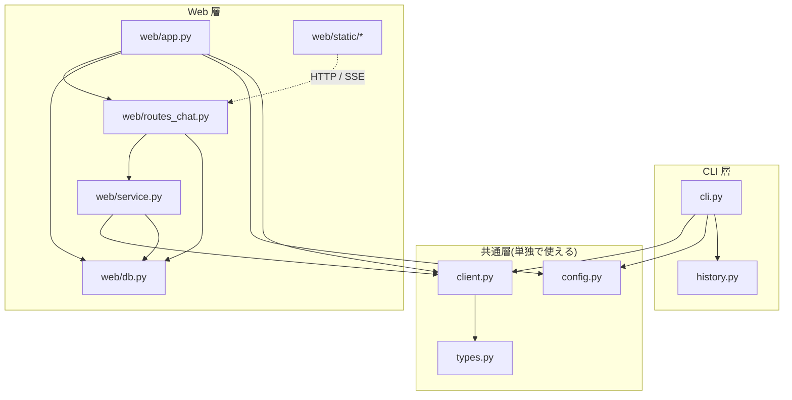

原則:

- `client.py` と `types.py` は他の自前モジュールに依存しない(ライブラリとして単独で使える)。
- `web/` から llama-server への HTTP は必ず `LlamaClient` 経由。`routes_chat.py` に httpx は登場しない。
- `service.py` は FastAPI に依存しない(辞書のイテレータを返すだけ)。SSE への文字列化は `routes_chat.py`。
- `db.py` は SQL と行の辞書化だけを持ち、ビジネスルールを持たない(タイトル自動設定だけは例外として `add_message` にある)。

## 4. 共通層

### 4.1 config.py

```python
@dataclass(frozen=True)
class Settings:
    base_url: str = "http://127.0.0.1:8080"
    default_model: str = "unsloth/Qwen3.6-35B-A3B-GGUF:Q4_K_M"
    db_path: Path = Path("data/chat.db")
    timeout: float = 600.0

def load_settings(env_file=None) -> Settings
```

- `load_dotenv(override=False)` のため、既に環境変数があれば `.env` で上書きしない。
- `base_url` は末尾の `/` を落とす。

### 4.2 types.py

| 型 | フィールド | 備考 |
| --- | --- | --- |
| `Message` | `role: str`, `content: str` | `to_dict()` で OpenAI 形式に |
| `Usage` | `prompt_tokens`, `completion_tokens`, `total_tokens` | `from_dict()`。欠けた項目は 0 |
| `ChatChunk` | `content=""`, `reasoning=""`, `finish_reason=None`, `usage=None` | `is_empty` が True なら呼び出し側へ流さない |

すべて frozen dataclass。

### 4.3 client.py

**LlamaClient**

| メソッド | HTTP | 処理 |
| --- | --- | --- |
| `health()` | GET `/health` | 200 かつ `status == "ok"` で True。例外は握りつぶして False |
| `list_models()` | GET `/v1/models` | `data[].id` を返す |
| `chat(...)` | POST `/v1/chat/completions` | 下記 |

`chat()` のリクエスト本文:

```json
{"model": "...", "messages": [...], "stream": true,
 "stream_options": {"include_usage": true},
 "temperature": 0.7,
 "chat_template_kwargs": {"enable_thinking": false}}
```

`stream_options` は `stream=True` のとき、`temperature` は指定時のみ、`chat_template_kwargs` は `enable_thinking=False` のときだけ付く。

ストリーミング時の処理順:

1. `httpx.AsyncClient.stream()` でレスポンスを開く。4xx/5xx なら本文を読んで `LlamaClientError`。
2. `response.aiter_lines()` を `iter_sse_data()` に通し、イベントごとの `data` 文字列を得る。
3. `[DONE]` で終了。それ以外は `_parse_stream_event()` で `ChatChunk` に変換。
   - JSON が壊れていれば読み飛ばす。
   - `{"error": ...}` で `choices` が無ければ `LlamaClientError`。
   - `delta.reasoning_content` → `reasoning`。
   - `delta.content` は `ThinkTagSplitter.feed()` に通し、`<think>` 内なら `reasoning` に回す。
   - `usage` があれば `Usage` に。
4. ストリーム終端で `splitter.flush()` し、残りがあれば最後の `ChatChunk` として返す。
5. `httpx.HTTPError` はすべて `LlamaClientError` に包む。

`stream=False` のときは `_chat_once()` が 1 回の POST で `ChatChunk` を 1 個作る(呼び出し側の形を揃えるため、ジェネレータとして 1 回 yield する)。

`chat()` のストリーミング処理をフローで示す:

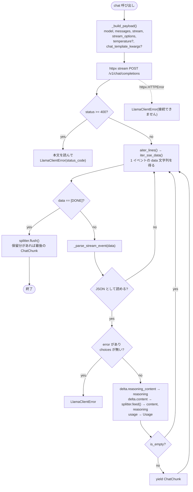

**ThinkTagSplitter**

状態機械。`_in_think` フラグと保留バッファ `_buf` を持つ。

- `feed(text)`: バッファに足し、`<think>` / `</think>` を探して content と reasoning に振り分ける。
  タグがチャンク境界で切れる場合に備え、末尾がタグの先頭部分と一致する分だけ保留する。
- `flush()`: 保留分を吐き出す。`<think>` が閉じていなければ reasoning 扱い。

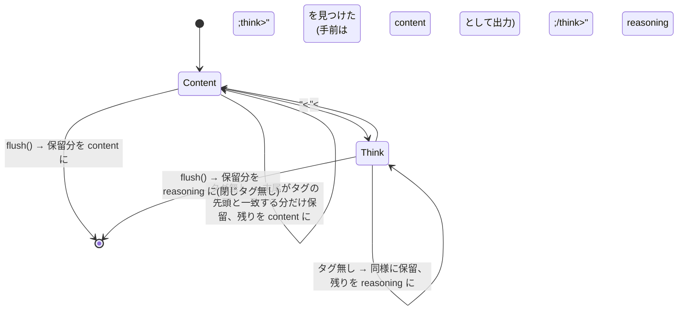

例: `"<thi"` → `"nk>考え"` → `"中</think>答え"` の 3 チャンクが来た場合、
1 回目は全部保留、2 回目でタグが揃って Think に入り `考え` を reasoning に、
3 回目で `中` を reasoning、Content に戻って `答え` を content に出す。

**iter_sse_data**

SSE 仕様のサブセット。`data:` 行を集めて空行で 1 イベント。複数 `data:` は改行連結。`:` コメント行と他フィールドは無視。CRLF 対応。末尾の空行が無くても最後のイベントを出す。

**LlamaClientError**

`status_code: int | None` を持つ。接続失敗は `llama-server に接続できません(...)`、HTTP エラーは `llama-server が HTTP NNN を返しました: <本文先頭 200 文字>`。

## 5. CLI 層(cli.py, history.py)

### 5.1 ChatSession

状態: `client`, `console`, `logger`, `model`, `system_prompt`, `enable_thinking`, `history: list[Message]`。

| メソッド | 役割 |
| --- | --- |
| `build_messages()` | system prompt(あれば)+ history |
| `handle_command(line) -> bool` | スラッシュコマンド。False で終了 |
| `_command_model(arg)` | 引数なしで一覧、ありで切替 |
| `ask(user_text)` | 1 往復。下記 |
| `_print_stats(usage, elapsed, ttft)` | 統計行 |
| `_check_server()` | 起動時の疎通とモデル存在確認 |
| `run()` | 入力ループ |

`run()` のメインループ:

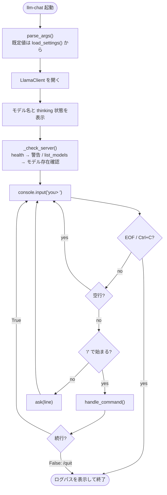

`ask()` の流れ:

1. `history` に user を積み、`logger.append("user", ...)`。
2. `client.chat()` を回し、`reasoning` は dim で、`content` は通常色で逐次出力。初トークン時刻を記録。
3. `LlamaClientError` なら赤字表示し `history.pop()` して return(ログには user が残る)。
4. `KeyboardInterrupt` / `CancelledError` は中断表示して続行(途中までを採用)。
5. content か reasoning があれば `history` に assistant を積み、`logger.append("assistant", ..., reasoning=...)`。
6. `_print_stats()`。生成速度 = completion_tokens / (elapsed - ttft)。

### 5.2 ChatLogger

- `path` は初回アクセス時に `log_dir/chat-<YYYYMMDD-HHMMSS>.jsonl` に確定(遅延)。
- `append(role, content, model, **extra)` で 1 行 JSON を追記。`time` はローカルタイムゾーン付き ISO8601。
- `read_log(path)` は読み戻し用。

### 5.3 エントリポイント

`parse_args()` は `load_settings()` の値を既定にする。`main()` は `asyncio.run(_amain())`。Ctrl+C で終了コード 130。

## 6. Web 層

### 6.1 app.py

```python
def create_app(settings=None, *, db=None, client=None) -> FastAPI
app = create_app()   # uvicorn が "local_llm.web.app:app" で参照
def main(argv=None)  # argparse → uvicorn.run()
```

- lifespan で `app.state.settings / db / client` を設定し、`db.init_schema()` を呼ぶ。
- `client` を外から渡さなかった場合だけ終了時に `aclose()` する(テストでは差し替える)。
- `/` は `static/index.html` を `FileResponse` で返す。`/static` は `StaticFiles`。

起動から画面表示までの流れ:

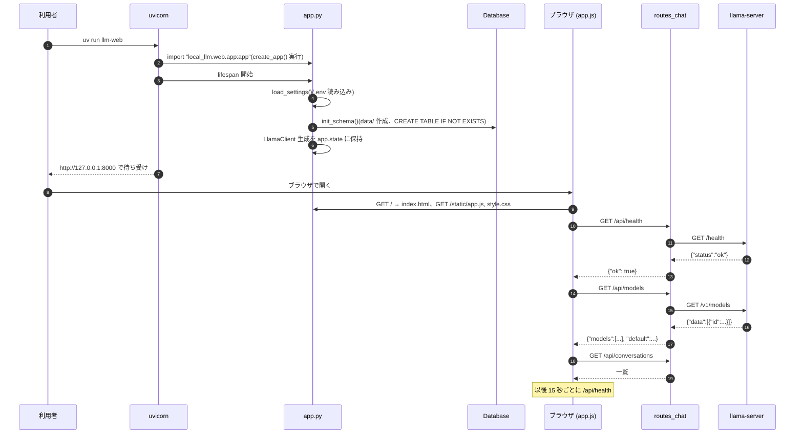

### 6.2 db.py

スキーマ:

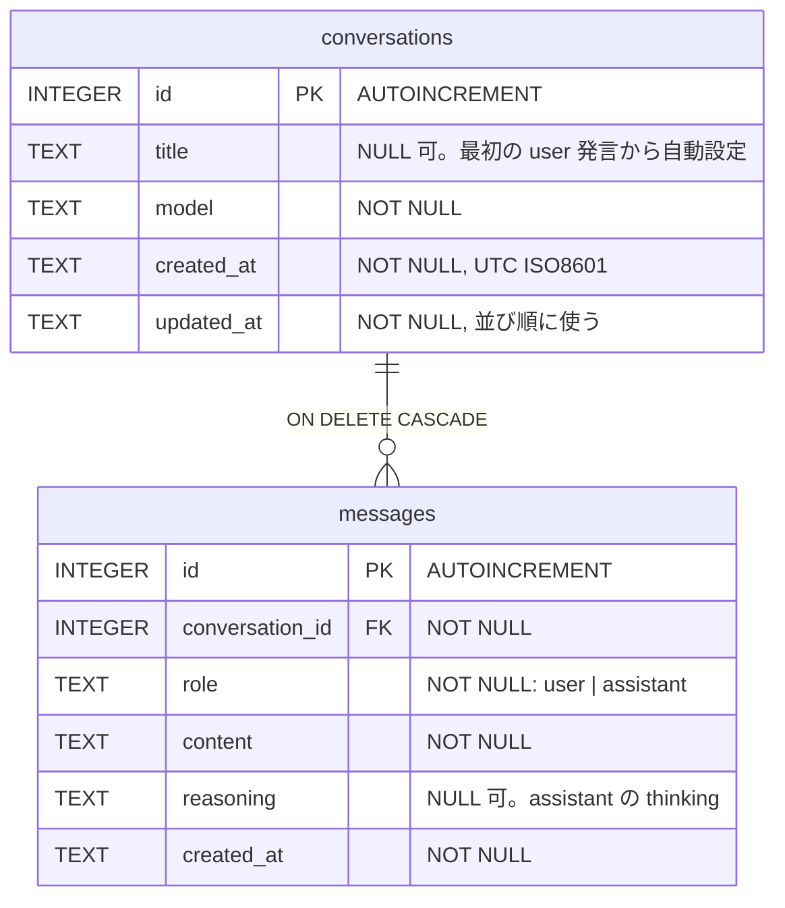

インデックス: `idx_messages_conversation ON messages(conversation_id, id)`。

接続方針:

- 呼び出しごとに `sqlite3.connect()` して閉じる(`connect()` コンテキストマネージャ)。FastAPI が同期ルートをスレッドプールで動かしても安全。
- `PRAGMA foreign_keys = ON` を毎回設定(CASCADE に必要)。
- 正常終了で commit、例外で rollback。
- `row_factory = sqlite3.Row` で列名アクセスし、`dict()` にして返す。

時刻は UTC の ISO8601、マイクロ秒付き、`Z` 終端。`updated_at DESC, id DESC` の並びで一覧を返すため、同一秒内でも順序が決まるようにしている。

| メソッド | SQL の要点 |
| --- | --- |
| `init_schema()` | 親ディレクトリ作成 + `executescript(SCHEMA)` |
| `list_conversations()` | 新しい順 |
| `create_conversation(model, title=None)` | INSERT、辞書で返す |
| `get_conversation(id)` | 会話 + messages(id 順)。無ければ None |
| `delete_conversation(id) -> bool` | rowcount > 0 |
| `update_conversation(id, *, model, title)` | 指定列 + updated_at |
| `add_message(id, role, content, reasoning)` | INSERT。role=user かつ title が空なら `make_title()` で設定。updated_at 更新 |
| `list_messages(id)` | id 順 |

`make_title(text)`: 空白と改行を 1 つの空白に潰し、先頭 40 文字。空なら `(無題)`。

会話レコードのライフサイクル:

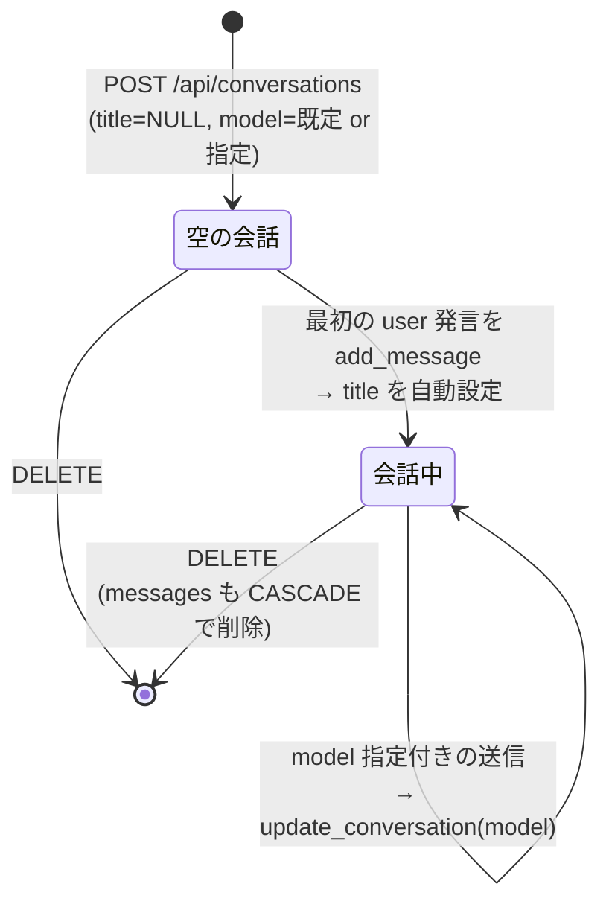

「+ 新規」ボタンは会話を作らない。最初の送信時に `POST /api/conversations` が呼ばれて初めて行ができる。
そのため、何も送らずに別の会話へ移っても空の行は残らない。

### 6.3 service.py

```python
def build_prompt(history: list[dict]) -> list[Message]
class ChatService:
    def __init__(self, db: Database, client: LlamaClient)
    async def stream_reply(self, conv_id, content, *, enable_thinking=True, model=None) -> AsyncIterator[dict]
```

`build_prompt()` は DB の行から `Message(role, content)` を作る。`reasoning` は含めない。content が空の行は除外する。Phase 3 では検索結果や system メッセージをここで差し込む。

`stream_reply()` の流れ:

1. 会話を取得。無ければ `error` イベントを 1 個出して終了。
2. `model` が指定され会話と異なれば `update_conversation(model=...)`。
3. `add_message(user)` で即保存し、`list_messages()` → `build_prompt()`。
4. `client.chat()` を回し、`reasoning` / `content` をイベントとして yield。断片を `content_parts` / `reasoning_parts` に蓄積。
5. 終了処理は `save_partial()` に集約。`saved` フラグで二重保存を防ぐ。
   - `LlamaClientError`: 保存 → `error` イベント → return。
   - 正常終了または切断(`GeneratorExit` / `CancelledError`): `finally` で保存。
   - 蓄積が空なら保存しない。
6. 正常終了時のみ `done` イベント。`tokens_per_second = completion_tokens / (elapsed - ttft)`、小数 1 桁。

### 6.4 routes_chat.py

`APIRouter(prefix="/api")`。依存の取り出しは `request.app.state` から(`get_db`, `get_client`)。

| ルート | 同期/非同期 | 処理 |
| --- | --- | --- |
| `GET /health` | async | `client.health()` を `{"ok", "llama_base_url"}` に |
| `GET /models` | async | `client.list_models()`。`LlamaClientError` → 502 |
| `GET /conversations` | sync | `db.list_conversations()` |
| `POST /conversations` | sync | `model` 省略時は settings の既定。201 |
| `GET /conversations/{id}` | sync | 404 if None |
| `DELETE /conversations/{id}` | sync | 204 / 404 |
| `POST /conversations/{id}/messages` | async | 404 チェック → `ChatService.stream_reply()` を `StreamingResponse(text/event-stream)` に |

リクエスト型(pydantic): `CreateConversationRequest(model: str | None)`、`SendMessageRequest(content: str [min 1], enable_thinking: bool = True, model: str | None)`。

SSE 文字列化: `data: {json}\n\n`、`ensure_ascii=False`。ヘッダに `Cache-Control: no-cache`、`X-Accel-Buffering: no`。

同期ルートは FastAPI がスレッドプールで実行する。DB が呼び出しごとに接続するのはこのため。

### 6.5 フロント(static/app.js)

IIFE で閉じた 1 ファイル。モジュールバンドラなし。

状態: `{conversations: [], currentId: null, streaming: false, healthy: null}`。

| 関数 | 役割 |
| --- | --- |
| `api(path, options)` | fetch の薄いラッパ。非 2xx は `detail` 付きで throw。204 は null |
| `renderMarkdown(text)` | marked があれば `parse(breaks, gfm)`、無ければエスケープのみ |
| `appendMessage(role, {content, reasoning})` | `<template>` から要素を作り、各パーツへの参照を返す |
| `loadConversations()` / `renderConversationList()` | 一覧の取得と描画 |
| `startNewConversation()` | 画面を空に。会話はまだ作らない |
| `openConversation(id)` | メッセージ復元とモデル反映 |
| `deleteConversation(id)` | confirm → DELETE → 再読込 |
| `loadModels()` | ドロップダウン構築。既定を選択 |
| `checkHealth()` | 15 秒周期。復帰時に `loadModels()` |
| `readSse(response, onEvent)` | `ReadableStream` を `TextDecoder` で読み、`\n\n` 区切りで `data:` を JSON にしてコールバック |
| `sendMessage()` | 会話なければ POST で作成 → user と空の assistant を描画 → POST messages → `readSse` でイベント反映 → 一覧更新 |

`sendMessage()` のイベント反映:

- `reasoning`: `<details>` を表示。本文が無いうちは `open`。
- `content`: `<details>` を閉じ、本文を再描画(累積文字列を毎回 `renderMarkdown`)。
- `done`: メタ行に usage、tok/s、秒、モデル。
- `error`: メタ行に赤字。

送信中は `setStreaming(true)` で入力欄・送信・新規を無効化し、一覧クリックと削除も `state.streaming` で弾く。

`sendMessage()` の処理フロー:

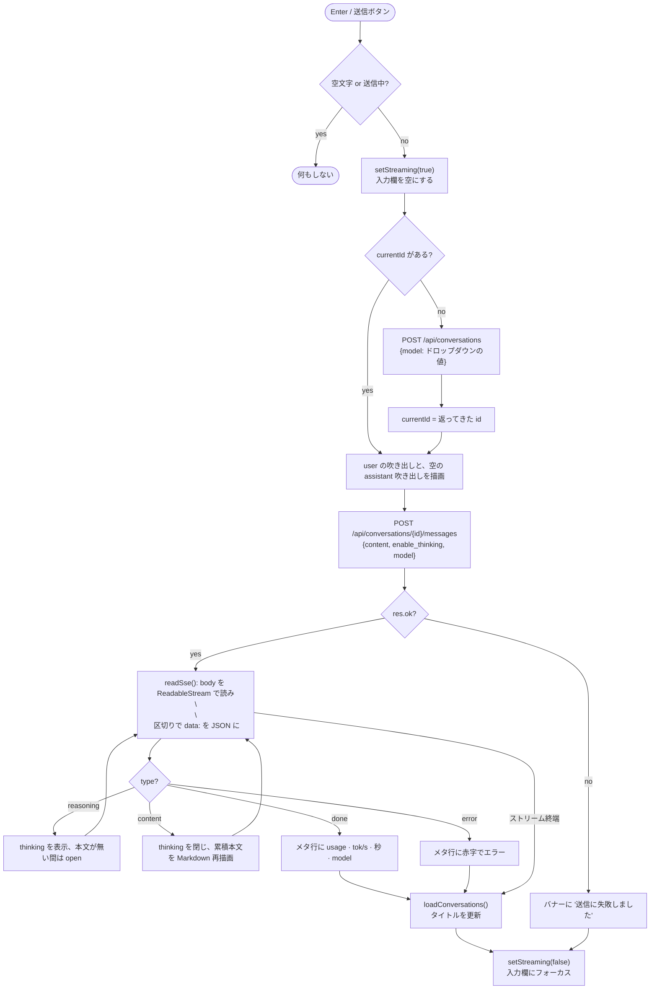

`checkHealth()` の 15 秒ポーリング:

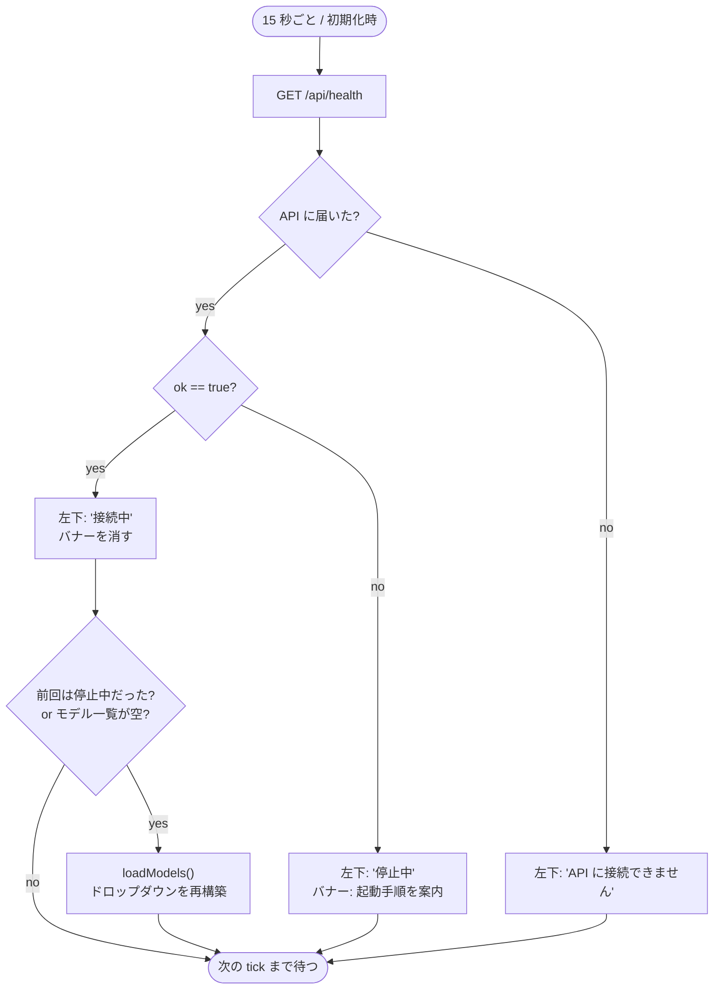

セキュリティ上の注意: assistant 本文は `innerHTML` に入れる(marked の出力)。ローカル専用のため sanitizer は入れていない。公開する場合は DOMPurify 等が必要。

## 7. データフロー

### 7.1 Web UI で 1 往復

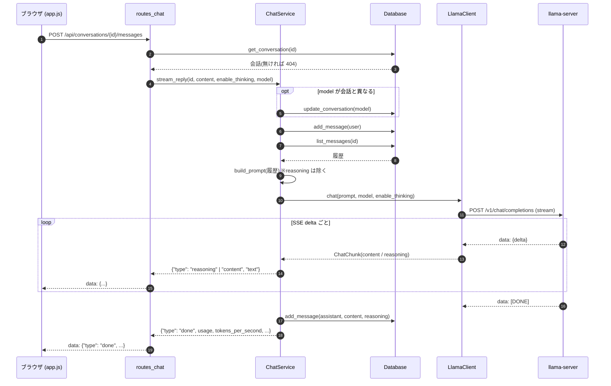

失敗・切断時:

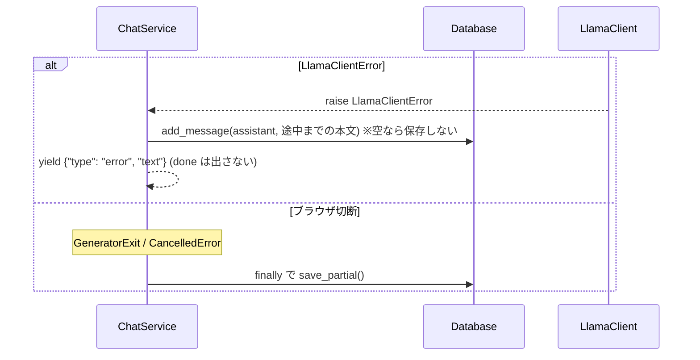

### 7.2 CLI で 1 往復

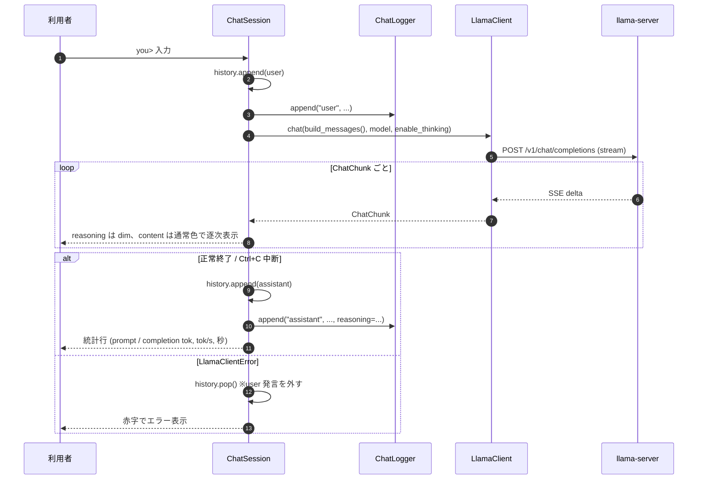

## 8. エラー処理の設計

| 発生箇所 | 例外 | 変換先 | 最終的な見え方 |
| --- | --- | --- | --- |
| httpx 接続/タイムアウト | `httpx.HTTPError` | `LlamaClientError` | CLI: 赤字。Web: `error` イベント or 502 |
| HTTP 4xx/5xx | - | `LlamaClientError(status_code=N)` | 同上 |
| SSE 内 `{"error"}` | - | `LlamaClientError` | 同上 |
| 壊れた SSE JSON | `JSONDecodeError` | 読み飛ばし | なし |
| 会話なし | - | 404 / `error` イベント | UI バナー |
| 空 content | pydantic | 422 | UI は送らない |
| クライアント切断 | `GeneratorExit` | `finally` で部分保存 | 次回開くと途中までの本文 |

`health()` だけは例外を投げず False を返す(疎通表示専用のため)。

## 9. テスト戦略

- llama-server は respx で httpx をモックする。GPU や実サーバなしで全テストが通る。
- Web は `TestClient(create_app(settings, db=Database(tmp_path/...), client=LlamaClient(...)))` で起動し、同じ respx モックで llama-server を差し替える。
- SSE のストリーミングは respx に生のバイト列を渡し、`aiter_lines()` の経路を本物のまま通す。
- 検証項目: SSE パース(複数 data、CRLF、`[DONE]`)、`<think>` の分断、ペイロードの形(`stream_options`、`chat_template_kwargs`)、エラー変換、CLI のコマンド状態遷移、CLI の失敗時履歴 pop、DB CRUD と並び順、SSE イベント列と永続化、2 往復目に reasoning を送らないこと、モデル上書き、部分保存、422。
- `asyncio_mode = "auto"` で async テストに marker 不要。

## 10. 拡張ポイント(Phase 3 以降に向けて)

| 拡張 | 変更箇所 |
| --- | --- |
| RAG(検索結果の差し込み) | `service.build_prompt()` に system メッセージと引用を足す。`routes_chat` と `client` は変更不要 |
| 文書の登録・インデックス | `web/db.py` に表を追加するか、別モジュールでベクトル DB を持つ |
| 回答の根拠表示 | `done` イベントに `sources` を足し、`app.js` のメタ行で描画 |
| ツール呼び出し | `client.chat()` に `tools` 引数と `tool_calls` の delta 解釈を追加 |
| サンプリング設定 | `SendMessageRequest` に項目を足し `client.chat(temperature=...)` へ渡す |
| 認証 / LAN 公開 | `app.py` にミドルウェア。`app.js` の `innerHTML` に sanitizer |
