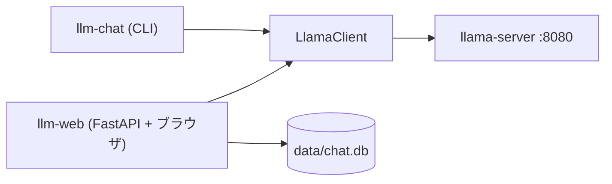

# Phase 0〜2: 土台、CLI チャット、Web チャット UI(振り返り)

Phase 3 以降のジャーナルと同じ形式で、ここまでを振り返ってまとめる。
詳細な振る舞いは [external-spec.md](../external-spec.md)、構造は [internal-spec.md](../internal-spec.md)。

## この Phase で作ったもの(1 分で)

- Phase 0: llama.cpp の `llama-server` を起動するスクリプト、3 つのモデルプリセット、速度と VRAM を測るスクリプト。git 化。
- Phase 1: llama-server の OpenAI 互換 API を httpx で叩く Python クライアントと、ターミナルで会話する CLI。
- Phase 2: FastAPI + 素の HTML/JS の Web チャット画面。会話は SQLite に保存。



## なぜこの Phase が必要か

ローカル LLM を「動かす」だけなら llama-server 内蔵の Web UI で足りる。
自分でクライアントと UI を書いたのは、(1) API の形と SSE の流れを手で理解するため、
(2) Phase 3 で検索結果を差し込む場所、Phase 4 でエージェントがツールとして呼ぶ API を自前で持つため。

## 用語

| 用語 | 1 行説明 |
| --- | --- |
| llama.cpp / llama-server | C++ 製の LLM 推論エンジンと、その HTTP サーバ |
| GGUF | llama.cpp 用の量子化済みモデルファイル |
| ルーターモード | `models.ini` に複数モデルを登録し、リクエストの `model` で切り替える llama-server の機能 |
| OpenAI 互換 API | `/v1/chat/completions` など、OpenAI と同じ形の HTTP API |
| SSE | 応答を閉じずに `data: ...` を少しずつ送る仕組み。文字の逐次表示に使う |
| thinking | Qwen3 系モデルが本文の前に出す推論過程。`reasoning_content` で届く |

## やったことの流れ

1. **Phase 0**: RTX 5070(12 GB)で動くモデルを選ぶため、dense 27B、MoE 35B-A3B、dense 8B の 3 つを `models.ini` に登録。27B は VRAM に収まらず約 6 tok/s と遅いことが分かった。ベンチの表は未計測のまま(Phase 6 で埋める)。
2. **仕様を先に決めた**(2026-10-24)。論点は 4 つ。フロントは素の HTML/JS、HTTP は httpx 自作、永続化は SQLite、git は先に初期化。すべて「範囲を小さくして後の Phase に時間を回す」「学習目的で中身を自分で書く」を理由に選んだ。
3. **Phase 1**: SSE のパースと `<think>` タグの分離を自前で書いた。`stream_options.include_usage` で最終チャンクに usage を載せ、tok/s を出す。
4. **Phase 2**: FastAPI は llama-server への中継と保存に専念させ、HTTP は Phase 1 の `LlamaClient` だけが持つ構造にした。ブラウザ向け SSE は `{type, text}` の自前形式に詰め直した。
5. **モデル id の罠**: `models.ini` の `UD-Q4_K_M` は llama-server が `Q4_K_M` として公開する。既定モデル id を直すコミットが 1 つ増えた。
6. **PowerShell の罠**: `.ps1` に BOM が無いと PowerShell 5.1 が日本語コメントでパースエラーになる。全スクリプトに BOM を付けた。

## 動かし方

```powershell
uv sync
.\scripts\start-server.ps1      # 別ターミナル。モデル読み込みに数分
uv run llm-chat                 # CLI
uv run llm-web                  # http://127.0.0.1:8000
```

期待する出力: CLI は 1 行目にモデル名、Web は左に会話一覧と右下に「llama-server: 接続中」。

## どう確かめたか(証拠)

- `uv run pytest`: 40 件通過(2026-10-24、コミット `53d1187`)。llama-server は respx でモックしているため GPU なしで通る。
- 実機: llama-server を起動し、CLI と Web UI で 1 往復ずつ会話できることを実装セッションが確認(この確認はセッションの報告であり、別の人が再現したものではない)。

Phase 0〜2 はハーネス導入前なので Task Contract と Completion Report は無い。Phase 3 から導入する。

## うまくいかなかったこと・やり直したこと

- `init-repo.ps1` が BOM なしで動かなかった(上記)。
- 既定モデル id が実サーバと一致せず修正コミットが要った。仕様書の値を実機で確認してから書くべきだった。

## 次の Phase への引き継ぎ

- Phase 3 は `service.build_prompt()` に検索結果を差し込む。`client.py` に `/v1/embeddings` を足す。
- Phase 0 のベンチ表は未計測。Phase 6 で埋める。
- Web UI の Markdown 描画に sanitizer が無い。ローカル専用のため保留。公開時に要対応。

## 参考リンク

- [spec-phase1-2.md](../spec-phase1-2.md): 実装前の決定事項
- [llama.cpp](https://github.com/ggml-org/llama.cpp)
