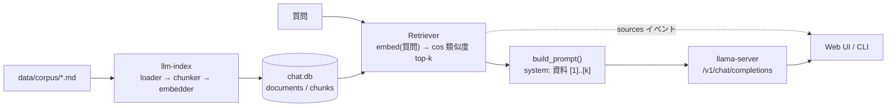

# Phase 3: RAG(文書を根拠付きで答える)

## この Phase で作ったもの(1 分で)

- ai_harness の Markdown 19 本を `data/corpus/` に取り込み、見出し単位で約 800 文字に切って(433 チャンク)、
  llama-server の `/v1/embeddings` でベクトル化し、チャットと同じ SQLite に保存する `llm-index`。
- 質問に近いチャンクを上位 k 件(既定 5)選び、「以下の資料だけを根拠に答え、[n] で示す」という system メッセージに
  差し込んで回答させる仕組み。Web UI は RAG トグルと出典リスト、CLI は `/rag on|off`、API は `use_rag` / `top_k` と `sources` イベント。
- 埋め込みモデル(Qwen3-Embedding-0.6B)は `models.ini` にセクションを足し、既存のルーターモードの llama-server から配信する。



## なぜこの Phase が必要か

Phase 2 までのチャットは、モデルが学習時に覚えていることしか答えられず、根拠も示せない。
手元の文書(ここでは ai_harness のドキュメント)を読ませ、「どの資料のどの節を見て答えたか」を出すのが RAG。
Phase 4 のエージェントは、この検索を `rag_search` ツール(`GET /api/rag/search`)として呼ぶ。

## 用語

| 用語 | 1 行説明 |
| --- | --- |
| RAG | Retrieval-Augmented Generation。質問に関係する文書片を検索してプロンプトに足し、根拠付きで答えさせる手法 |
| 埋め込み(embedding) | 文を 1024 次元などの数値ベクトルにしたもの。意味が近い文はベクトルも近い |
| コサイン類似度 | 2 本のベクトルの向きの近さ(1 が同じ向き)。長さ 1 に正規化してあれば内積と同じ |
| チャンク | 文書を検索しやすい長さに切った断片。ここでは見出し単位、約 800 文字、隣と 100 文字重ねる |
| pooling | トークンごとのベクトルを 1 本にまとめる方法。Qwen3-Embedding は `last`(最終トークン)を使う |
| top-k | 類似度の上位 k 件。既定 5、評価では 3 |
| コーパス | 検索対象の文書集合 |

## やったことの流れ

1. **ハーネスのベースライン**: 実装前に `.\scripts\agent\verify.ps1` を打ち、契約 Schema OK、`git diff --check` OK、pytest 40 件通過、`commit: df8c706`、`ALL OK` を確認した。
2. **コーパス取得スクリプト**: `scripts/fetch-corpus.ps1`。ai_harness の `docs/README.md`(ドキュメントマップ)に載っている Markdown 19 本を raw.githubusercontent.com から個別に取る。
   一覧はスクリプトに固定で持ち(`-ListFile` で差し替え可)、`git clone` はしない。契約の許可先が raw.githubusercontent.com だけなので、一覧の作成に github.com のツリー表示を 1 度だけ人手(セッション)で参照した。
   PowerShell 5.1 では `Invoke-WebRequest` の `.Content` がテキスト応答で文字列になり `WriteAllBytes` に渡せなかったので `-OutFile` に変えた。
3. **ベクトル DB を入れなかった**。433 チャンク × 1024 次元の総当たりは numpy の行列積 1 回で済み、ミリ秒で終わる。
   SQLite の BLOB に float32 を入れ、検索時に全件読んで内積を取る。数万チャンクを超えたら考え直す(internal-spec 11 章に閾値を書いた)。
   numpy は仕様で許可された唯一の追加ライブラリ。
4. **チャンク分割は見出し優先**: `#`〜`######` で節に分け、見出しの階層を "親 > 子" の形で持たせる。800 文字を超える節だけ段落境界で切って 100 文字重ねる。
   埋め込み時は本文の前に「文書タイトル › 見出し」を付ける(どの文書の話かをベクトルに含めるため)。コードフェンス内の `#` は見出しにしない。
5. **埋め込みモデルはルーターモードで配信できた**。`models.ini` に `[Qwen/Qwen3-Embedding-0.6B-GGUF:Q8_0]` を足し `embeddings = true`、`pooling = last` を書くと、
   ルーターが子プロセスを `--embeddings --pooling last` で起動することをログで確認した。したがって別サーバ用の `start-embed-server.ps1` は作っていない。
   ただし **`hf-repo = ...` を明示しないと動かない**(後述)。
6. **埋め込みサーバを分けられる設定** `LLAMA_EMBED_BASE_URL` を足した。既定は `LLAMA_BASE_URL` と同じで、未指定なら Phase 2 と挙動は変わらない。
   今回の実機確認では、別セッション(Phase 5)が :8080 でチャットモデルを読み込み済みだったので、チャットは :8080、埋め込みは自分の :8082 に分けて走らせた(35B を二重に読み込むと RAM が足りない)。
7. **プロンプトの差し込み方**: `service.build_prompt(history, retrieved)` が先頭に system メッセージ(指示 + `[n] path › 見出し` + 本文)を置く。
   既に system があれば連結する。DB には system を保存しない(毎回検索し直すため)。CLI も同じ `build_rag_messages()` を使う。
8. **sources は本文より先に流す**。`stream_reply()` は検索が終わった時点で `{"type":"sources","items":[...]}` を yield し、その後にモデルを呼ぶ。
   埋め込みサーバが落ちているときは `error` イベントだけ返し、モデルは呼ばない。CLI も同じで、検索に失敗した発言は履歴に積まない。
9. **評価セット** `tests/rag/eval_retrieval.jsonl` は 10 問。正解文書のパスと、見出しか本文に含まれるべきキーワードで hit を判定する。
   評価の実行は `scripts/agent/eval_retrieval.py`(実サーバが要るので pytest には含めない)。

## 動かし方

```powershell
.\scripts\fetch-corpus.ps1                 # data/corpus/ai_harness/ に Markdown 19 本(初回のみ)
.\scripts\start-server.ps1                 # 別ターミナル。埋め込みモデルは初回に約 640 MB をダウンロード
uv run llm-index                           # 索引を作る。期待: 「更新 19 文書 / ... / 新規チャンク 433 件」
uv run llm-chat --rag                      # CLI。/rag off で通常チャットに戻る
uv run llm-web                             # Web UI。上部の「RAG」をチェックして送信
```

評価(RAG-002)と索引の状態:

```powershell
uv run python scripts/agent/eval_retrieval.py     # 期待: PASS: 10/10 hit@3 (threshold 8)
curl http://127.0.0.1:8000/api/rag/status          # {"documents":19,"chunks":433,...}
```

埋め込みだけ別の llama-server で動かすとき(例: :8082 で起動した場合):

```powershell
$env:LLAMA_EMBED_BASE_URL = "http://127.0.0.1:8082"
```

## どう確かめたか(証拠)

Completion Report は [../harness/reports/phase-3.md](../harness/reports/phase-3.md)。要点:

| 条件 | 確かめ方 | 結果 |
| --- | --- | --- |
| RAG-001 索引と差分スキップ | `tests/rag/test_store_retriever.py::test_index_and_search`(respx モック)+ 実機 `llm-index` | 19 文書 433 チャンク、2 回目は埋め込み API を呼ばない |
| RAG-002 検索精度 | `scripts/agent/eval_retrieval.py` 実機 | 10/10 が top-3 に入る(閾値 8)。`reports/evidence/phase-3.eval_retrieval.json` |
| RAG-003 sources → 本文 → [n] | pytest(API, CLI)+ 実機 2 問 | 最初のイベントが `sources`、本文に `[1]` `[2]` `[3]` の引用。`reports/evidence/phase-3.e2e_rag.json` |
| RAG-004 全テスト | `.\scripts\agent\verify.ps1` | 70 件通過(Phase 1/2 の 40 件 + RAG 30 件) |
| RAG-005 文書 | このジャーナル、external-spec 10 章、internal-spec 11 章 | 人のレビュー待ち |

実機の数値(2026-10-25、RTX 5070):

| 項目 | 値 |
| --- | --- |
| 埋め込みモデルの初回ダウンロード + 読み込み | 39 秒(3 文の埋め込み込み) |
| 索引作成(19 文書、433 チャンク) | 約 20 秒 |
| 埋め込みの次元 | 1024(L2 ノルム 1.0) |
| RAG 付き回答(Qwen3.6-35B-A3B、thinking off、top_k=3) | 約 9 秒、41〜43 tok/s |
| 類似度の例 | 「実行予算とは何か」と「Execution Budget の例」0.78、「Fencing Token」とは 0.48 |

## うまくいかなかったこと・やり直したこと

- **キャッシュに無いモデルはルーターが起動できない**。ルーターはキャッシュ済みモデルには `--hf-repo` を自動で付けるが、未ダウンロードのモデルには付けない。
  その結果、子プロセスがモデル無しの「ルーターモード」で起動し、状態が `loading` のまま戻らない(リクエストは 580 秒でタイムアウト)。
  `models.ini` のセクションに `hf-repo = Qwen/Qwen3-Embedding-0.6B-GGUF:Q8_0` を明示して解決した。
  同じ理由で、既存の `[unsloth/Qwen3-8B-GGUF:Q4_K_M]`(未ダウンロード)も現状では読み込めないと推測されるが、既存セクションは契約上変更しないので未修正(Report に記載)。
- **`.ps1` の BOM**。Write したスクリプトに BOM が無く、日本語コメントで PowerShell 5.1 がパースエラーになった(Phase 0〜2 と同じ穴)。BOM を付けて解決。
- **`Invoke-WebRequest` の `.Content`** はテキスト応答だと文字列になる。`-OutFile` で保存するよう変更。
- **Windows の端末エンコーディング**。`python -c` に日本語を直接書くと化けるので、確認スクリプトはファイルにして `PYTHONIOENCODING=utf-8` で実行した。
- **評価の見直しはしていない**。10 問は 1 回目で 10/10 だったので、質問の差し替えや閾値の調整は行っていない(質問は実装者が corpus を見て作ったので、独立した評価ではない。Report の残存リスクに記載)。
- 自分で起動したルーター(:8081)を Stop-Process で止める操作が実行環境のポリシーで拒否されたため、`POST /models/unload` で子プロセスだけ解放し、修正後は :8082 で起動し直した。:8081 と :8082 のルーター(モデル未読み込み、または埋め込みモデルのみ)はセッション終了時点で残っている(最終報告に記載)。

## 次の Phase への引き継ぎ

- Phase 4 の `rag_search` ツールは `GET /api/rag/search?q=...&top_k=...` を呼ぶ(本文つき)。`llm-web` を起動しておく必要がある。
- 索引の埋め込みモデルと検索時のモデルが違うと次元不一致で 409 を返す。モデルを替えたら `uv run llm-index --force`。
- 残存リスク: 評価セットの独立性、Markdown 以外(JSON Schema)は索引していない、`[n]` の付与はモデル任せ(検証していない)。
- `models.ini` の 8B セクションに `hf-repo` が無い問題は人の判断待ち(GATE_MODELS_INI)。

## 参考リンク

- [spec-phase3-6.md 2 章](../spec-phase3-6.md): 決定事項と完了条件
- [external-spec.md 10 章](../external-spec.md) / [internal-spec.md 11 章](../internal-spec.md)
- [llama.cpp server README](https://github.com/ggml-org/llama.cpp/blob/master/tools/server/README.md): `--embeddings`、`--pooling`、`--models-preset`
- [Qwen/Qwen3-Embedding-0.6B-GGUF](https://huggingface.co/Qwen/Qwen3-Embedding-0.6B-GGUF)
- [Moro-1025/ai_harness](https://github.com/Moro-1025/ai_harness): コーパス
