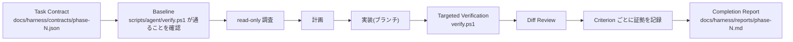
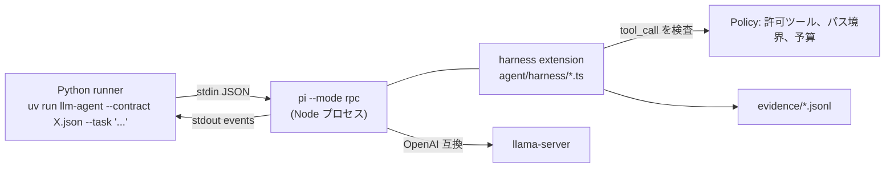
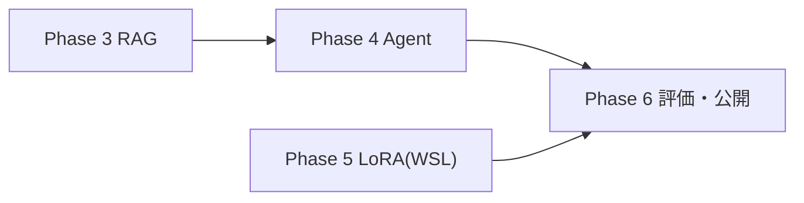

# Phase 3〜6 仕様

README のロードマップの後半、Phase 3(RAG)、Phase 4(ツール呼び出しとエージェント)、
Phase 5(LoRA ファインチューニング)、Phase 6(評価・計測・公開)の実装仕様。
Phase 1/2 の仕様は [spec-phase1-2.md](spec-phase1-2.md)、現在の構造は [internal-spec.md](internal-spec.md)。

## 0. 決定事項

| 論点 | 決定 | 理由 |
| --- | --- | --- |
| ハーネスの設計原則 | [Moro-1025/ai_harness](https://github.com/Moro-1025/ai_harness) の Normative Core に従う | 「モデルは提案し、コードが許可する」「成果と証拠で完了を判定する」「最小権限・予算・停止条件」「不可逆操作の前に人間」「失敗を見てから複雑性を足す」 |
| エージェント基盤 | [Pi](https://pi.dev)(pi-coding-agent 1.0 系、この PC に導入済み)を llama-server に接続して使う | ツールと extension が最小で、`tool_call` イベントで実行前にブロックできる。RPC モードで Python から制御できる |
| 開発の実行主体 | Claude のセッション(Phase 1/2 と同じ) | Pi + ローカル LLM は Phase 4 の「作るもの」であり、開発ツールとしては使わない |
| RAG の対象文書 | このリポジトリの `docs/` と ai_harness の Markdown | すぐ試せる。評価用の質問を作りやすい |
| 埋め込み | llama-server の `/v1/embeddings`(埋め込み用 GGUF を `models.ini` に追加) | 推論と同じサーバで済む。別プロセスを増やさない |
| ベクトル保存 | SQLite(既存 `data/chat.db`)に float32 の BLOB、検索は numpy の総当たり | 文書数は数百チャンク。ベクトル DB は CORE-12(失敗を見てから足す)に従い入れない |
| LoRA の目的 | このプロジェクト固有の Q&A(docs/ と ai_harness から合成) | Phase 6 で「RAG あり」「LoRA のみ」「素のモデル」を同じ質問で比較できる |
| LoRA の環境 | WSL Ubuntu + unsloth(QLoRA) | 12 GB VRAM で現実的。WSL から GPU が見えることは確認済み |
| 評価 | 版管理した JSONL データセットと決定論的な採点 + LLM 採点の 2 段 | ai_harness「評価対象はシステム全体」 |
| 公開 | GitHub 公開用の README 整備、LoRA アダプタは Hugging Face に上げられる形にする(実際のアップロードは人間が行う) | 外部送信は Human Gate |

## 1. 開発プロセスのハーネス(全 Phase 共通)

ai_harness の `coding-agent-tutorial` に従い、開発そのものにもハーネスをかける。

### 1.1 Phase ごとの流れ



### 1.2 成果物

| 成果物 | 場所 | 内容 |
| --- | --- | --- |
| Task Contract | `docs/harness/contracts/phase-N.json` | ai_harness の `task-contract.schema.json` に適合。目的、範囲、完了条件、予算、停止条件 |
| 検証の単一入口 | `scripts/agent/verify.ps1` | pytest、`git diff --check`、Contract の Schema 検証。引数 `-Scope` で絞る |
| Completion Report | `docs/harness/reports/phase-N.md` | Criterion ごとの結果と証拠(コマンドと出力の要約、コミット hash)、未実施、残存リスク、Rollback 方法 |
| Completion Decision | `docs/harness/reports/phase-N.decision.json` | `completion-decision.schema.json` に適合 |
| 学習ジャーナル | `docs/journal/phase-N.md` | 何をしたか、なぜそうしたか、どう確認するか、用語。初心者向け |

### 1.3 ルール

- Contract にない範囲を変更する必要が出たら、止まって Amendment を作る(範囲を黙って広げない)。
- 「テストを書いた」「動くはず」は証拠ではない。コマンドの出力とコミット hash を Report に残す。
- 同じエラーが 2 回続いたら止まり、Report に書く。
- 外部送信(push、Hugging Face アップロード、公開設定の変更)は Human Gate。セッションは行わず、人間が行う。
- Phase ごとに 1 ブランチ、1 Report。

## 2. Phase 3: RAG(文書を根拠付きで答える)

### 2.1 構成

```
src/local_llm/rag/
├─ __init__.py
├─ loader.py      文書の読み込み(.md .txt)、front matter と見出しの保持
├─ chunker.py     見出し単位 → 文字数上限で分割(目安 800 字、重なり 100 字)
├─ embedder.py    LlamaClient.embed() を使ってベクトル化(バッチ)
├─ store.py       SQLite の documents / chunks テーブル、ベクトルの保存と総当たり検索
├─ retriever.py   質問 → 埋め込み → 上位 k 件 → (任意)簡易リランク
├─ indexer.py     CLI: uv run llm-index <dir> ... 差分更新(ファイル hash で判定)
└─ prompt.py      検索結果を system メッセージに差し込む(引用番号付き)
```

- `client.py` に `embed(texts, model) -> list[list[float]]`(`POST /v1/embeddings`)を追加する。
- 埋め込みモデルは `models.ini` に追加する。候補: `Qwen/Qwen3-Embedding-0.6B-GGUF`。llama-server のルーターモードで `embeddings = true` が指定できることを確認し、できなければ埋め込み専用の 2 つ目の llama-server を `scripts/start-embed-server.ps1` で起動する(どちらにしたかを journal に書く)。
- 対象文書: `docs/**/*.md`、README.md、および `data/corpus/ai_harness/` に取得した ai_harness の Markdown(取得は `scripts/fetch-corpus.ps1`、git には入れない)。

### 2.2 DB

```sql
documents(id PK, path TEXT UNIQUE, title TEXT, sha256 TEXT, indexed_at TEXT)
chunks(id PK, document_id FK CASCADE, ordinal INT, heading TEXT, text TEXT,
       embedding BLOB, embedding_model TEXT, token_count INT)
```

### 2.3 Web / CLI への組み込み

- `service.build_prompt()` に `retrieved: list[Chunk]` を渡せるようにし、system メッセージに「以下の資料だけを根拠に答え、使った資料を [n] で示す」と資料本文を差し込む。
- `POST /api/conversations/{id}/messages` に `use_rag: bool`(既定 false)と `top_k`(既定 5)を追加する。
- SSE に `{"type": "sources", "items": [{"n": 1, "path": ..., "heading": ..., "score": ...}]}` を本文の前に 1 回流す。
- UI にトグル「資料を使う」を追加し、応答の下に根拠一覧を表示する(クリックで本文を展開)。
- CLI に `/rag on|off` を追加する。
- `GET /api/rag/status` で文書数・チャンク数・埋め込みモデルを返す。

### 2.4 完了条件(Contract の criterion と対応)

| ID | 条件 | 検証 |
| --- | --- | --- |
| RAG-001 | `uv run llm-index docs README.md` で文書とチャンクが DB に入り、再実行で未変更ファイルはスキップされる | integration-test(一時 DB、埋め込みは respx モック) |
| RAG-002 | 質問に対し上位 k 件が返り、既知の質問 10 件で正解文書が上位 3 件に入る割合が 8/10 以上 | `tests/rag/eval_retrieval.jsonl` を使う e2e(実サーバ)。結果を Report に記録 |
| RAG-003 | `use_rag: true` の応答で `sources` イベントが届き、本文に [n] 引用が含まれる | integration-test(モック) + 実機 1 回 |
| RAG-004 | 既存テスト(Phase 1/2)がすべて通る | unit-test |

## 3. Phase 4: ツール呼び出しとエージェント(Pi + ハーネス)

### 3.1 全体像



### 3.2 Pi の設定

- `~/.pi/agent/models.json` ではなくプロジェクト内 `agent/pi/models.json` を作り、runner が環境変数か `--models` 相当で渡せるか確認する(できなければ `~/.pi/agent/models.json` に `llama-local` プロバイダを追記する手順を journal に書く)。
- provider `llama-local`: `baseUrl = http://127.0.0.1:8080/v1`、`api = openai-completions`、`apiKey = "none"`、models に Qwen3.6-35B-A3B(`reasoning: true`)。
- ツール呼び出しは llama-server の `--jinja`(models.ini で有効)で function calling が通ることを確認する。

### 3.3 ハーネス extension(TypeScript、`agent/harness/`)

ai_harness の原則を Pi の extension で実装する。

| 原則 | 実装 |
| --- | --- |
| Task Contract | 起動時に `--contract` の JSON を読み、`contract_hash`(sha256)を計算して全イベントに付ける |
| 最小権限 | `capability_profile.allowed_tools` 以外の `tool_call` は `block`。`scope.read/write` のグロブでパスを検査し、外なら `block`(`scope_boundary_exceeded`) |
| 実行予算 | `execution_budget.max_steps`、`max_tool_calls`、`same_action_limit`、`same_error_limit` を数え、超えたら以後の tool_call を block し `stop_reason` を記録 |
| 証拠 | すべての tool_call / tool_result / block を `evidence/<run_id>/events.jsonl` に追記(引数の正規化 hash、時刻、結果の先頭 500 字) |
| 停止 | 予算超過、同一失敗反復、scope 逸脱、deny のとき `agent_before_settle` で継続を止め、理由を残す |
| 完了判定 | runner が `completion_criteria` ごとに検証し `verification-result` と `completion-decision` を JSON で出す。エージェントの「できました」は使わない |

カスタムツール(extension で登録):

| ツール | 内容 | 副作用 |
| --- | --- | --- |
| `rag_search(query, top_k)` | Phase 3 の retriever を HTTP(`GET /api/rag/search`)経由で呼ぶ | なし |
| `read_file(path)` | scope.read 内のみ | なし |
| `list_files(glob)` | scope.read 内のみ | なし |
| `finish(result)` | 結果を提出。runner が検証に回す | なし |

Pi 組み込みの `bash` `write` `edit` は、Contract の `denied_tools` に入れて使わない(初級プロファイル = 読み取り専用)。

### 3.4 Python runner(`src/local_llm/agent/`)

```
runner.py     pi を RPC で起動、prompt 送信、agent_settled まで待つ、イベントを保存
contract.py   Contract の読み込み、schema 検証、hash 計算
verify.py     criterion ごとの検証(result の必須キー、引用の存在など決定論的なもの)
report.py     verification-result / completion-decision JSON と Markdown Report の生成
```

- サンプル Contract: `agent/contracts/summarize-docs.json`(docs/ を読み、指定テーマの要約と根拠ファイルを返す。読み取り専用)。
- `uv run llm-agent --contract agent/contracts/summarize-docs.json --task "RAG の設計方針を 3 点にまとめて"` で 1 回実行し、`evidence/<run_id>/` に events.jsonl、decision.json、report.md ができる。

### 3.5 完了条件

| ID | 条件 | 検証 |
| --- | --- | --- |
| AGT-001 | 許可外ツール(bash)の呼び出しが block され、events.jsonl に記録される | e2e(RPC 経由で意図的に bash を促す prompt)、またはextension の unit-test(vitest) |
| AGT-002 | scope 外のパス読み取りが block される | 同上 |
| AGT-003 | max_steps 超過で停止し `stop_reason = budget_exceeded` になる | 同上(予算を 2 に下げて実行) |
| AGT-004 | サンプル Contract の実行で completion-decision が生成され、criterion ごとに pass/fail が付く。`accepted` はすべての必須 criterion が pass のときだけ | integration-test(pi をモック or 実機) |
| AGT-005 | Python 側に pytest、extension 側に vitest があり、両方通る | unit-test |

## 4. Phase 5: LoRA ファインチューニング

### 4.1 環境(WSL Ubuntu)

- `training/` ディレクトリに WSL 用の独立した環境を作る(`training/pyproject.toml` または `requirements.txt`、Windows 側の uv 環境とは分ける)。
- `training/setup-wsl.sh`: uv の導入、Python 3.12 venv、torch(CUDA 12.x)、unsloth、trl、datasets の導入。`nvidia-smi` と `torch.cuda.is_available()` の確認を出力する。
- ベースモデル: `unsloth/Qwen3-4B`(4bit)を第一候補。VRAM に収まらなければ `Qwen3-1.7B`。選んだ理由と VRAM 実測を journal に書く。

### 4.2 データ

- `training/data/build_dataset.py`: `docs/**/*.md` と ai_harness の Markdown をチャンクし、llama-server(Qwen3.6-35B-A3B)に「このチャンクだけから答えられる質問と答えを 3 組作れ」と頼んで Q&A を合成する。出力は `training/data/qa.jsonl`(`{"question", "answer", "source"}`)。
- 件数の目安 300〜600 組。重複と低品質(答えが 20 字未満、質問に出典語が無い)は決定論的に除外する。
- `training/data/split.py` で train/eval を 9:1 に分け、eval の質問は Phase 6 でも使う(`eval/datasets/qa-v1.jsonl` にコピー、版番号を付ける)。
- 合成に使ったプロンプト、モデル id、日時を `training/data/qa.meta.json` に残す(評価汚染の追跡用)。

### 4.3 学習と変換

- `training/train_lora.py`: unsloth で QLoRA。r=16、alpha=16、lr 2e-4、1〜3 epoch、max_seq_len 2048。ハイパーパラメータは `training/config.yaml`。
- 学習ログ(loss の推移)を `training/runs/<日時>/` に保存。
- `training/export_gguf.sh`: アダプタをマージして GGUF(Q4_K_M)に変換し、`models/` に置く。`models.ini` に `[local/qwen3-4b-localllm-lora]` として登録する(ローカル GGUF パス指定)。
- `scripts/start-server.ps1` で起動し、CLI から会話できることを確認する。

### 4.4 完了条件

| ID | 条件 | 検証 |
| --- | --- | --- |
| LORA-001 | `setup-wsl.sh` 後に WSL で `torch.cuda.is_available()` が True | other(コマンド出力を Report に) |
| LORA-002 | `qa.jsonl` が 300 組以上で、メタ情報ファイルがある | unit-test(件数と schema) |
| LORA-003 | 学習が完走し、eval loss が train 初期 loss より下がっている | other(ログを Report に) |
| LORA-004 | GGUF が `models.ini` に登録され、llama-server 経由で 1 往復できる | e2e |
| LORA-005 | eval 質問 20 件で、LoRA モデルの正答率(Phase 6 の採点器)が素の 4B モデルを上回る | e2e(Phase 6 の採点器を使う。Phase 6 前なら簡易採点で暫定) |

## 5. Phase 6: 評価・計測・公開

### 5.1 評価ハーネス(`src/local_llm/eval/`)

```
datasets/qa-v1.jsonl          Phase 5 の eval 質問 + 手で追加した 20 件(version 付き)
datasets/retrieval-v1.jsonl   質問 → 正解文書パス
datasets/agent-tasks-v1.jsonl エージェントのタスクと期待(必須キー、禁止ツール)
run_eval.py                   uv run llm-eval --suite qa --config <モデル/RAG/LoRA の組合せ>
graders.py                    決定論的採点(キーワード一致、引用の有無、JSON 妥当性)+ LLM 採点(採点モデルは回答モデルと別にする)
report.py                     eval/results/<日時>-<suite>.md と .json
```

比較する構成:

| 構成 | モデル | RAG | 意図 |
| --- | --- | --- | --- |
| A | Qwen3.6-35B-A3B | なし | 素の大型モデル |
| B | Qwen3.6-35B-A3B | あり | RAG の効果 |
| C | Qwen3-4B(素) | なし | 小型の基準 |
| D | Qwen3-4B + LoRA | なし | LoRA の効果 |
| E | Qwen3-4B + LoRA | あり | 併用 |

指標: 正答率(決定論)、LLM 採点の平均(1〜5)、検索ヒット率(top-3)、tok/s、VRAM。エージェントは成功率、block 件数、平均 step 数。

### 5.2 計測の仕上げ

- Phase 0 で保留した `bench.ps1` と `ctx-vram.ps1` を実行し、README の表を埋める。

### 5.3 公開

- README を公開用に整える: 1 枚の構成図、各 Phase の成果と数値、スクリーンショット(`docs/images/`)、再現手順。
- `LICENSE`(MIT)を追加。
- LoRA アダプタの `README.md`(モデルカード)を `training/export/` に用意する。Hugging Face へのアップロードと GitHub の公開設定変更は人間が行う(Human Gate)。

### 5.4 完了条件

| ID | 条件 | 検証 |
| --- | --- | --- |
| EVAL-001 | `uv run llm-eval --suite qa --config A` で結果 JSON と Markdown が生成される | integration-test(モック)+ 実機 |
| EVAL-002 | 5 構成すべての結果が `eval/results/` にあり、README の比較表に転記されている | human-review + diff-review |
| EVAL-003 | 採点モデルと回答モデルが別であることが結果 JSON に記録されている | schema |
| EVAL-004 | bench と ctx-vram の表が README で埋まっている | diff-review |
| EVAL-005 | README に構成図、再現手順、各 Phase の成果、LICENSE がある | human-review |

## 6. 学習ジャーナル(`docs/journal/`)

知識がない人が後から見返して「何をしたか、なぜか、どう確かめるか」が分かるように、Phase ごとに書く。
形式は [journal/README.md](journal/README.md) のテンプレートに従う。各 Phase のセッションは実装と同時に書き、Completion Report から参照する。

## 7. 実装の順序と並列



- Phase 3 → 4 は同じセッション・同じブランチで順に進める(4 が 3 の retriever を使う)。
- Phase 5 は別ブランチで並行。`training/` と `models.ini` の追記、`docs/journal/phase-5.md` だけを触る。
- Phase 6 は両方を main に取り込んでから始める。
