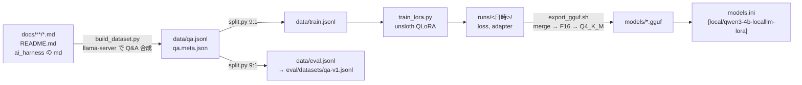

# training/ — Phase 5: LoRA ファインチューニング(WSL)

このフォルダは **WSL Ubuntu 側で動かす**。Windows 側の uv 環境(ルートの `pyproject.toml`)には torch を入れない(契約 SEPARATE_ENV)。
何をなぜそうしたかは [docs/journal/phase-5.md](../docs/journal/phase-5.md)、合否の証拠は [docs/harness/reports/phase-5.md](../docs/harness/reports/phase-5.md)。



## ファイル

| パス | 役割 |
| --- | --- |
| `setup-wsl.sh` | uv → Python 3.12 venv(`~/venvs/local_llm-training`)→ 依存導入 → GPU 確認 |
| `requirements.in` / `requirements.lock.txt` | 依存の宣言と固定版(lock は setup が `uv pip freeze` で生成) |
| `data/fetch_corpus.sh` | ai_harness の Markdown を `data/corpus/ai_harness/` に取得(固定 commit、git 管理外) |
| `data/build_dataset.py` | チャンク化 → llama-server で Q&A 合成 → 決定論的フィルタ → `qa.jsonl` + `qa.meta.json` |
| `data/split.py` | 9:1 に分割。eval 側を `eval/datasets/qa-v1.jsonl` にコピー |
| `config.yaml` | QLoRA のハイパーパラメータ |
| `train_lora.py` | unsloth で学習。`runs/<日時>/` に loss と adapter |
| `export_gguf.sh` | マージ → GGUF F16 → Q4_K_M → `C:\dev\local_llm\models\` |
| `eval_quick.py` | 暫定の簡易採点(キーワード一致)。LoRA あり/なしの比較 |
| `tests/` + `run_tests.sh` | `qa.jsonl` の件数と schema、チャンク化・フィルタの単体テスト(`verify.ps1 -Training` が呼ぶ) |

## 実行手順

WSL のコマンドは Windows の PowerShell からこう打つ(`<repo>` はリポジトリの WSL パス、例 `/mnt/c/dev/local_llm`):

```powershell
wsl -d Ubuntu -- bash -lc "cd /mnt/c/dev/local_llm/training && ./setup-wsl.sh"
```

### 0. 前提(1 回だけ)

unsloth の Triton カーネルは実行時に C コンパイラを使うので gcc が要る。WSL の root で入れる(sudo のパスワード入力を避けるため `-u root`):

```powershell
wsl -d Ubuntu -u root -- apt-get install -y build-essential
```

### 1. 環境(LORA-001)

```powershell
wsl -d Ubuntu -- bash -lc "cd /mnt/c/dev/local_llm/training && ./setup-wsl.sh"
```

最後に `torch.cuda.is_available(): True` と GPU 名・VRAM が出れば成功。venv は WSL 側のディスク(`~/venvs/`)に置く(`/mnt/c` 上は遅い)。

### 2. データ(LORA-002)

llama-server を Windows 側で起動しておく(`.\scripts\start-server.ps1`)。合成スクリプトは httpx だけで動くので **Windows の uv 環境から** 実行するのが簡単:

```powershell
bash training/data/fetch_corpus.sh                  # ai_harness の md を取得(Git Bash)
uv run python training/data/build_dataset.py --dry-run   # チャンク数の確認
uv run python training/data/build_dataset.py        # 合成(約 500 チャンク、1 時間強)。応答は data/cache/ に残り再実行で再利用
uv run python training/data/split.py                # train/eval 9:1、eval/datasets/qa-v1.jsonl を生成
```

WSL から llama-server に届かせたい場合は、サーバを `-Expose`(0.0.0.0 バインド)で起動し、WSL の既定ゲートウェイ(`ip route show default`)の IP を `--base-url http://<IP>:8080` に渡す。既定の 127.0.0.1 バインドでは WSL(NAT)から届かない(journal 参照)。

### 3. 学習(LORA-003)

```powershell
wsl -d Ubuntu -- bash -lc "cd /mnt/c/dev/local_llm/training && source ~/venvs/local_llm-training/bin/activate && python train_lora.py --max-steps 5"   # 動作確認
wsl -d Ubuntu -- bash -lc "cd /mnt/c/dev/local_llm/training && source ~/venvs/local_llm-training/bin/activate && python train_lora.py"                 # 本番
```

学習前に llama-server を止める(VRAM を空ける)。`runs/<日時>/summary.json` の `eval_loss_first` > `eval_loss_last` が LORA-003 の判定。
`loss.md` が journal に貼る表。adapter/ と checkpoint は git 管理外。

### 4. 変換と登録(LORA-004)

```powershell
wsl -d Ubuntu -- bash -lc "cd /mnt/c/dev/local_llm/training && ./export_gguf.sh runs/<日時>"
.\scripts\start-server.ps1
uv run llm-chat --model local/qwen3-4b-localllm-lora
```

`models.ini` の `[local/qwen3-4b-localllm-lora]` は `model = C:\dev\local_llm\models\qwen3-4b-localllm-lora-Q4_K_M.gguf`(絶対パス)。

### 5. 暫定評価(LORA-005)

```powershell
uv run python training/eval_quick.py --models local/qwen3-4b-localllm-lora unsloth/Qwen3-4B-GGUF:Q4_K_M
```

### テスト

```powershell
.\scripts\agent\verify.ps1 -Training          # Windows の pytest + WSL の training/run_tests.sh
wsl -d Ubuntu -- bash -lc "cd /mnt/c/dev/local_llm/training && ./run_tests.sh"
```
